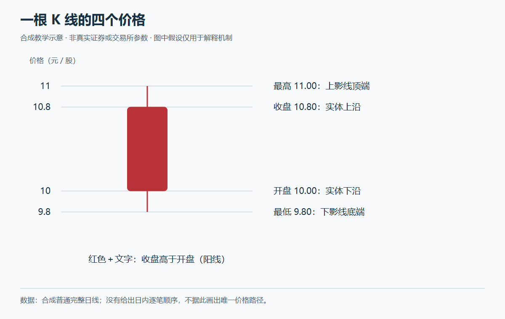

# A股交易与图表学习

版本：0.5.2。本课程面向真正零基础的学习者，系统讲解A股交易基础、K线、日本蜡烛图、缠论、量价与看盘方法，以及ETF、LOF、可转债和其他场内基金。

全课20个模块、80个单元。用概念、图示、真实案例、逐步回放和完整模拟交易串联学习。先保存原始回答，再开放同题标注和后续行情；学习过程与盈亏分别评价。

## 学习入口

- [量价实训](references/volume-price.md)：同图双窗口、真图回放、纸面交易筛选和五类产品。
- [缠论全书路线](references/chan-book/index.md)：从预备课到原书各节与例题。

- [课程图谱](references/course-map.md)与[学习路线](references/roadmap.md)
- [第一课：股票代表什么](references/modules/module-01.md#u01-p01)
- [2026真实图形](references/tech-2026-atlas.md)与[缠论逐层标注](references/chan-2026-atlas.md)
- [量价、压力、破位等看盘逻辑](references/chart-reading.md)
- [多品种全景](references/modules/module-15.md)、[ETF](references/modules/module-16.md)、[LOF](references/modules/module-17.md)、[可转债](references/modules/module-18.md)、[其他场内基金](references/modules/module-19.md)
- [完整交易训练](references/modules/module-20.md)与[练习记录](references/trading-practice.md)

2026主案例为中际旭创、寒武纪、中芯国际和天普股份，行情截止10月19日收盘。保留失败与回落案例，不把历史形态当成收益保证。

## 使用

本目录的[SKILL.md](SKILL.md)是技能入口。保留整个目录，交给支持SKILL.md的工具使用。给AI的指令用英语；给学员的讲解用清楚、简洁的汉语。每次先讲清概念、例子和图，再提问。学员回答后，先判定并解释正确信息与原因，再衔接下一段；不要求抄写标准答案或回复“懂了”。保留实际原答、点评和学习进度。

## 当前发布边界

本包用于个人教学。完整保留真实行情、图形和训练材料；上游来源与公开再分发边界保持。当前尚未完成公开再分发条件核验，不能把公开接口可访问当成发布授权。详见[2026数据说明](references/data-2026.md)和[历史数据说明](references/chart-data.md)。

## 验证范围

0.5.2完成两轮连续整套独立复核，两轮使用同一个验收ZIP，均无须修改。核对了20模块、80单元、56节缠论全书课及123道编号题，并实查先讲后问、答后点评与课程衔接。课程相关197项程序检查通过；1,474个技能文件与验收包逐字节核验。

验收ZIP SHA-256：`def40c5504a422ec6a287c26fa3705db95285edb5adf60289e15dbc21d36a682`。开发规格、测试、评估记录和历史包保留在统一源码工作区。

0.3.4的STE核验属于历史版本结果；本次没有重新认证全套STE、金融规则或公开再分发权利。程序检查与模型教学试跑不证明人的掌握程度或交易收益。
