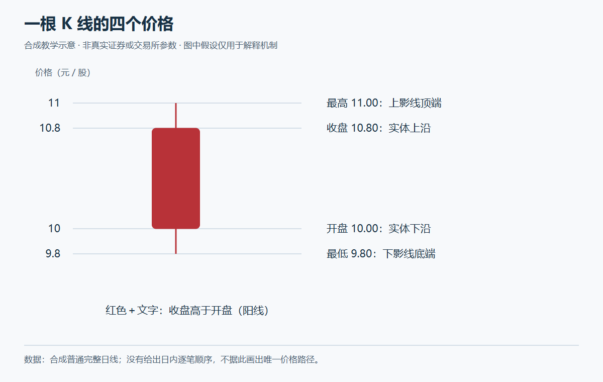

# A股交易与图表学习

版本：0.3.4。本课程面向真正零基础的学习者，系统讲解A股交易基础、K线、日本蜡烛图、缠论、量价与看盘方法，以及ETF、LOF、可转债和其他场内基金。

全课20个模块、80个单元。用概念、图示、真实案例、逐步回放和完整模拟交易串联学习。先保存原始回答，再开放同题标注和后续行情；学习过程与盈亏分别评价。

## 学习入口

- [课程图谱](references/course-map.md)与[学习路线](references/roadmap.md)
- [第一课：股票代表什么](references/modules/module-01.md#u01-p01)
- [2026真实图形](references/tech-2026-atlas.md)与[缠论逐层标注](references/chan-2026-atlas.md)
- [量价、压力、破位等看盘逻辑](references/chart-reading.md)
- [多品种全景](references/modules/module-15.md)、[ETF](references/modules/module-16.md)、[LOF](references/modules/module-17.md)、[可转债](references/modules/module-18.md)、[其他场内基金](references/modules/module-19.md)
- [完整交易训练](references/modules/module-20.md)与[练习记录](references/trading-practice.md)

2026主案例为中际旭创、寒武纪、中芯国际和天普股份，行情截止10月19日收盘。保留失败与回落案例，不把历史形态当成收益保证。

## 使用

本目录的[SKILL.md](SKILL.md)是技能入口。保留整个目录，交给支持SKILL.md的工具使用。给AI的指令用英语；给学员的讲解用清楚、简洁的汉语。每次从一个小问题开始，保留学习进度与实际回答。

## 当前发布边界

这是待发布的本地完整候选。真实行情及其图形保留上游来源；现有材料尚未完成公开再分发条件核验，不能把公开接口可访问当成发布授权。详见[2026数据说明](references/data-2026.md)和[历史数据说明](references/chart-data.md)。本候选限本地个人教学审阅。

## 验证范围

0.3.4已完成STE的53条规则、8条建议及英文用词语境核验，独立复查未闭项为0。课程148项检查通过；全仓375项中374项通过、1项跳过。1129个技能文件与已审阅、已测试的候选包逐字节一致。开发规格、测试、评估记录和历史包保留在统一源码工作区。

这些结果不构成ASD官方认证、投资收益证明或当前所有产品交易资格的认证。
