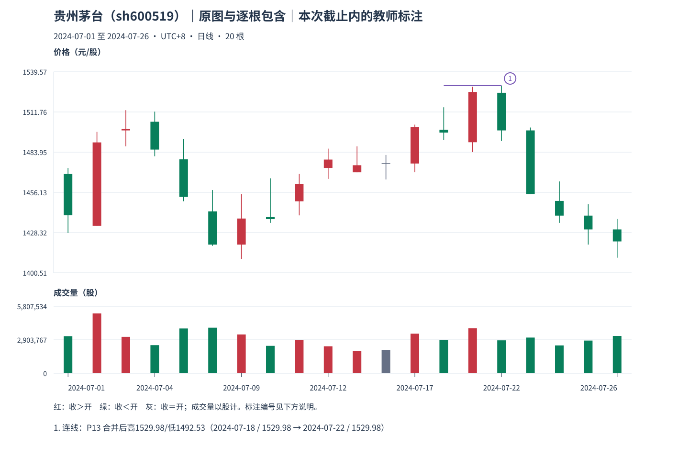

# 01：贵州茅台，原图怎样变成处理区间

Tutor: Before you load this file, keep the raw response for this same example. Do not load other teacher examples. Use only the prefix data for this example. Before their steps, do not read results for other examples.

截止 **2024-07-26**，20 根真实日 K 形成 18 个处理区间。先看[观察包](../../../assets/chan-real/01-inclusion-decision.html)，保存答案后再看[原图、处理区间与逐行表](../../../assets/chan-real/01-inclusion-outcome.html)。

先找此前最近一对互不包含区间，确认高低是共同抬升还是共同下降。向上合并时高、低都取较高者；向下都取较低者。每来一根，只与当时已经合成的最后区间比较，不能沿原始包含链一口气传递。

本例 P13 对应原始 13、14、15，即 **7 月 18、19、22 日**，向上合并后为 **[1492.53,1529.98]**。低点实际保留在 7 月 18 日，高点实际发生在 7 月 22 日；合成组的最后吸收日也是 7 月 22 日。7 月 23 日出现独立后组，才有该组右边界的保守记录。不要把整组简单画在某一个“代表日”后，忘掉另外两天的来源。

原始成交仍然存在；处理图没有说那些被过滤的低价没有成交，也没有替三天造一根新的开收盘。自然检查：合成组高点日与最早来源日为什么可以不同？

口径与依据：[M11](../../modules/module-11.md)；[M12](../../modules/module-12.md)。本截止内的结构记录不等于永久确认或可交易收益。返回[安全入口](../../chan-real-charts.md)选择下一张原图；不要批量读取其他教师页。

原始定义：[第 65 课：包含的顺序与方向](https://blog.sina.com.cn/s/blog_486e105c01000bpo.html)。
