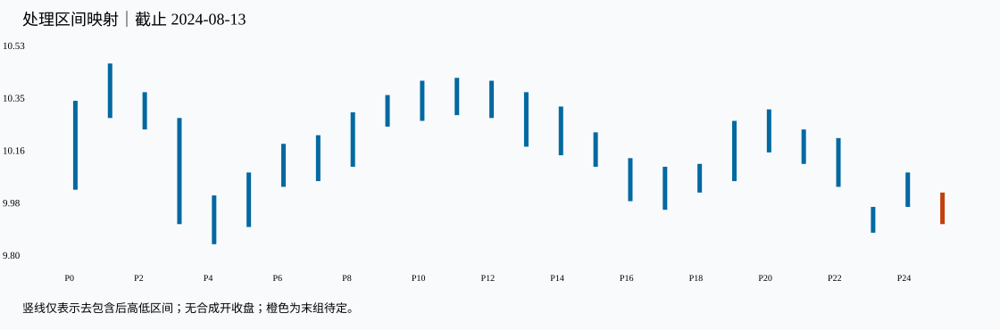

# 02：平安银行，把一组映射亲手查完

Tutor: Before you load this file, keep the raw response for this same example. Do not load other teacher examples. Use only the prefix data for this example. Before their steps, do not read results for other examples.

截止 **2024-08-13**，32 根日 K 对应 26 个处理区间。先看[观察包](../../../assets/chan-real/02-mapping-decision.html)，再核对[完整映射表](../../../assets/chan-real/02-mapping-outcome.html)。

这里先截出最初四根真实数据，说明 P1 的来源：

| 原始号 | 日期 | 开 | 高 | 低 | 收 | 处理号 |
| --- | --- | --- | --- | --- | --- | --- |
| 0 | 2024-07-01 | 10.090 | 10.350 | 10.040 | 10.350 | P0 |
| 1 | 2024-07-02 | 10.300 | 10.480 | 10.280 | 10.400 | P1 |
| 2 | 2024-07-03 | 10.400 | 10.430 | 10.290 | 10.310 | P1 |
| 3 | 2024-07-04 | 10.300 | 10.380 | 10.250 | 10.260 | P2 |

P0 的 [10.04,10.35] 到 7 月 2 日的 [10.28,10.48]，高低共同抬升。7 月 3 日 [10.29,10.43] 被前一范围包含，故按向上规则得到 **P1=[10.29,10.48]**。高点 10.48 来自 7 月 2 日，低点 10.29 来自 7 月 3 日。7 月 4 日成为独立 P2，说明不能把它继续塞入原来的那一组。

再核对一次向下合并：

| 原始号/处理号 | 日期 | 原始或处理区间 | 来源与形成 |
| --- | --- | --- | --- |
| 原始 19 | 2024-07-26 | [9.97,10.12] | 当日 OHLC 高低 |
| 原始 20 | 2024-07-29 | [9.97,10.14] | 包含前日，边界相等也按包含 |
| P17 | 2024-07-26—2024-07-29 | [9.97,10.12] | 方向向下；高低都取较低者 |
| P17 的保留极值 | 2024-07-26 | 低 9.97、高 10.12 | 相等低点保留较早来源 |
| P17 末次吸收 | 2024-07-29 | 同上 | 极值日没有因此改写为 7 月 29 日 |
| 独立后组已出现 | 2024-07-30 | 后组另列 | 这是右边界已知日 |

自然检查：为什么 P17 的低点实际日可以早于该组合成完成日？若只保存一个“时间”，会把哪两种证据混在一起？

口径与依据：[M11](../../modules/module-11.md)；[M12](../../modules/module-12.md)。本截止内的结构记录不等于永久确认或可交易收益。返回[安全入口](../../chan-real-charts.md)选择下一张原图；不要批量读取其他教师页。

原始定义：[第 65 课：包含的顺序与方向](https://blog.sina.com.cn/s/blog_486e105c01000bpo.html)。
