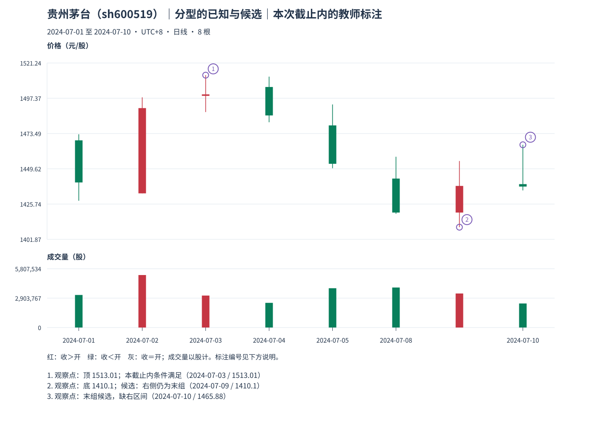

# 03：分型的发生日、形成日和可知日

Tutor: Before you load this file, keep the raw response for this same example. Do not load other teacher examples. Use only the prefix data for this example. Before their steps, do not read results for other examples.

先看贵州茅台截止 **2024-07-10** 的[观察包](../../../assets/chan-real/03-fractals-decision.html)，再看[分型标注](../../../assets/chan-real/03-fractals-outcome.html)。同一页同时存在本截止内满足条件的顶，以及右组仍为末组的底候选。

| 分型 | 三个处理组 | 极值实际发生 | 右组已出现/形成 | 独立后组出现 | 7 月 10 日状态 |
| --- | --- | --- | --- | --- | --- |
| 顶 | P1、P2、P3 | 7 月 3 日，1513.01 | 7 月 4 日 | 7 月 5 日 | 本截止内条件满足 |
| 底 | P5、P6、P7 | 7 月 9 日，1410.10 | 7 月 10 日 | 尚未看到 | 右侧 P7 仍是末包含组 |

顶分型不能只因为某天最高就成立；P2 的高低都必须严格高于 P1 与 P3。底镜像检查。这个底画在 7 月 9 日，不意味着那天已经知道右边区间，更不意味着能按 1410.10 买到。

本实现保守地另记独立后组出现日：即使右侧原始日 K 已收盘，最后包含组尚可吸收。`formed_at` 保留三组关系首次可见的右组首日；`right_group_updated_at` 另记该组末次吸收日；`known_at` 是右组出现独立后组的日期。形成来源与当前完整来源也分别保留，不因后续吸收就把最初形成时间推迟。标签 `confirmed_at_cutoff` 只说本截止规则条件满足，不作永久确认断言。

自然检查：7 月 10 日收盘，底的“三组形状可见”和“右组边界已有独立后组”是否是同一件事？

口径与依据：[M11](../../modules/module-11.md)；[M12](../../modules/module-12.md)。本截止内的结构记录不等于永久确认或可交易收益。返回[安全入口](../../chan-real-charts.md)选择下一张原图；不要批量读取其他教师页。

原始定义：[第 62 课](https://blog.sina.com.cn/s/blog_486e105c01000bf2.html)、[第 69 课](https://blog.sina.com.cn/s/blog_486e105c01000c5b.html)。
