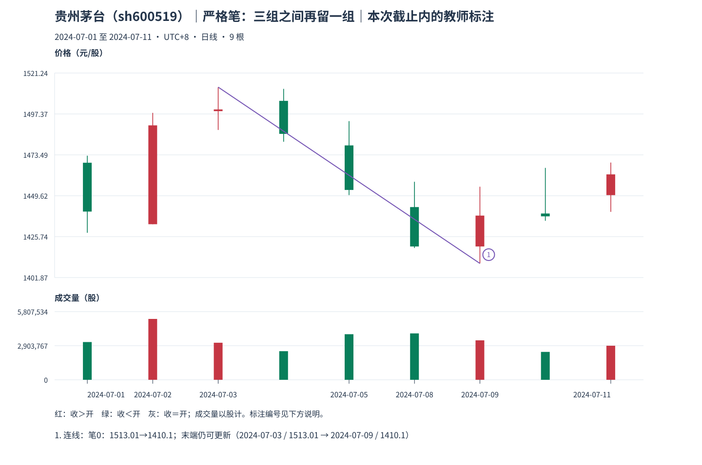

# 04：真实严格笔，确实留出了一组

Tutor: Before you load this file, keep the raw response for this same example. Do not load other teacher examples. Use only the prefix data for this example. Before their steps, do not read results for other examples.

把截止推到 **2024-07-11**，先看[新观察包](../../../assets/chan-real/04-strict-stroke-decision.html)，再核对[严格笔讲解](../../../assets/chan-real/04-strict-stroke-outcome.html)。

这组样本前九根均不需要包含合并，故原始号与 P 号一一对应：

| P/原始号 | 日期 | 处理区间 | 本次用途 |
| --- | --- | --- | --- |
| P0 / 0 | 2024-07-01 | [1428,1472.99] | 左侧背景 |
| P1 / 1 | 2024-07-02 | [1433,1498] | 顶分型左组 |
| P2 / 2 | 2024-07-03 | [1488.02,1513.01] | 顶分型中心，顶 1513.01 |
| P3 / 3 | 2024-07-04 | [1481.13,1512] | 顶分型右组 |
| P4 / 4 | 2024-07-05 | [1450,1493.18] | 两分型之间独立的一组 |
| P5 / 5 | 2024-07-08 | [1419.14,1457.77] | 底分型左组 |
| P6 / 6 | 2024-07-09 | [1410.10,1454.89] | 底分型中心，底 1410.10 |
| P7 / 7 | 2024-07-10 | [1435,1465.88] | 底分型右组 |
| P8 / 8 | 2024-07-11 | [1440.21,1469] | 底右组后的独立组，仍为当前末组 |

顶用 P1—P3，底用 P5—P7；中间 P4 独立。两个中心 P2、P6 的距离是 **6−2=4**，不是“图上约四天”。P2—P6 范围的最高是 1513.01、最低是 1410.10，恰由两端覆盖；因此可以记录一条满足本课严格几何条件的下笔。底的保守可知日是 7 月 11 日，早先 7 月 9 日的低点不能用作当时已确认的交易价格。

这仍是当前末笔；后面若尚无合格异类端点，更低同类底可能更新它。自然检查：若把 P4 也算进底分型，会违反哪一组三组来源？

口径与依据：[M11](../../modules/module-11.md)；[M12](../../modules/module-12.md)。本截止内的结构记录不等于永久确认或可交易收益。返回[安全入口](../../chan-real-charts.md)选择下一张原图；不要批量读取其他教师页。

原始定义：[第 62 课](https://blog.sina.com.cn/s/blog_486e105c01000bf2.html)、[第 69 课](https://blog.sina.com.cn/s/blog_486e105c01000c5b.html)。
