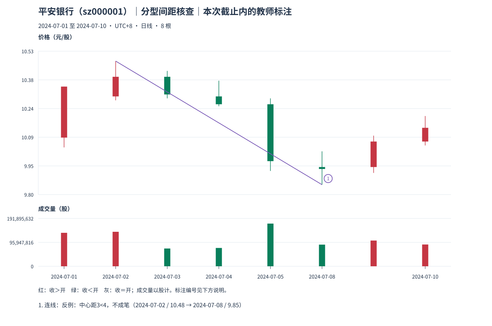

# 05：真实反例——不共用，还不够

Tutor: Before you load this file, keep the raw response for this same example. Do not load other teacher examples. Use only the prefix data for this example. Before their steps, do not read results for other examples.

先看平安银行截止 **2024-07-10** 的[反例观察包](../../../assets/chan-real/05-spacing-check-decision.html)，再看[被拒绝的尝试连线](../../../assets/chan-real/05-spacing-check-outcome.html)。

P1 顶为 7 月 2 日的 **10.48**；P4 底为 7 月 8 日的 **9.85**。顶分型用 P0、P1、P2，底分型用 P3、P4、P5。它们没有共用区间，却挨在一起：两组三组中间没有额外一组。中心距 **4−1=3**，所以拒绝成笔。

这里共有 8 根原始日 K，去包含后只有 7 个处理区间。原始根数多并不能给两组三组之间补一组。图上的尝试连线带有“不成笔”说明，不能把它与严格笔图混读。

自然检查：如果软件允许中心距 3，那是同一口径，还是应先注明版本差异再比较？

口径与依据：[M11](../../modules/module-11.md)；[M12](../../modules/module-12.md)。本截止内的结构记录不等于永久确认或可交易收益。返回[安全入口](../../chan-real-charts.md)选择下一张原图；不要批量读取其他教师页。

原始定义：[第 62 课](https://blog.sina.com.cn/s/blog_486e105c01000bf2.html)、[第 69 课](https://blog.sina.com.cn/s/blog_486e105c01000c5b.html)。
