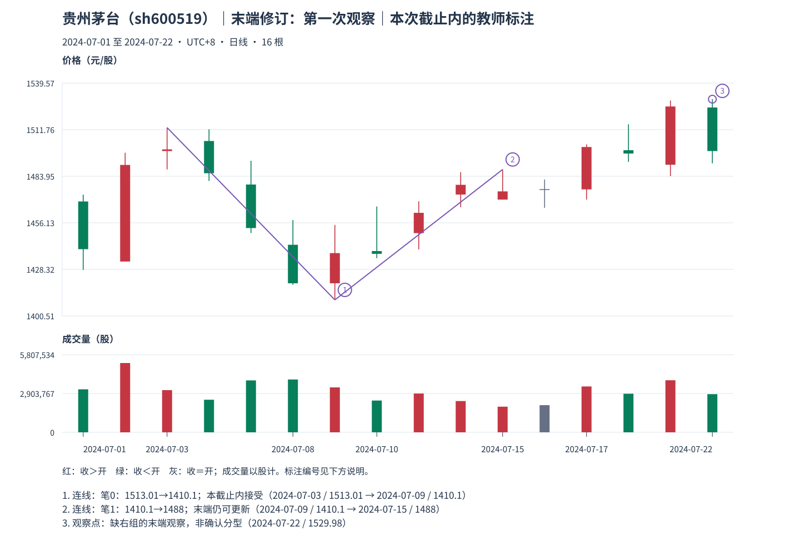

# 06：保留第一次截止，不预读下一包

Tutor: Before you load this file, keep the raw response to `06-endpoint-before`. This explanation contains only the prefix for example 06. Do not load teacher files for example 07 or other teacher examples.

Next, show the RAW observation for example 07. Before its explanation, keep a different raw response for example 07.

本包是贵州茅台，截止 **2024-07-22 收盘**。先核对本包原话，再读[本包区间与逐笔表](../../../assets/chan-real/06-endpoint-before-outcome.html)。本页不提供下一观察包结果。

| 截止内的对象 | 日期与价格 | 已知条件 | 尚缺什么 |
| --- | --- | --- | --- |
| 已选末笔起点 | 7 月 9 日，底 1410.10，P6 | 已有分型及处理来源 | 与末端逐次重查 |
| 当前已选末端 | 7 月 15 日，顶 1488，P10 | 顶底中心距 4，范围覆盖通过 | 仍是可被更极端同类候选更新的末端 |
| 很近的异类底 | 7 月 16 日，1465.05，P11 | 是截止内满足局部关系的底 | 距 P10 只有 1，不足以成为反向笔端点 |
| 最新方向极值 | 7 月 22 日，高 1529.98，P13 | 末包含组已吸收真实原始 13、14、15 | 缺右组，不是完整新顶分型 |

P13 对应 7 月 18、19、22 日，向上处理后为 **[1492.53,1529.98]**。低点保留在 7 月 18 日，高点实际发生在 7 月 22 日；此时组还在末尾，没有独立右组。不能把新高直接说成已经确认的顶，更不能把旧末端的记录删掉、假称早已连到 1529.98。

也不能为了维持旧顶永久有效而无视新资料。正确记录是：“截至本包，旧末端顶仍在选笔表；当前末组出现更高方向极值，缺右侧分型，后续再核。”这句话同时保留了当前资格和未完成状态。

本包的原答应单独保存：截止、所选旧末端、最新方向极值、缺失的右组、允许何种更新。下一包先给原图，让学习者重新说一遍能确定到哪一层，再加载下一包教师说明。本页不预告它会怎样变化。

自然检查：一根日 K 已收盘，为什么它所在的最后包含组仍可能继续吸收？把“新高出现”与“新的顶分型满足条件”分开说。

口径与依据：[M11](../../modules/module-11.md)。本截止内结构记录不等于永久确认或极值可成交。返回[安全入口](../../chan-real-charts.md)，下一包仍须独立原答。

原始定义：[第 62 课](https://blog.sina.com.cn/s/blog_486e105c01000bf2.html)、[第 69 课](https://blog.sina.com.cn/s/blog_486e105c01000c5b.html)。
