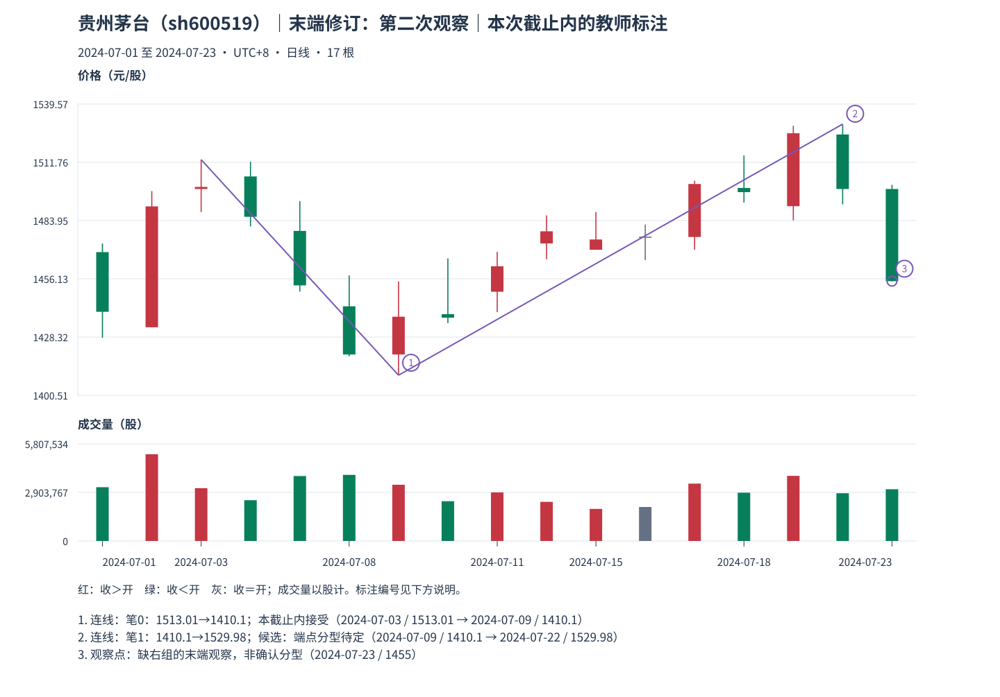

# 07：新增资料之后，候选末端怎样更新

Tutor: Before you load this file, keep the raw responses for example 06 and this specified example 07. This explanation uses only the prefix for example 07. Do not load subsequent teacher examples or full history as lesson information.

本包是贵州茅台，截止 **2024-07-23 收盘**。先核对学习者分别保存的两份原答，再看[本包逐笔表与更新记录](../../../assets/chan-real/07-endpoint-after-outcome.html)。

| 两份已完成作答的观察 | 当时选笔末端 | 最新资料 | 应如何表述 |
| --- | --- | --- | --- |
| 前包，截止 7 月 22 日 | 7 月 15 日顶 1488 | P13 高 1529.98，仍缺右组 | 旧末端与方向极值分别记录 |
| 本包，截止 7 月 23 日 | 新的候选顶在 7 月 22 日，1529.98 | P14=[1455,1501]，P12、P13、P14 出现严格顶关系 | 同类更高候选更新末端，但右侧 P14 仍是可吸收的末组 |

P12=[1470.02,1503]，P13=[1492.53,1529.98]，P14=[1455,1501]。P13 的高低都严格高于左右。新的顶价取 P13 的高 1529.98，实际发生日在 7 月 22 日；最早看见三组关系的形成日在 7 月 23 日。独立后组尚未看到，因此保守 `known_at` 仍为空，状态是 **`provisional_right_group`**。

上一末端 P10 顶 1488 之后，P11 的底距它只有 1；它没有成为合格反向笔端点。所以新来的同类更高顶可以更新未完成末端，没有跨越已合格反向笔。候选连接从 7 月 9 日底 1410.10 到 7 月 22 日顶 1529.98，处理后中心距 **13−6=7**，几何间距、范围通过；端点分型仍待定，所以整条末笔标 **`provisional_fractal`**，不能写成已永久确认完成。

| 更新记录 | 保留值 |
| --- | --- |
| 旧顶 | 7 月 15 日，1488 |
| 新顶候选 | 7 月 22 日，1529.98 |
| 更新可观察到的日期 | 7 月 23 日 |
| 新顶的保守边界已知日期 | 本包尚缺 |
| 还要等待 | 右组稳定边界及后续合格反向结构，继续按规则重查 |

自然检查：为什么“7 月 23 日可以追加候选更新”不能改写成“7 月 22 日已经知道完成顶”？如果已有间距、极值均合格的异类端点，还能跳过去连更高顶吗？

口径与依据：[M11](../../modules/module-11.md)。只追加新观察，不回填极值成交，不修改前包原答。返回[安全入口](../../chan-real-charts.md)选择下一原图；不要批量读其他教师案例。

原始定义：[第 62 课](https://blog.sina.com.cn/s/blog_486e105c01000bf2.html)、[第 69 课](https://blog.sina.com.cn/s/blog_486e105c01000c5b.html)。
