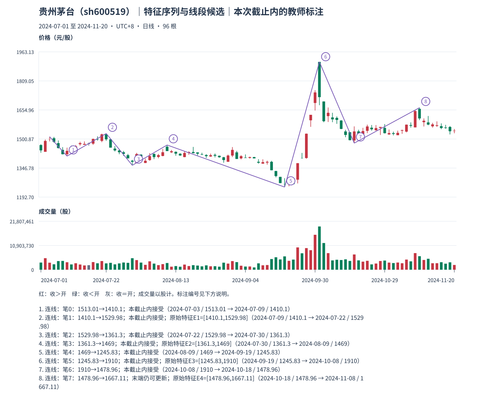

# 08：先把真实笔和特征区间摊开，再说线段候选

Tutor: Before you load this file, keep the raw response for this same example. Do not load other teacher examples. Use only the prefix data for this example. Before their steps, do not read results for other examples.

先看贵州茅台截止 **2024-11-20** 的[观察包](../../../assets/chan-real/08-feature-sequence-decision.html)，再看[实际笔、特征区间与资格缺口](../../../assets/chan-real/08-feature-sequence-outcome.html)。下表列出真实选笔，不是给想象的标准图配价格：

| 笔号 | 方向 | 起点日期/价格 | 终点日期/价格 | 笔区间 |
| --- | --- | --- | --- | --- |
| 0 | 下 | 7 月 3 日 / 1513.01 | 7 月 9 日 / 1410.10 | [1410.10,1513.01] |
| 1 | 上 | 7 月 9 日 / 1410.10 | 7 月 22 日 / 1529.98 | [1410.10,1529.98] |
| 2 | 下 | 7 月 22 日 / 1529.98 | 7 月 30 日 / 1361.30 | [1361.30,1529.98] |
| 3 | 上 | 7 月 30 日 / 1361.30 | 8 月 9 日 / 1469 | [1361.30,1469] |
| 4 | 下 | 8 月 9 日 / 1469 | 9 月 19 日 / 1245.83 | [1245.83,1469] |
| 5 | 上 | 9 月 19 日 / 1245.83 | 10 月 8 日 / 1910 | [1245.83,1910] |
| 6 | 下 | 10 月 8 日 / 1910 | 10 月 18 日 / 1478.96 | [1478.96,1910] |
| 7 | 上 | 10 月 18 日 / 1478.96 | 11 月 8 日 / 1667.11 | [1478.96,1667.11] |

若**假设**从笔 0 开始检验一个向下段，取反向的上笔 1、3、5、7 作原始特征：

| 原始特征 | 来源笔 | 价格区间 | 要核查什么 |
| --- | --- | --- | --- |
| E1 | 1 | [1410.10,1529.98] | 与 E2 有交集 [1410.10,1469] |
| E2 | 3 | [1361.30,1469] | E1、E2 无特征缺口 |
| E3 | 5 | [1245.83,1910] | 包含 E2，须先作特征包含整理 |
| E4 | 7 | [1478.96,1667.11] | 最新笔仍可修订，不能偷作稳定封口 |

前三笔确实正宽重叠于 [1410.10,1513.01]，但这只是起始条件之一。E1、E2 无缺口，也不等于已经有标准特征底分型。E3 包含 E2，直接从原始三元素找底分型不合格；还缺特征包含整理与来源、段起点左侧资格以及适用分支的完成证据。窗口左边第一笔不能自动充任新线段起点。

本程序故意把这些输入和检查摊开，**没有输出完成线段**，也没有实现完整线段识别器。若某个候选首两标准特征有缺口，还必须等候选端点之后反向标准特征分型，不能靠补画三根箭头完成第二种情形。没有通过这项有限检查，不能据此断言市场不存在任何其他合格分段。

自然检查：本图 E3 区间很大，为什么“中间看着最低”仍不能跳过特征包含处理？

口径与依据：[M11](../../modules/module-11.md)；[M12](../../modules/module-12.md)。本截止内的结构记录不等于永久确认或可交易收益。返回[安全入口](../../chan-real-charts.md)选择下一张原图；不要批量读取其他教师页。

原始定义：[第 67 课](https://blog.sina.com.cn/s/blog_486e105c01000c16.html)、[第 71 课](https://blog.sina.com.cn/s/blog_486e105c01000c8i.html)、[第 78 课](https://blog.sina.com.cn/s/blog_486e105c01000cio.html)、[第 81 课](https://blog.sina.com.cn/s/blog_486e105c01000cmz.html)。
