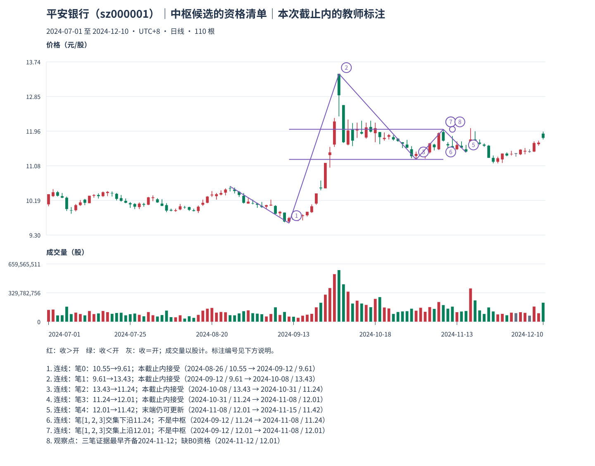

# 09：真实交集算得出，中枢资格仍可能没有

Tutor: Before you load this file, keep the raw response for this same example. Do not load other teacher examples. Use only the prefix data for this example. Before their steps, do not read results for other examples.

先看平安银行截止 **2024-12-10** 的[观察包](../../../assets/chan-real/09-center-qualification-decision.html)，再看[三笔交集与资格清单](../../../assets/chan-real/09-center-qualification-outcome.html)。

| 笔号 | 起点日期/价格 → 终点日期/价格 | 区间 | 分型证据保守齐备日 |
| --- | --- | --- | --- |
| 0 | 8 月 26 日 10.55 → 9 月 12 日 9.61 | [9.61,10.55] | 9 月 18 日 |
| 1 | 9 月 12 日 9.61 → 10 月 8 日 13.43 | [9.61,13.43] | 10 月 10 日 |
| 2 | 10 月 8 日 13.43 → 10 月 31 日 11.24 | [11.24,13.43] | 11 月 4 日 |
| 3 | 10 月 31 日 11.24 → 11 月 8 日 12.01 | [11.24,12.01] | 11 月 12 日 |
| 4 | 11 月 8 日 12.01 → 11 月 15 日 11.42 | [11.42,12.01] | 11 月 19 日，末端仍可更新 |

选连续笔 **1、2、3**，最大低点为 11.24，最小高点为 12.01，故共同价格区间 **[11.24,12.01]**，外围范围 **[9.61,13.43]**。最晚一笔的分型证据至 11 月 12 日才齐备；不能从 9 月 12 日起就把后来计算的交集当作当时已知。图中上下沿只覆盖被选三笔的时间范围，并另标最早齐备日，不将整幅图涂成“早已成立”的横带。

| 中枢候选的先决条件 | 本例检查结果 |
| --- | --- |
| 同一股票、周期、价格口径和截止 | 已固定 |
| 所选对象连续 | 笔 1、2、3 连续 |
| 交集正宽，核心与外围分开 | 11.24 < 12.01；核心不等于整个波动范围 |
| 三个对象是 M11 已确认 B0 线段 | **没有这项资格；所列只是笔** |
| B0 逐段结束证据与左边界可追溯 | 尚缺标准特征及适用反向确认记录 |
| 合格 B0 建立最低教学中枢 | 停止准入，不能由三笔替代 |
| L1 已完成，满足 C12-F 课堂块封口 | 尚无合格输入，未执行 |
| 进入 L2 递归 | 尚无合格完成 L1 输入，未执行 |

再看笔 0、1、2：最大低点 11.24 高于最小高点 10.55，交集为空。同一张图并非“每三笔都是一个中枢”。程序只把正宽窗口列在算术练习表，且所有窗口都标明“不是 B0 中枢”。

自然检查：若有人把上表的“笔”直接改成“线段”，具体缺少哪一份证据，而不是只说“规则不同”？

口径与依据：[M11](../../modules/module-11.md)；[M12](../../modules/module-12.md)。本截止内的结构记录不等于永久确认或可交易收益。返回[安全入口](../../chan-real-charts.md)选择下一张原图；不要批量读取其他教师页。

原始定义：[第 17 课](https://blog.sina.com.cn/s/blog_486e105c010007p1.html)、[第 18 课](https://blog.sina.com.cn/s/blog_486e105c010007t8.html)、[第 20 课](https://blog.sina.com.cn/s/blog_486e105c010007zw.html)、[第 83 课](https://blog.sina.com.cn/s/blog_486e105c01000cqy.html)。
