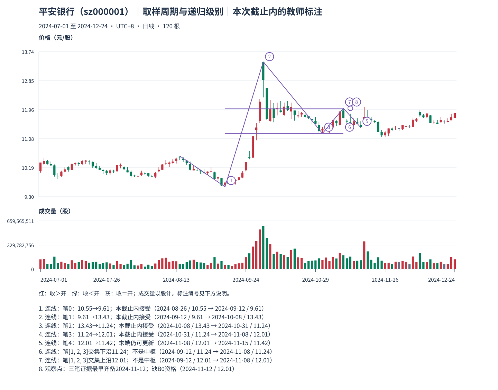

# 10：日线周期不会自动变成 L1 或 L2

Tutor: Before you load this file, keep the raw response for this same example. Do not load other teacher examples. Use only the prefix data for this example. Before their steps, do not read results for other examples.

先看平安银行截止 **2024-12-24** 的[观察包](../../../assets/chan-real/10-interval-level-decision.html)，再核对[结构层次讲解](../../../assets/chan-real/10-interval-level-outcome.html)。

本图从头到尾都是日 K。去包含改变的是结构表示，不是把它换成周 K；连成笔也没有自动得到“分钟级别”或“L1 级别”。

| 问题 | 这幅真实图能回答什么 |
| --- | --- |
| 一根 K 装多长时间？ | 一交易日，这是取样周期 |
| 去包含后有哪些区间？ | 120 根原始日 K 对应 98 个当前处理区间 |
| 哪些顶底可组成严格笔？ | 有逐笔来源、间距和范围表，共 5 笔，末端仍可更新 |
| 哪些是完成 B0？ | 未输出合格线段；不可由笔直接替代 |
| 可以称最低教学中枢吗？ | 缺三个连续合格 B0；仅有笔交集练习 |
| 可以称 L2 吗？ | 缺 C12-F 封口的合格 L1 输入，不能按天数或九笔换算 |

自然检查：改用周 K 以后，应该对新输入重新处理包含，还是把本图 P 号原样搬过去？

口径与依据：[M11](../../modules/module-11.md)；[M12](../../modules/module-12.md)。本截止内的结构记录不等于永久确认或可交易收益。返回[安全入口](../../chan-real-charts.md)选择下一张原图；不要批量读取其他教师页。

原始定义：[第 17 课](https://blog.sina.com.cn/s/blog_486e105c010007p1.html)、[第 18 课](https://blog.sina.com.cn/s/blog_486e105c010007t8.html)、[第 20 课](https://blog.sina.com.cn/s/blog_486e105c010007zw.html)、[第 83 课](https://blog.sina.com.cn/s/blog_486e105c01000cqy.html)。
