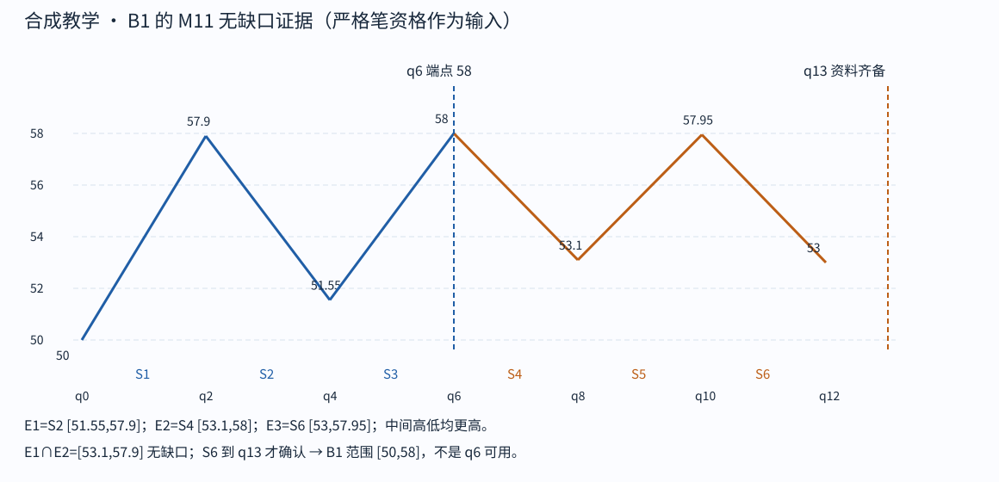

# Step 01 feedback

cutoff: q13

Tutor: Before you open this file, record the raw response for this step at this cutoff. This file contains no feedback for subsequent steps. The input conditions include strict-stroke qualification and left-start qualification. This packet gives no raw K-line proof. The support for this C12-F lesson is `assisted`. This is not an `independent` assessment.

Tutor: Do a check for `assets/chan-trace/00.png` in the active skill root. For each image, if there is the PNG, use it. If there is no PNG, use the SVG with the same image identifier. In the tutor reply to the learner, use an absolute path in the local filesystem for each selected image. The relative SVG that follows is a source-document alternative. It is not the path format for a tutor reply.

## 01 · 从六笔确认 B1

六笔依次为 50→57.9→51.55→58→53.1→57.95→53。前三笔构成向上候选段，成员范围共同部分为 [51.55,57.9]。反向元素 E1=[51.55,57.9]、E2=[53.1,58]、E3=[53,57.95]：E2 的低点 53.1 同时高于 51.55 和 53，高点 58 同时高于 57.9 和 57.95，形成特征顶；E1∩E2=[53.1,57.9]，无缺口。

B1 画到 q6 的 58，成员 S1—S3 的全范围是 [50,58]；确认须等 S6 在 q13 可用。S4—S6 属于后续向下段的成员，是本段的结束见证，不把 B1 错画到 53。只有 q12 的末端价格 53、没有 S6 完成输入时，仍不能把确认回填到 q6 或 q12。

Check: Give a question about the orange data and the conditions that make q6 different from the knowledge time. Stop before step 02.

