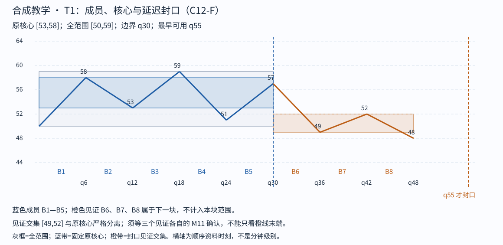

# Step 02 feedback

cutoff: q55

Tutor: Before you open this file, record the raw response for this step at this cutoff. This file contains no feedback for subsequent steps. The input conditions include strict-stroke qualification and left-start qualification. This packet gives no raw K-line proof. The support for this C12-F lesson is `assisted`. This is not an `independent` assessment.

Tutor: Do a check for `assets/chan-trace/01.png` in the active skill root. For each image, if there is the PNG, use it. If there is no PNG, use the SVG with the same image identifier. In the tutor reply to the learner, use an absolute path in the local filesystem for each selected image. The relative SVG that follows is a source-document alternative. It is not the path format for a tutor reply.

## 02 · T1 的核心不是封口资格

q25，B1—B3 都确认，原核心为 [max(50,53,53),min(58,58,59)]=[53,58]。若想在 B3 的 59 截断，后续 B4 虽向下到 51，B5 却返回 57，进入核心；该边界不通过。纳入 B4、B5 后，它们均触及原核心，移动三段交集 B2—B4=[53,58]、B3—B5=[53,57] 也触及原核心。保留最初 [53,58]，不偷偷改窄。

下一候选边界是 B5 的 57，发生于 q30。见证 B6：57→49，49<53；B7：49→52，52<53；B8：52→48，48<49。三者交集 [49,52] 正宽且与原核心严格分离。最后一个 B8 在 q55 确认，所以 T1=B1—B5 到 q55 才封口。它的边界仍是 q30，完整范围 [50,59]；59 在内部，不能只取端点 50→57 的 [50,57]。

**不完成对照**：停在 q54 时 S27 还未确认，B8 就没有完整的 M11 证据，T1 不得封口。另一项门槛对照只用于 C12-F 单元检查：把 B7 返回价换为 53 或 54，则不满足返回严格低于 53，不能沿用本边界。若要把改价方案当另一条完整行情，还须重建并重新核准底层笔与 B0，不能沿用原证书。

Check: Give a question about the B0 for which the necessary data stay missing at q54. Stop before step 03.

