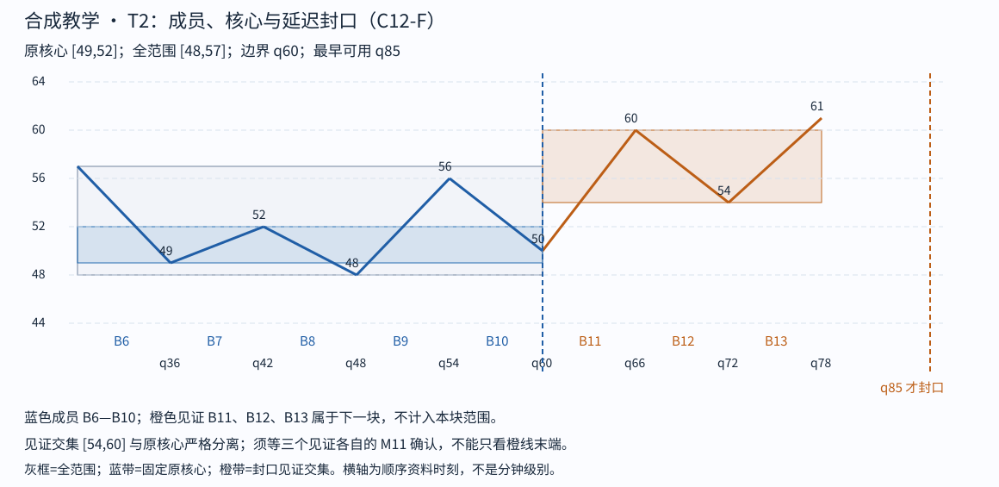

# Step 03 feedback

cutoff: q85

Tutor: Before you open this file, record the raw response for this step at this cutoff. This file contains no feedback for subsequent steps. The input conditions include strict-stroke qualification and left-start qualification. This packet gives no raw K-line proof. The support for this C12-F lesson is `assisted`. This is not an `independent` assessment.

Tutor: Do a check for `assets/chan-trace/02.png` in the active skill root. For each image, if there is the PNG, use it. If there is no PNG, use the related SVG. In the reply that the tutor sends, use an absolute path in the local filesystem for each selected image.

The SVG link that follows is an alternative in the source document. This link uses a path relative to the document. It is not the path format for a tutor reply.

## 03 · T2 独立取得镜像封口

T2 从 q30 的同一公共端点 57 接续，成员是 B6—B10，不重复使用 T1 的任一整段。B6—B8 的原核心为 [49,52]，最早 q55 形成；这只是 T1 获得见证的同时，T2 开始具备核心，不能宣称 T2 也完成了。

若在 B8 的 48 截断，镜像离开 B9 上到 56，但返回 B10 低至 50，重新进入 [49,52]，故这个较早边界失败。纳入 B9、B10 后，移动交集为 [49,52]、[50,52]，均触及原核心。选 B10 的 50 为下一候选边界，发生于 q60。

见证 B11 上到 60>52，B12 返回低点 54>52，B13 再上到 61>60；三者交集 [54,60] 与原核心分离。B13 在 q85 才确认，因此 T2 到 q85 封口；全范围 [48,57]，不是端点区间 [50,57]。这一块自己的成员、边界、核心与见证都已经给出，不能只抄一个“合格”标签。

Check: Give a question about T2 core time q55, boundary q60, and availability q85. Stop before step 04.

