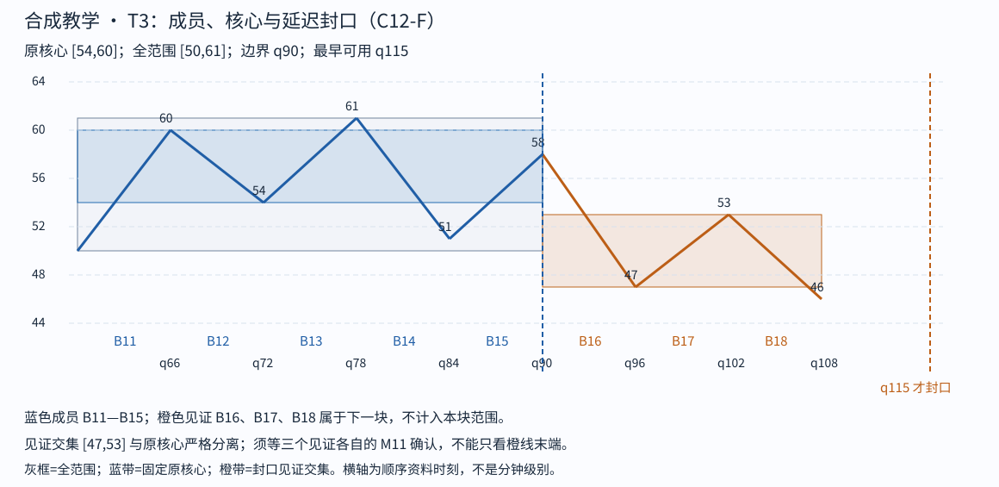

# Step 04 feedback

cutoff: q115

Tutor: Before you open this file, record the raw response for this step at this cutoff. This file contains no feedback for subsequent steps. The input conditions include strict-stroke qualification and left-start qualification. This packet gives no raw K-line proof. The support for this C12-F lesson is `assisted`. This is not an `independent` assessment.

Tutor: Do a check for `assets/chan-trace/03.png` in the active skill root. For each image, if there is the PNG, use it. If there is no PNG, use the SVG with the same image identifier. In the tutor reply to the learner, use an absolute path in the local filesystem for each selected image. The relative SVG that follows is a source-document alternative. It is not the path format for a tutor reply.

## 04 · T3 完成，真正递归一次

T3 从 q60 的 50 接续，成员 B11—B15。B11—B13 原核心 [54,60] 于 q85 形成。若截在 B13 的 61，B14 下到 51，但 B15 返回 58，进了核心；较早边界不通过。纳入 B14、B15 后，移动交集 [54,60]、[54,58] 均触及原核心。

下一边界是 q90 的 58。见证 B16 下到 47<54，B17 返回 53<54，B18 再下到 46<47，见证交集 [47,53] 与旧核心分离。B18 最早 q115 确认，因此 T3 于 q115 封口，全范围 [50,61]。

现在三块连续衔接：T1 q0—q30，T2 q30—q60，T3 q60—q90。全范围依次是 [50,59]、[48,57]、[50,61]。**实际求 L2 核心**：[max(50,48,50),min(59,57,61)]=[50,57]，正宽为 7。T1—T3 的知识时间分别 q55、q85、q115，最晚者 q115 才是本 L2 核心可用时间。整个覆盖范围 [48,61]，不能冒充核心。

三个内部核心 [53,58]、[49,52]、[54,60] 并无共同交集，但那不是本次 L2 的输入。L2 取已封口块的全范围，不能改成内部核心来算。此时只是形成 L2 中枢，**没有证明整个 L2 走势类型完成**；不用更换 K 线周期，也不自动得到更高一级。

Check: Give a question about the conditions that make T3 not permitted at q114 although its endpoint showed at q90. Stop before step 05.

