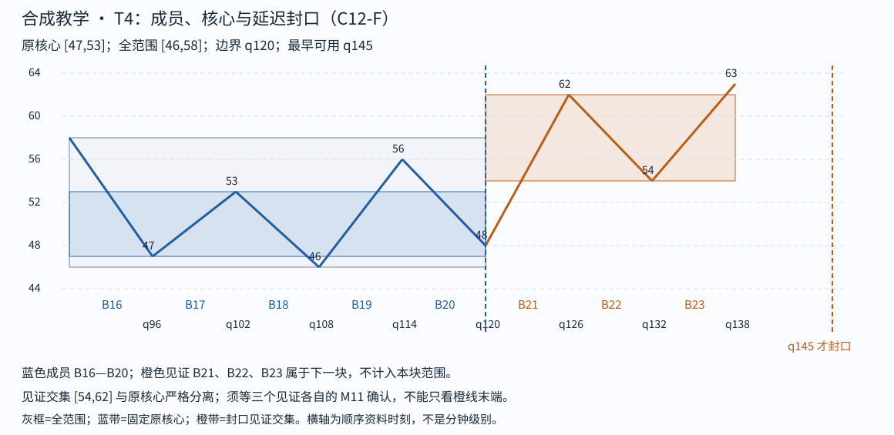

# Step 05 feedback

cutoff: q174

Tutor: Before you open this file, record the raw response for this step at this cutoff. This file contains no feedback for subsequent steps. The input conditions include strict-stroke qualification and left-start qualification. This packet gives no raw K-line proof. The support for this C12-F lesson is `assisted`. This is not an `independent` assessment.

Tutor: Do a check for `assets/chan-trace/04.png` in the active skill root. For each image, if there is the PNG, use it. If there is no PNG, use the related SVG. In the reply that the tutor sends, use an absolute path in the local filesystem for each selected image.

The SVG link that follows is an alternative in the source document. This link uses a path relative to the document. It is not the path format for a tutor reply.

## 05 · 同记录的离开与尚未完成的首次返回

T4 从 q90 的 58 接续，成员 B16—B20，原核心 [47,53]。B16—B18 最早 q115 形成核心；B17—B19、B18—B20 的移动交集依次 [47,53]、[48,53]。较早的 B18 边界因 B20 回到 48 而未满足镜像封口；延伸到 B20 后，边界为 q120 的 48。

见证 B21 上到 62>53、B22 返回低点 54>53、B23 再上到 63>62，交集 [54,62]。B23 到 q145 确认，T4 才封口，全范围 [46,58]。相对 L2 核心 [50,57]，这一完整次级块从 58 向下到 48<50，形成此次向下离开。不能要求离开块的全部范围都低于核心：它本就从旧结构接续离开。

L2 到 q115 才能登记，T4 的价格起点在 q90，二者不矛盾：只能在 q115 之后讨论当时可知的 L2，不能倒说 q90 已经知道 L2。类似地，T5 的价格波动从 q120 开始，但 T4 到 q145 才取得完成资格。

截止 q174，T5 的三笔见证价格虽已出现，B28 却缺最后一个反向特征元素 S87 的确认。S87 的末端 q174 已见、输入确认尚未到来，因此 B28 未确认，T5 未封口，不能报告“已完成的首次返回”。这不妨碍记下返回路径已经进入核心的反证；更不应等待一个未来确认才管理已有风险。

Check: Give a question about S87, its endpoint q174, and its confirmation time, which stays unknown. Stop before step 06.

