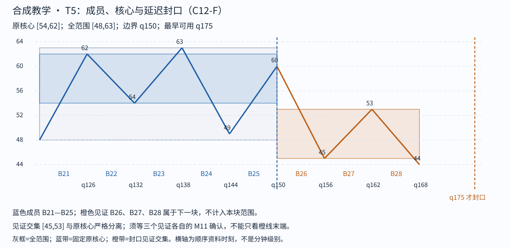
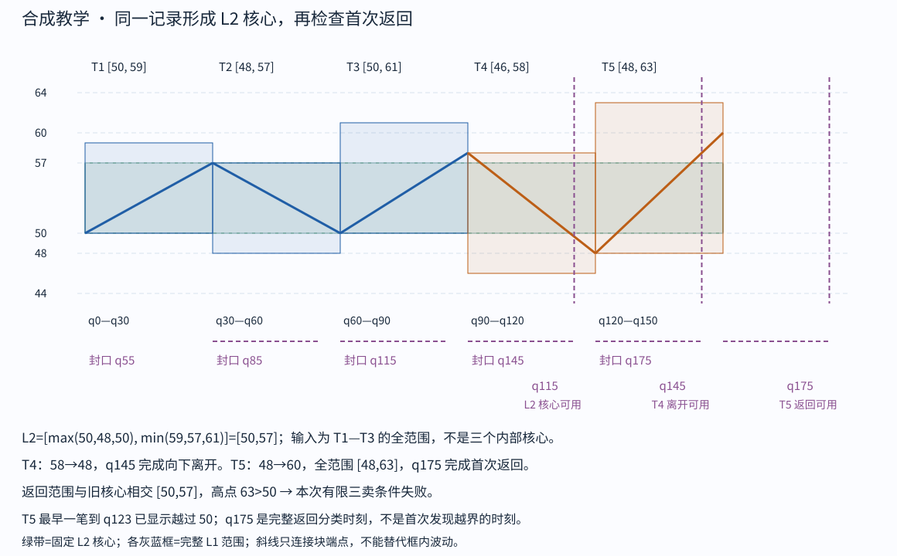

# Step 06 feedback

cutoff: q175

Tutor: Before you open this file, record the raw response for this step at this cutoff. This file contains no feedback for subsequent steps. The input conditions include strict-stroke qualification and left-start qualification. This packet gives no raw K-line proof. The support for this C12-F lesson is `assisted`. This is not an `independent` assessment.

Tutor: Do a check for `assets/chan-trace/05.png` in the active skill root. Do a check for `assets/chan-trace/06.png` in the active skill root. For each image, if there is the PNG, use it. If there is no PNG, use the related SVG. In the reply that the tutor sends, use an absolute path in the local filesystem for each selected image.

The SVG link that follows is an alternative in the source document. This link uses a path relative to the document. It is not the path format for a tutor reply.

## 06 · 返回完成后，有限三卖条件失败

T5 从 T4 末端 q120 的 48 接续，成员 B21—B25，原核心 [54,62]。B21—B23 最早 q145 形成核心；移动交集 B22—B24=[54,62]、B23—B25=[54,60] 均触及原核心。较早的 B23 边界因 B25 返回 60 而失败，下一候选边界是 q150 的 60。

见证 B26 下到 45<54，B27 返回最高 53<54，B28 再下到 44<45，交集 [45,53]，与原核心分离。B28 最早 q175 确认，T5 在 q175 封口，全范围 [48,63]。B26—B28 只是 T5 见证，下一块自己还没有封口；不能借它们再造第六块完成 L1。

T4、T5 是本次声明分解中紧接 T1—T3 的连续 L1，T5 才是这次离开后的首次次级返回。T5 的全范围 [48,63] 与旧 L2 核心 [50,57] 相交 [50,57]；返回最高 63>50，课程三卖要求的“严格低于核心下界 50”失败。**q175 的完整分类结论是：本次 C12-F 有限三卖条件不成立。**它不是三买，也不是背驰结论，更不是盈利预测。

这里要分开三个时间：T5 的起点 q120；S61 已在 q122 到达 55.9，作为已确认严格笔到 q123 就可见其越过 50；完整返回作为已封口 L1 则要等 q175。q123 是返回路径的越界反证时间，不是已完成 L1 返回时间；q145 离开块才封口；q175 是 `max(115,145,175)` 的完整返回分类决策时间，不能说 q175 才首次发现越界，也不能把 q123 时尚未封口的对象说成已完成首次返回。

若只把返回端点拿来判断，可能漏掉内部最高 63。即使另一个返回端点低于 50，只要全范围曾到 51，就仍失败；最高恰为 50 则记原文边界情形、课程暂不交易。脚本的边界单元检查分别使用高点 51、50、49，检验失败、边界及严格条件满足三种结果。这三组是单项门槛算例，不是另外三条完成行情。

Check: Tell the learner to give one sentence with these items:
- The return range
- The inequality that is not correct
- The completion witness
- The q175 decision time.
Keep the raw response. This example gives all calculation steps. It does not show mastery for a task with no learner access before its assessment starts.

