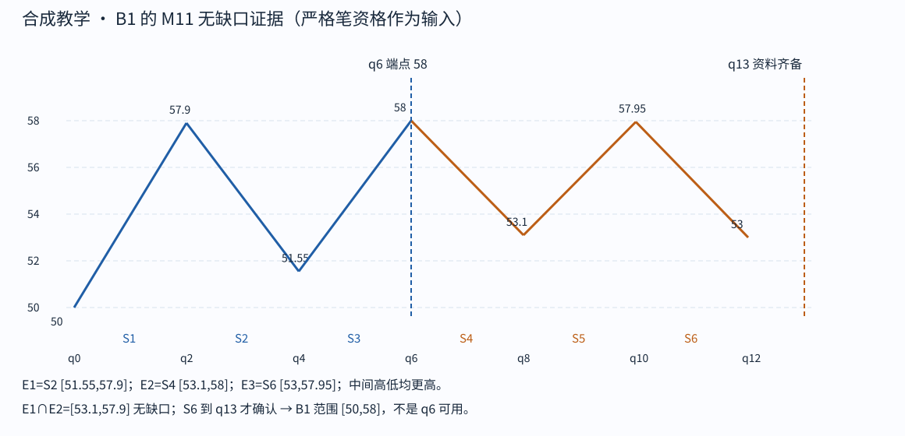
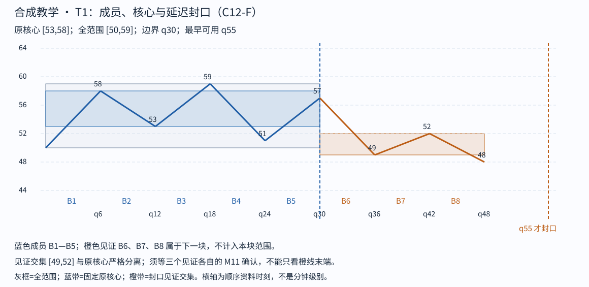
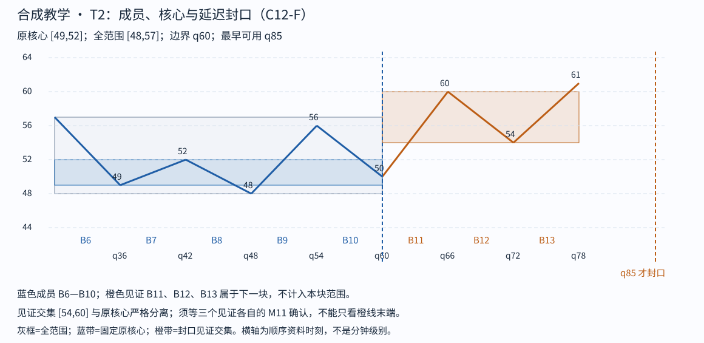
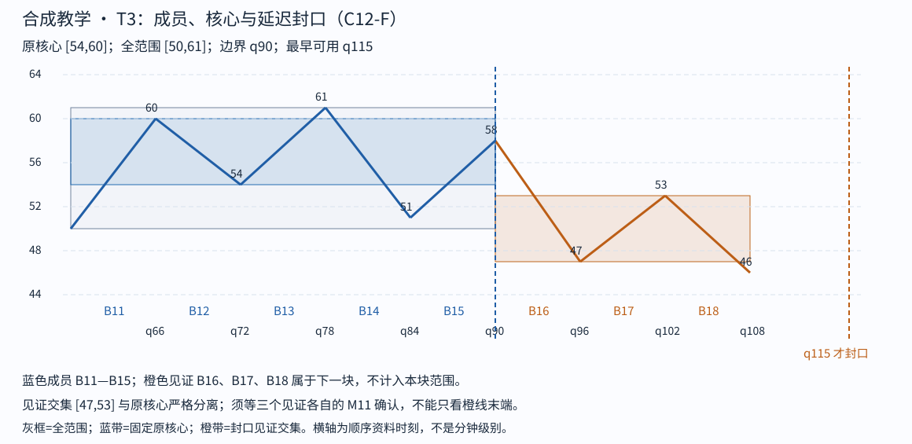
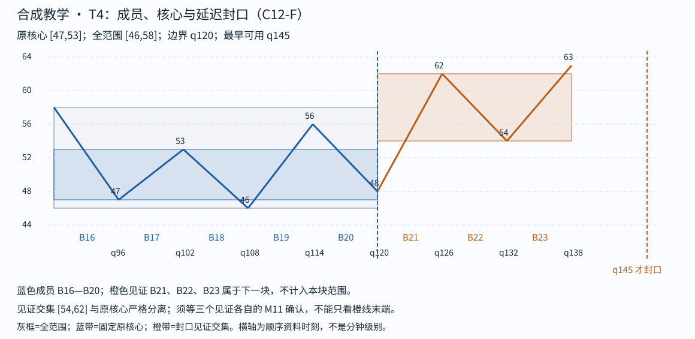
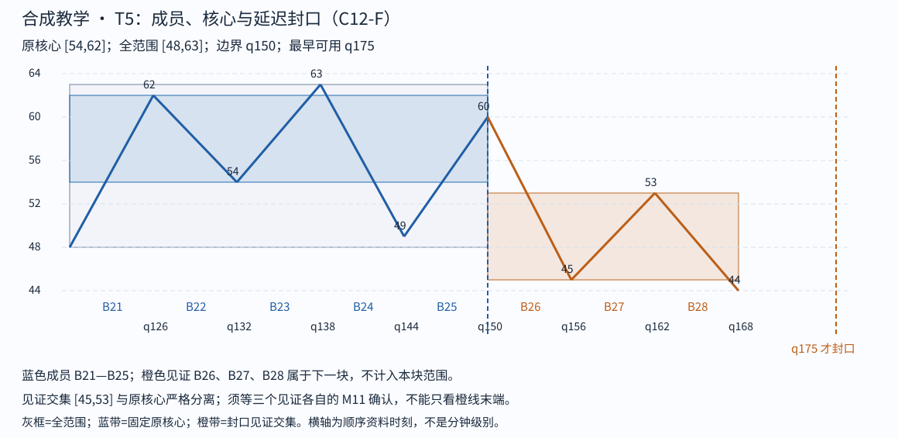
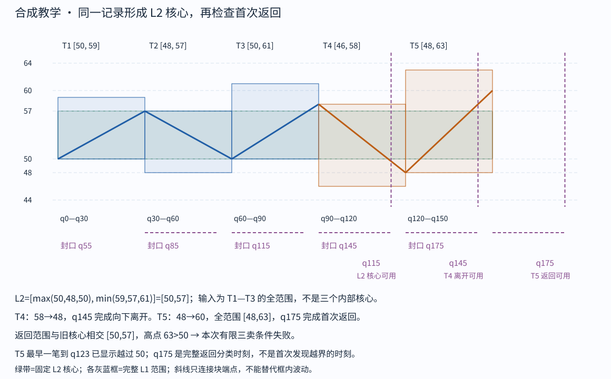

# Post-trace audit only

Tutor: Before you open this file and the full JSON, record all six raw responses. Before all steps are completed, do not use this audit for feedback about a step.

# 合成贯通示范：教师反馈与复核

This route is for the tutor only. Do not give this guide, its SVGs, or the full JSON to the learner. Use [the learner route](../../chan-trace.md). Show only the prefix for this step. Keep each raw response. Give one feedback paragraph.

Then, give one check question. All learner explanations that follow are Chinese. This demonstration with tutor aid does not show mastery without tutor aid.

## 口径与证据层次

本例固定同一合成序列、同一价格口径及 C12-F 分解，不使用真实行情或网络。依据是 [M11](../../modules/module-11.md) 第一种无缺口线段结束情形，以及 [M12](../../modules/module-12.md) C12-F 四项条件和完全镜像分支。这里不新增原作者定义，也不复述“原义走势必然怎样”的断言。

**输入信任边界**：严格笔及其确认时刻、q0 起点资格作为已给条件，不含原始 K 线。本例不声称验证过底层分型间隔。所有 87 笔的端点、发生与可用时刻都见[教师完整记录](../../../assets/chan-trace/teacher-record.json)的 `strokes`；同一文件 `b0` 逐项保存成员、三个特征元素及范围。B1—B28 的线段资格在这些条件下实际核查；B29 的三笔仅给 B28 提供右侧见证，B29 自身未获线段完成资格，更不是第六个完成 L1。

每个 Bn 的成员为 S(3n−2)—S(3n)，反向特征元素取 S(3n−1)、S(3n+1)、S(3n+3)。三笔成员正宽相交；三个反向元素已按原序列检查，彼此不存在需要另作处理的包含。上行 B0 看特征顶，下行看特征底；前两元素正宽相交，全部走 M11 第一种情形。三个成员的范围没有内部越界；不能把这一性质推广到任意真实线段。

每笔的端点时刻为 q(2k)，输入确认时间是 q(2k+1)。Bn 的端点 q(6n)，要等到末个特征元素 S(3n+3) 在 q(6n+7) 可用，才能确认 Bn。q 只是信息先后序号，不能据此推断每笔只需要两根 K 线。

## 01 · 从六笔确认 B1

六笔依次为 50→57.9→51.55→58→53.1→57.95→53。前三笔构成向上候选段，成员范围共同部分为 [51.55,57.9]。反向元素 E1=[51.55,57.9]、E2=[53.1,58]、E3=[53,57.95]：E2 的低点 53.1 同时高于 51.55 和 53，高点 58 同时高于 57.9 和 57.95，形成特征顶；E1∩E2=[53.1,57.9]，无缺口。

B1 画到 q6 的 58，成员 S1—S3 的全范围是 [50,58]；确认须等 S6 在 q13 可用。S4—S6 属于后续向下段的成员，是本段的结束见证，不把 B1 错画到 53。只有 q12 的末端价格 53、没有 S6 完成输入时，仍不能把确认回填到 q6 或 q12。

Check: Give a question about the orange data and the conditions that make q6 different from the knowledge time. Stop before step 02.

## B0 总账：同一记录，逐段可查

下表的“成员/特征”均指严格笔编号；特征列三个笔的**具体高低范围**另逐行保存在完整 JSON 的 `b0.features`，并可从 `strokes` 独立复算。不是把 B0 当作未说明内部的黑箱。

| B0 | 端点与全范围 | 起止时刻 | 成员 S | 特征 S | 最早可用 |
| --- | --- | --- | --- | --- | --- |
| B1 | 50→58，[50,58] | q0—q6 | 1—3 | 2,4,6 | q13 |
| B2 | 58→53，[53,58] | q6—q12 | 4—6 | 5,7,9 | q19 |
| B3 | 53→59，[53,59] | q12—q18 | 7—9 | 8,10,12 | q25 |
| B4 | 59→51，[51,59] | q18—q24 | 10—12 | 11,13,15 | q31 |
| B5 | 51→57，[51,57] | q24—q30 | 13—15 | 14,16,18 | q37 |
| B6 | 57→49，[49,57] | q30—q36 | 16—18 | 17,19,21 | q43 |
| B7 | 49→52，[49,52] | q36—q42 | 19—21 | 20,22,24 | q49 |
| B8 | 52→48，[48,52] | q42—q48 | 22—24 | 23,25,27 | q55 |
| B9 | 48→56，[48,56] | q48—q54 | 25—27 | 26,28,30 | q61 |
| B10 | 56→50，[50,56] | q54—q60 | 28—30 | 29,31,33 | q67 |
| B11 | 50→60，[50,60] | q60—q66 | 31—33 | 32,34,36 | q73 |
| B12 | 60→54，[54,60] | q66—q72 | 34—36 | 35,37,39 | q79 |
| B13 | 54→61，[54,61] | q72—q78 | 37—39 | 38,40,42 | q85 |
| B14 | 61→51，[51,61] | q78—q84 | 40—42 | 41,43,45 | q91 |
| B15 | 51→58，[51,58] | q84—q90 | 43—45 | 44,46,48 | q97 |
| B16 | 58→47，[47,58] | q90—q96 | 46—48 | 47,49,51 | q103 |
| B17 | 47→53，[47,53] | q96—q102 | 49—51 | 50,52,54 | q109 |
| B18 | 53→46，[46,53] | q102—q108 | 52—54 | 53,55,57 | q115 |
| B19 | 46→56，[46,56] | q108—q114 | 55—57 | 56,58,60 | q121 |
| B20 | 56→48，[48,56] | q114—q120 | 58—60 | 59,61,63 | q127 |
| B21 | 48→62，[48,62] | q120—q126 | 61—63 | 62,64,66 | q133 |
| B22 | 62→54，[54,62] | q126—q132 | 64—66 | 65,67,69 | q139 |
| B23 | 54→63，[54,63] | q132—q138 | 67—69 | 68,70,72 | q145 |
| B24 | 63→49，[49,63] | q138—q144 | 70—72 | 71,73,75 | q151 |
| B25 | 49→60，[49,60] | q144—q150 | 73—75 | 74,76,78 | q157 |
| B26 | 60→45，[45,60] | q150—q156 | 76—78 | 77,79,81 | q163 |
| B27 | 45→53，[45,53] | q156—q162 | 79—81 | 80,82,84 | q169 |
| B28 | 53→44，[44,53] | q162—q168 | 82—84 | 83,85,87 | q175 |

## 02 · T1 的核心不是封口资格

q25，B1—B3 都确认，原核心为 [max(50,53,53),min(58,58,59)]=[53,58]。若想在 B3 的 59 截断，后续 B4 虽向下到 51，B5 却返回 57，进入核心；该边界不通过。纳入 B4、B5 后，它们均触及原核心，移动三段交集 B2—B4=[53,58]、B3—B5=[53,57] 也触及原核心。保留最初 [53,58]，不偷偷改窄。

下一候选边界是 B5 的 57，发生于 q30。见证 B6：57→49，49<53；B7：49→52，52<53；B8：52→48，48<49。三者交集 [49,52] 正宽且与原核心严格分离。最后一个 B8 在 q55 确认，所以 T1=B1—B5 到 q55 才封口。它的边界仍是 q30，完整范围 [50,59]；59 在内部，不能只取端点 50→57 的 [50,57]。

**不完成对照**：停在 q54 时 S27 还未确认，B8 就没有完整的 M11 证据，T1 不得封口。另一项门槛对照只用于 C12-F 单元检查：把 B7 返回价换为 53 或 54，则不满足返回严格低于 53，不能沿用本边界。若要把改价方案当另一条完整行情，还须重建并重新核准底层笔与 B0，不能沿用原证书。

Check: Give a question about the B0 for which the necessary data stay missing at q54. Stop before step 03.

## 03 · T2 独立取得镜像封口

T2 从 q30 的同一公共端点 57 接续，成员是 B6—B10，不重复使用 T1 的任一整段。B6—B8 的原核心为 [49,52]，最早 q55 形成；这只是 T1 获得见证的同时，T2 开始具备核心，不能宣称 T2 也完成了。

若在 B8 的 48 截断，镜像离开 B9 上到 56，但返回 B10 低至 50，重新进入 [49,52]，故这个较早边界失败。纳入 B9、B10 后，移动交集为 [49,52]、[50,52]，均触及原核心。选 B10 的 50 为下一候选边界，发生于 q60。

见证 B11 上到 60>52，B12 返回低点 54>52，B13 再上到 61>60；三者交集 [54,60] 与原核心分离。B13 在 q85 才确认，因此 T2 到 q85 封口；全范围 [48,57]，不是端点区间 [50,57]。这一块自己的成员、边界、核心与见证都已经给出，不能只抄一个“合格”标签。

Check: Give a question about T2 core time q55, boundary q60, and availability q85. Stop before step 04.

## 04 · T3 完成，真正递归一次

T3 从 q60 的 50 接续，成员 B11—B15。B11—B13 原核心 [54,60] 于 q85 形成。若截在 B13 的 61，B14 下到 51，但 B15 返回 58，进了核心；较早边界不通过。纳入 B14、B15 后，移动交集 [54,60]、[54,58] 均触及原核心。

下一边界是 q90 的 58。见证 B16 下到 47<54，B17 返回 53<54，B18 再下到 46<47，见证交集 [47,53] 与旧核心分离。B18 最早 q115 确认，因此 T3 于 q115 封口，全范围 [50,61]。

现在三块连续衔接：T1 q0—q30，T2 q30—q60，T3 q60—q90。全范围依次是 [50,59]、[48,57]、[50,61]。**实际求 L2 核心**：[max(50,48,50),min(59,57,61)]=[50,57]，正宽为 7。T1—T3 的知识时间分别 q55、q85、q115，最晚者 q115 才是本 L2 核心可用时间。整个覆盖范围 [48,61]，不能冒充核心。

三个内部核心 [53,58]、[49,52]、[54,60] 并无共同交集，但那不是本次 L2 的输入。L2 取已封口块的全范围，不能改成内部核心来算。此时只是形成 L2 中枢，**没有证明整个 L2 走势类型完成**；不用更换 K 线周期，也不自动得到更高一级。

Check: Give a question about the conditions that make T3 not permitted at q114 although its endpoint showed at q90. Stop before step 05.

## 05 · 同记录的离开与尚未完成的首次返回

T4 从 q90 的 58 接续，成员 B16—B20，原核心 [47,53]。B16—B18 最早 q115 形成核心；B17—B19、B18—B20 的移动交集依次 [47,53]、[48,53]。较早的 B18 边界因 B20 回到 48 而未满足镜像封口；延伸到 B20 后，边界为 q120 的 48。

见证 B21 上到 62>53、B22 返回低点 54>53、B23 再上到 63>62，交集 [54,62]。B23 到 q145 确认，T4 才封口，全范围 [46,58]。相对 L2 核心 [50,57]，这一完整次级块从 58 向下到 48<50，形成此次向下离开。不能要求离开块的全部范围都低于核心：它本就从旧结构接续离开。

L2 到 q115 才能登记，T4 的价格起点在 q90，二者不矛盾：只能在 q115 之后讨论当时可知的 L2，不能倒说 q90 已经知道 L2。类似地，T5 的价格波动从 q120 开始，但 T4 到 q145 才取得完成资格。

截止 q174，T5 的三笔见证价格虽已出现，B28 却缺最后一个反向特征元素 S87 的确认。S87 的末端 q174 已见、输入确认 q175 未到，因此 B28 未确认，T5 未封口，不能报告“已完成的首次返回”。这不妨碍记下返回路径已经进入核心的反证；更不应等待一个未来确认才管理已有风险。

Check: Give a question about S87, its endpoint q174, and its availability q175. Stop before step 06.

## 06 · 返回完成后，有限三卖条件失败

T5 从 T4 末端 q120 的 48 接续，成员 B21—B25，原核心 [54,62]。B21—B23 最早 q145 形成核心；移动交集 B22—B24=[54,62]、B23—B25=[54,60] 均触及原核心。较早的 B23 边界因 B25 返回 60 而失败，下一候选边界是 q150 的 60。

见证 B26 下到 45<54，B27 返回最高 53<54，B28 再下到 44<45，交集 [45,53]，与原核心分离。B28 最早 q175 确认，T5 在 q175 封口，全范围 [48,63]。B26—B28 只是 T5 见证，下一块自己还没有封口；不能借它们再造第六块完成 L1。

T4、T5 是本次声明分解中紧接 T1—T3 的连续 L1，T5 才是这次离开后的首次次级返回。T5 的全范围 [48,63] 与旧 L2 核心 [50,57] 相交 [50,57]；返回最高 63>50，课程三卖要求的“严格低于核心下界 50”失败。**q175 的完整分类结论是：本次 C12-F 有限三卖条件不成立。**它不是三买，也不是背驰结论，更不是盈利预测。

这里要分开三个时间：T5 的起点 q120；S61 已在 q122 到达 55.9，作为已确认严格笔到 q123 就可见其越过 50；完整返回作为已封口 L1 则要等 q175。q123 是返回路径的越界反证时间，不是已完成 L1 返回时间；q145 离开块才封口；q175 是 `max(115,145,175)` 的完整返回分类决策时间，不能说 q175 才首次发现越界，也不能把 q123 时尚未封口的对象说成已完成首次返回。

若只把返回端点拿来判断，可能漏掉内部最高 63。即使另一个返回端点低于 50，只要全范围曾到 51，就仍失败；最高恰为 50 则记原文边界情形、课程暂不交易。脚本的边界单元检查分别使用高点 51、50、49，检验失败、边界及严格条件满足三种结果。这三组是单项门槛算例，不是另外三条完成行情。

Check: Tell the learner to give one sentence with these items:
- The return range
- The inequality that is not correct
- The completion witness
- The q175 decision time.
Keep the raw response. This example gives all calculation steps. It does not show mastery for a task with no learner access before its assessment starts.

## 总结账本与复核入口

| 块 | 成员 | 原核心 | 全范围 | 发生边界 | 封口见证 | 见证交集 | 最早可用 |
| --- | --- | --- | --- | --- | --- | --- | --- |
| T1 | B1—B5 | [53,58] | [50,59] | q30，57 | B6—B8 | [49,52] | q55 |
| T2 | B6—B10 | [49,52] | [48,57] | q60，50 | B11—B13 | [54,60] | q85 |
| T3 | B11—B15 | [54,60] | [50,61] | q90，58 | B16—B18 | [47,53] | q115 |
| T4 | B16—B20 | [47,53] | [46,58] | q120，48 | B21—B23 | [54,62] | q145 |
| T5 | B21—B25 | [54,62] | [48,63] | q150，60 | B26—B28 | [45,53] | q175 |

[本例专用脚本](../../../scripts/chan_trace.py)只生成本例新目录下的输入包、记录和 SVG，不调用真实图生成器。完整 JSON 的算式字段与每笔记录可复算；测试在源码仓中另存，不是便携教学运行依赖。本例没有通用缠论识别器，没有原始 K 线层资格证明，没有 L2 走势封口、趋势背驰、真实候选升级或独立学员掌握证据。

另一口径可以暂把若干 B0 留在较长的未完成结构中；本示范不排除竞争分解。换规则必须另记输入与当时可见证据，不能把本次 C12-F 的封口见证当原义通用完成定理。
