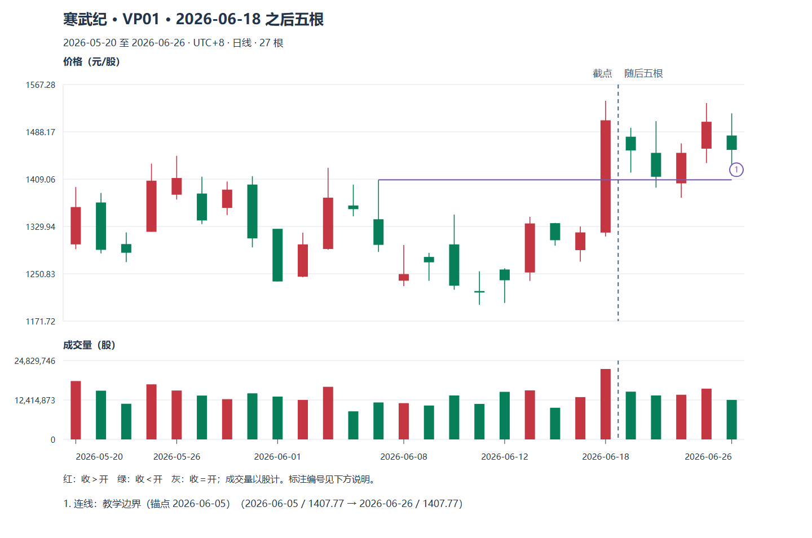

# VP01：只核对这一题

先保存本题原答，再看本页。

[标注图与逐日表](../../../assets/volume-price-2026/vp01-outcome.html)

**截点复算。** 6 月 5 日前窗高点 B=1407.77。6 月 18 日收 1507.46，量 22,169,416 股÷13,202,298.7≈1.679；两条件通过。

**回看。** 保持。五个收盘都在 B 上方，6 月 23 日是五根中收得最低的一天，收 1413.00；第五根 6 月 26 日收 1458.00。

[回到真图题页，按表进入下一题](../../exercises/volume-price-replay.md)
