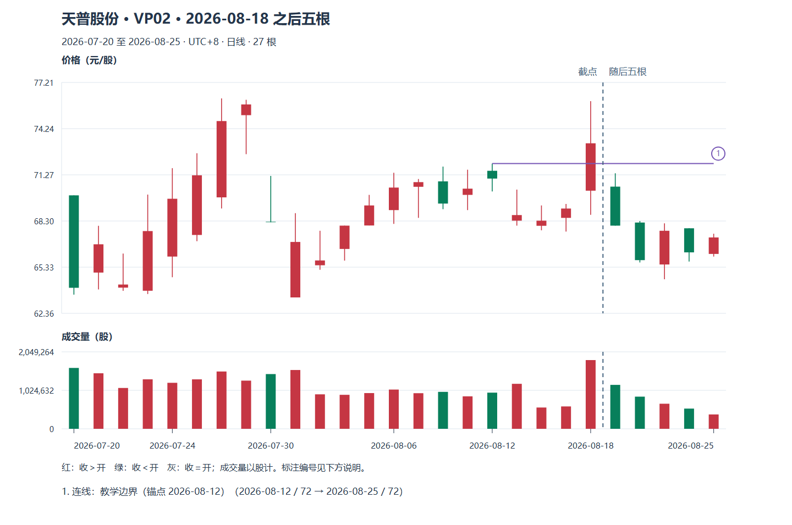

# VP02：只核对这一题

先保存本题原答，再看本页。

[标注图与逐日表](../../../assets/volume-price-2026/vp02-outcome.html)

**截点复算。** 8 月 12 日前窗高点 B=72.00。8 月 18 日收 73.30，1,829,700 股÷1,109,479.05≈1.649；两条件通过。

**回看。** 失败。8 月 19 日即收 68.00，8 月 25 日收 67.24，低于未重画的 B。

[回到真图题页，按表进入下一题](../../exercises/volume-price-replay.md)
