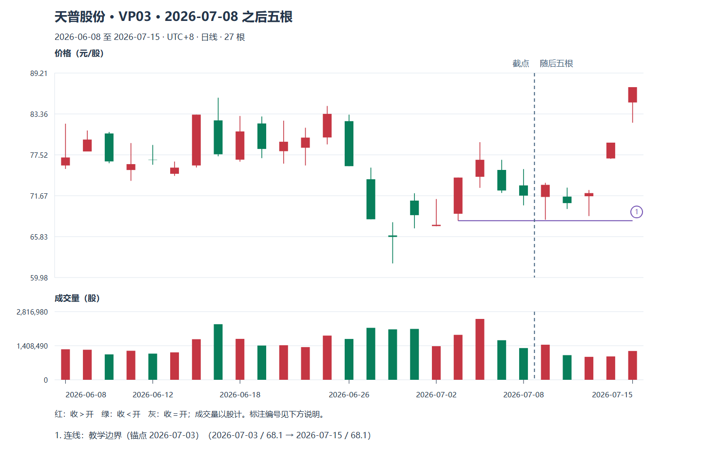

# VP03：只核对这一题

先保存本题原答，再看本页。

[标注图与逐日表](../../../assets/volume-price-2026/vp03-outcome.html)

**截点复算。** 此前背景涨 10.08%，S=68.10（7 月 3 日）。7 月 8 日收 71.69，较昨收跌 1.01%；最低 70.30 在 S 的约定范围内；1,311,100 股÷1,640,560.8≈0.799。

**回看。** 守住。截点及随后五根收盘均不低于 S，第五根 7 月 15 日收 87.19，高于截点收盘。

[回到真图题页，按表进入下一题](../../exercises/volume-price-replay.md)
