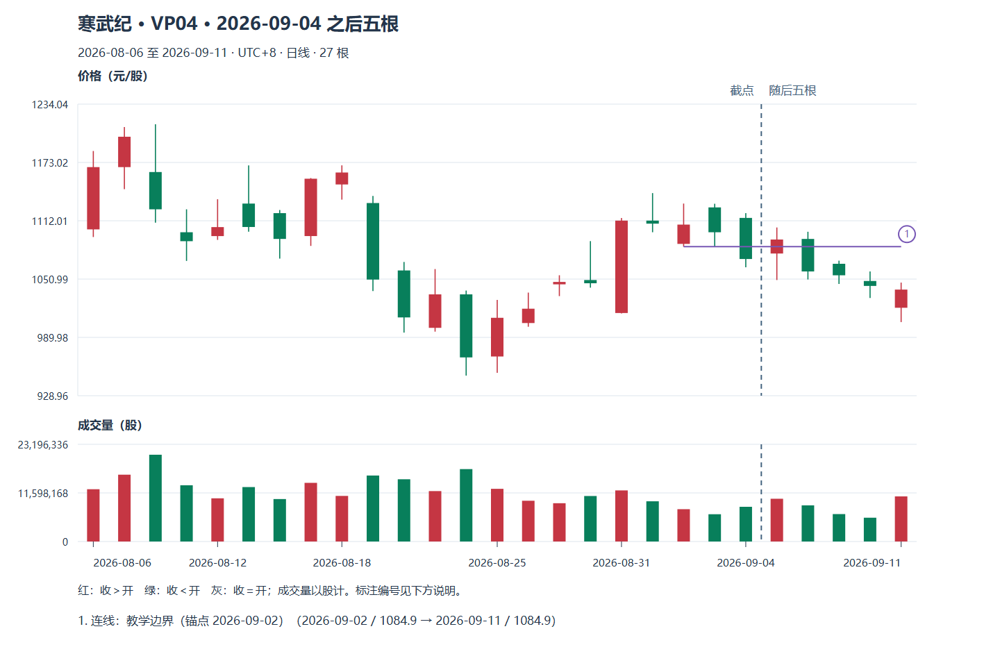

# VP04：只核对这一题

先保存本题原答，再看本页。

[标注图与逐日表](../../../assets/volume-price-2026/vp04-outcome.html)

**截点复算。** 此前背景涨 4.96%，S=1084.90（9 月 2 日）。9 月 4 日收 1072.00，较昨收跌 2.54%；最低 1063.41 在约定范围内；8,282,775 股÷12,331,052.5≈0.672。

**回看。** 截点已收在 S 以下；9 月 7 日虽收回 1092.38，9 月 8 日又跌下。第五根 9 月 11 日收 1040.00，判「失守」。记下第一次失效是 9 月 4 日，而非第五根。

[回到真图题页，按表进入下一题](../../exercises/volume-price-replay.md)
