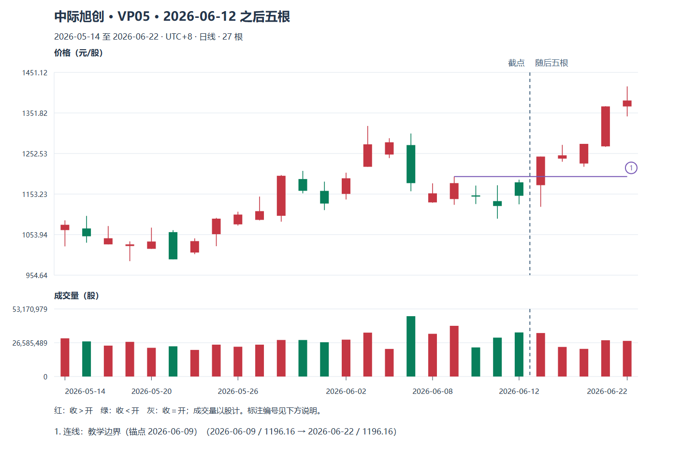

# VP05：只核对这一题

先保存本题原答，再看本页。

[标注图与逐日表](../../../assets/volume-price-2026/vp05-outcome.html)

**截点复算。** B=1196.16（6 月 9 日）。6 月 12 日收 1149.00，涨 2.22%，在 B 的约定区域内；34,685,070 股÷28,213,310.95≈1.229。有放量也没有收过这条上沿。

**回看。** 恢复推进。6 月 15 日收 1245.00，越过 B，第五根 6 月 22 日收 1382.33。截点前五个收盘间隔的累计变化约为 −12.19%。图只说明短窗恢复推进。

[回到真图题页，按表进入下一题](../../exercises/volume-price-replay.md)
