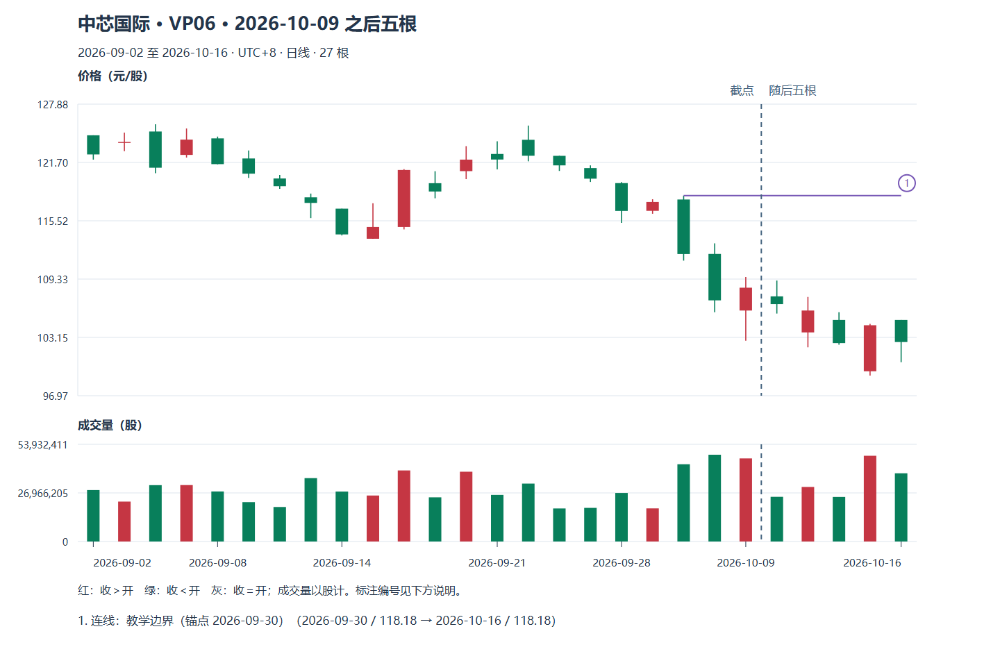

# VP06：只核对这一题

先保存本题原答，再看本页。

[标注图与逐日表](../../../assets/volume-price-2026/vp06-outcome.html)

**截点复算。** B=118.18（9 月 30 日）。10 月 9 日收 108.42，较昨收涨 1.25%，在 B 的约定区域内；46,104,484 股÷28,797,111.1≈1.601。

**回看。** 转弱。五个后续收盘最高 106.68，未过 B；第五根 10 月 16 日收 102.66，较截点低约 5.31%。

[回到真图题页，按表进入下一题](../../exercises/volume-price-replay.md)
