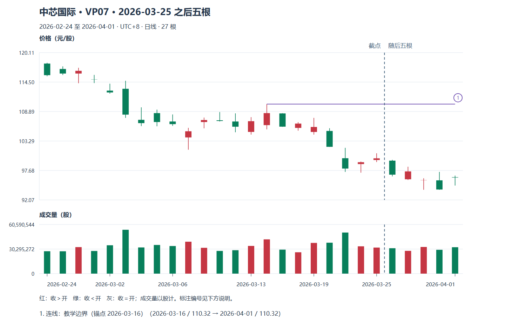

# VP07：迁移核对与判分

只在保存本题原答并完成[题面中的暴露复查](../../exercises/volume-price-replay.md#vp07)后读本页。下面含后续行情。

前 10 根为 3 月 11—24 日，其中 3 月 16 日高点 110.32 是上沿。前 20 根为 2 月 25 日至 3 月 24 日。3 月 25 日昨收 99.25，今收 99.99，涨约 0.75%，但收盘低于上沿。成交量 32,130,643 股÷34,983,800.95≈0.918，低于 1.15。两项触发条件都未满足；这个截点属于**没有触发**，不能给它记「突破失败」或委托。下一完整日若出现新的候选，要按那次截点的规则重算；不把后来第五根收 96.33 倒填为当时理由。如果询问能否成交，还缺当时可执行报价或订单回报。收盘信号不能回填为同一收盘已成交。

按五项判分，接受标明口径后的合理四舍五入：

1. 取对前 10 根和前 20 根窗口，两处都排除截点日。
2. 从前窗算出上沿 110.32 元、均量 34,983,800.95 股及相对量约 0.918；不能只报「很小」。
3. 算对当日涨幅约 0.75%，并分开判断「上涨」和「收盘未越界」。
4. 价格和量的两个触发条件都判为未通过。
5. 说明因此不下单；下一候选需要新的完整收盘及同口径成交量。若要核成交，还要实际可执行报价或订单回报。

五项齐备，且按[开题与交卷后的两次暴露检查](../../volume-price.md#vp07-score)最终记为独立，才把本次作答记为独立通过。有提示不计独立通过。

[同题标注图与逐日表](../../../assets/volume-price-2026/vp07-outcome.html)

