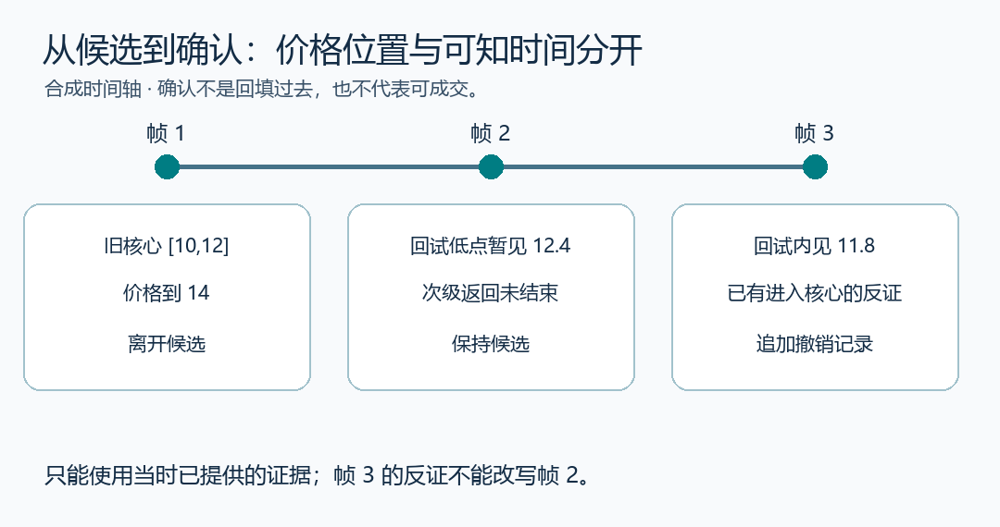

# CB04 · 历史案例与回放

## 具体走势及案例附录

来源：第三章第25节及其小附录（PDF 62–80）。书中的分段解盘、指数多尺度观察与举例要拆成「当时的判断、之后新增的证据、最终图形」。历史解读如果只有成图或叙述，最多作讲解或口径判断，不能用来给初学者作盲测，也不能补造原始行情。

每案先登记图的对象、日期、时间周期、价格基准、数据来源和可知截止；能查到原始逐根数据才重新画出该输入支持的结构。不能用后续叙述知道低点、补买卖点、或把当年的成交制度挪到今天。附件附录分别从 PDF 65、67、69、71、72、76 页起；用原位置定位，不给未对齐的例子编造统一证券或日期。

下面是逐段阅读任务。资料不足时答「只能核文本内部是否一致」，不能用配图截图声称已重建计算。

| PDF 图文段 | 任务 |
| --- | --- |
| 62–64 | 写出同一串标号的两种分解；指出两者共同支持、以及各自仍需要的证据 |
| 64–67（含65页附录） | 圈出用于力度比较的完整范围；若把前面几根柱漏掉，说明将怎样改变比较 |
| 67–69（含67页附录） | 分开小层反弹、大层判断与执行通道；给「已看见但来不及执行」留位置 |
| 69–72（含69、71页附录） | 区分已辨认的核心、继续震荡、离开后返回及升级的待核条件 |
| 72–76（含72页附录） | 用分支树重写 2007 年的观察，核同方向比较段，不把大盘点位作为今日信号 |
| 76–78（含76页附录） | 比较月线概览与小周期定位；标明每张图缩放程度能否支持该结论 |
| 78–79（例11） | 对照2007-08-15例中 27–32 与 35–38 的比较，分清当时可见力度、后见图形与结果 |
| 79–80（例12） | 找到 106–107 一笔的取整前提；输入精度若不同，要重核资格，不能沿用另一个示范的图 |

已有可用实图：[2026 缠论图谱](../chan-2026-atlas.md)有原图和分步结果，适合练原始映射、确认、候选修订及高阶资格。它并不具备每种高级结构的已确认实证。先用入口的 04 练笔的资格，再用 07 练「能看出特征序列、还不能证明完成」，最后用 08 区分三笔算术交集与中枢。已经看过讲解的一律作为辅助练习。

## 同一条行情的观察记录

先用 [M11/M12 的有限贯通例](../chan-trace.md) 把入选笔、已核准线段、中枢、块成员、封口见证、首次返回放在同一时间线上。它采用 C12-F 教学规则，缺原始 K 线证据的部分不能重新标成实证。对照以下三时点的合成序列，可练如何保留被否决判断；表中价格本身不证明任何原书级别。

| 帧 | 到当前可知的证据 | 能记什么 | 不能记什么 |
| --- | --- | --- | --- |
| 1 | 旧核心 [10,12] 已查证；价格到 14 | 离开方向候选 | 完成三买 |
| 2 | 回试暂见低点 12.4，次级返回尚未结束 | 回试不进核心的暂时观察 | 用 12.4 当最终最低点 |
| 3 | 回试内见 11.8，之后返回仍待完成 | 已有进入核心的反证；按已知信息追加撤销 | 把撤销写回帧 2，或虚构成交 |

用现有 [H01](../holdout-replay.md) 练规范记录与信息时点。H01 只有一条有限保留案例，不覆盖全部缠论定义。另用 [CB05](../exercises/chan-book.md) 测书中明确的高阶资格、转折分支和统计误用。如果未见记录不完整，仍可练习，但不计独立达标。

## 市场杂史：分析证据，不模仿行为

来源：第三章第26节（PDF 80–85）。把故事中的「图上发生了什么」「作者如何解释」「还需要哪种独立证据」分开。价格、量和假设的行为动机是不同层次。例：急跌后放量但不再创新低，可记波动和成交现象；不能单靠图确认具体主体、安排或操纵。

练习：把一段故事改成可核的三个陈述，分别标「能用行情核查」「需同期独立记录」「仅有叙述」。保留对流动性与集中度的风险观察。书中涉及操纵手法的情节只用作证据与合规边界的历史讨论，不写成可执行交易步骤。
