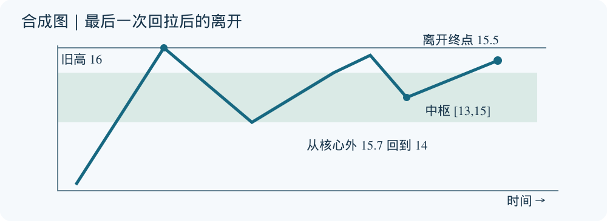

# b00 · 前言：研究对象、前提与学习顺序

来源：PDF 物理第 3 页，从「前言」到第一章第一节标题之前（包括第一章导语）。

## 「缠」与「禅」各指什么（第 3 页）

在技术语境里，「缠」指反复交易所经过的价格重叠区，作者把那里比作买卖双方争夺的阵地；「禅」是从这场重叠中寻找处理办法。原书用拔河说明：把重叠区当参照，两侧可比较的走势若后段仍强，保留原方向上的仓位；若后段变弱，才讨论反向处理。原书在前言只立纲领，没有给力度计算式、触发时刻或风险预算。在作者的现实与哲学语境里，「缠」另指贪、嗔等人的纠结，「禅」指觉察与超脱；路线由股市的解法延伸到《论语》的入世观，再到佛学的修习（原文举静坐、心经、佛号），区分领悟与逐步实践。作者用「眼中有股，心中无股」表达看得见市场而不执着于持仓的理想。

## 两个市场前提和一个几何层（第 3 页）

前言列出价格充分有效、市场交易不完全绝对趋同两个前提。前者在这里是把价格当作足以承载分析的市场观察量；后者是说参与者的交易不会在方向、时点等方面完全按同一种行为行事。这是书的立论前提，本页没有给出可检验的充要条件，也没有证明所有市场都满足。第一章导语另外指出：给定价格序列，即使只有一人在交易，也可作形态的几何分类。这是把「能构造几何形态」与「理论用于市场的解释和操作」分开。原书把笔、线段、中枢、走势类型归入形态学，把背驰及走势和中枢的能量结构归入动力学；中枢两边都用到。本汇编在前言的说明里称尚未涉及成交量分析，并以价格包容信息作可能的解释；这句话没有证明成交量无用。

## 三种比较的读法（第 3 页）

1. 围绕同级中枢，把进入与离开的可比走势放在两边看强弱。
2. 若先把全图分成同一观察级别的连续走势段，则以中间一段作参照，将新段和再前一段比较，关注新走势是否正在形成。段的顺序和层次要先定好。
3. 可在多个级别各自做同级分解，据情形选用不同的观察档位；「多重赋格」描述这些分析并行，不表示拼接不同级的片段冒充同级段。

先学分型→笔→线段→中枢→走势，再学趋势→背驰→区间套→转折及其力度。「形态学导语」按书里的用法，把单靠形态可识别的情形说成：先见最后一个中枢的回拉，再观察与回拉方向相反的第一次同级离开；若该离开未创新高（向上时）或未创新低（向下时），原书把这一段当作买卖段，用于第二买卖点的判断。原书区分只靠形态与借助背驰找第一买卖点；仅凭这段文字不能把一根反向 K 线当作完整的离开，也不能确定一笔可成交的价格。

## 例：找比较对象（第 3 页）

下面是合成数据。各直线示意段的最高、最低价由两个端点给出，无额外内部极值。已标定同级的六个节点按时间依次为 10、16、13、15、15.7、14；教材假定最后一个中枢为 [13,15]，既有高点为 16。先由 15 完整上离至 15.7，再从外部的 15.7 向下回拉至 14，回拉已完成。若下一段为 **已确认的同级** 14→15.5，并且是回拉后第一次反向离开，则 15.5 在核心上沿之外而低于 16，符合导语所说的向上离开未创新高。若盘中只见 15.5、同级段未完成，结论仍待确认；若段终点为 16.5，则「不创新高」不成立。图中纵轴是价格；该例没有定义或测量动力。

[查看矢量图](../../../assets/chan-book/full/b00.svg)

## 练习

1. 已标定同级中枢 [20,24]，此前低点 18，由核心向下离开至 19.2 后，最后的向上回拉 19.2→22 已完成。其后第一次反向同级离开为已完成的 22→19，全段最高 22、最低 19。逐项判断它是否离开中枢、是否反向、是否创新低，并说出本页能给出的判断层次。
2. 取样图上某标的先涨 6 元、回撤 3 元、再涨 4 元，三个片段的结构级别和完成证据均未提供，也没有观测力度的口径。某人断言「后段小两元，发生背驰；不看成交量就一定可找到第一卖点」。列出还要查的证据，并指出前言关于成交量的实际表述力度。
