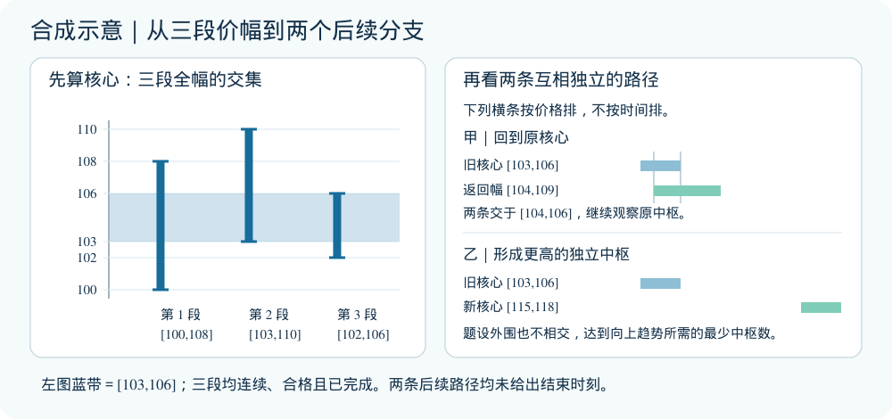

# d01｜走势必完美：完成、延伸与递归

来源：《缠中说禅-股市技术理论》PDF 物理第 13–14 页，第二章第 1 节；第 12 页末至第 13 页首是前章对盘整、趋势延伸的定义背景。

## 先确定级别，再去数中枢

中枢是三个连续、已完成的次级走势共有的价格区间。取三段低点中的最大值和高点中的最小值，两者之间是核心；若下界高于上界，这组三段不能成枢。初次成枢时若只有一点接触，本课程先记边界待核。次级指递归上紧邻的低一级，不能仅凭图表分钟数认定。某级别的完成走势，只有一个同级中枢时归作盘整；有至少两个依次同向、且按采用口径彼此独立的同级中枢时归作趋势，按迁移方向分上涨与下跌。先定图表、包含处理、笔和线段口径、起点及确认时刻，再数中枢。

章首用几何来描述市场力度，沿用[前言的两个前提](b00.md)：**价格充分有效**，即把价格当作足以承载分析的观察量；**市场交易不完全绝对趋同**，即参与者在交易方向、时点等方面不会完全采取同一种行为。两条都是书的建模前提；能用几何规则划分价格序列，并不能反过来证明实际市场满足这两个前提。

## 能完成、仍延伸与已结束

“走势终要完成”是模型原理：走势会完成，完成后按固定切分考察后续走势的类型。它不给出结束日期。一个中枢形成，只够使盘整具备结构条件；后续仍可不断回到原中枢。两个独立中枢同向，趋势具备结构条件；同向新增第三个会延伸原趋势。确认同级下跌结束以后，才把随后的盘整和上涨列为候选；在确认前，同向延伸仍是分支。反弹的幅度、确认时点和可成交价格不同，因此从结构分类推不出多头必然获利。

## 算例：先形成，再观察

三个连续、合格且已完成的直接次级走势全幅依次为 [100,108]、[103,110]、[102,106]，交集为 [103,106]。假定后续两段分别离开后返回，返回全幅 [104,109] 与核心有交集，现有证据支持原中枢继续震荡。若切换到另一条后续路径，若干连续合格次级段形成一个独立同级中枢 [115,118]，且两个中枢各自的外围波动也没有重叠，结构满足向上趋势的最少同向中枢数。无论哪一条，若资料刚好在最后标注处截断，都不能据此确认走势结束。

## 递归、完全分类与区间套

先用包含处理后相邻三根 K 线的高低关系找顶底分型，再依规则连接成笔，继而由笔确定线段，最后从规定的底层输入递归构造更高级别的走势。分型是递归的起始对象；给定定义与已完成输入，是否成分型应有可判定答案。书用自然数在固定进制下的表示和素因数分解比喻唯一性，也用宏观 GDP 的精度说明观察者可以按任务选级别。类比只能说明固定规则的重要性；第 13–14 页没有逐一证明任意底层设计都保留唯一性、现有分型设计最优，或所有分解视角共享同一刀口。第 2 节另有固定级别、固定组合规则下的唯一性主张；按不同级别重组则可以有多种合法表达。

完全分类要求先固定级别与判据，用可检查的区间和点位区分类型；把当下分成已确认、延伸中和输入未完成，可以保留未决状态。区间套的做法是在大级别已锁定的候选时间段内，找相应低级别证据，递归缩小观察范围。例：候选区间从第 10–30 根缩到第 16–22 根，再缩到第 19–20 根；第 20 根未完成，停止确认。时间窗口变窄并不提供精确成交价，也不保证总能在每层找到同向信号。

## 练习

1. 三段连续、合格且已完成的直接次级走势全幅依次是 [20,26]、[22,28]、[21,24]。求核心。第四段返回全幅 [23,27]，未见新中枢或结束证据；写出截至第四段的结构状态和不能确认的事项。
2. 已确认定义和起点相同。甲按较高级别得到 [第 40 根,第 60 根] 的候选时间窗，乙在其中筛得 [第 48 根,第 52 根]；第 52 根仍在形成。乙宣称已锁定第 52 根的最低价，且可即时买到。指出需要补什么，说明这种定位与“两个合法级别给出不同切分”是否冲突。
