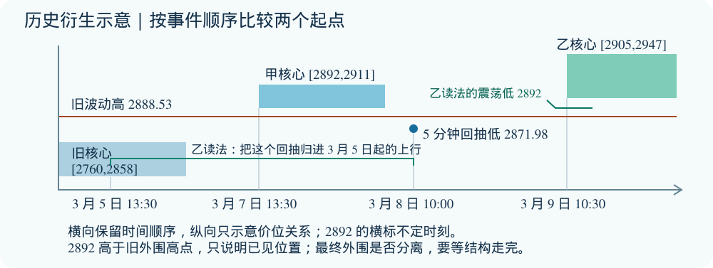

# d02｜走势分解：固定级别、嵌套与重新组合

来源：《缠中说禅-股市技术理论》PDF 物理第 14–19 页，第二章第 2 节；历史图在第 18 页。术语对读：作者[第 38 课](https://blog.sina.com.cn/s/blog_486e105c010009be.html)、[第 39 课](https://blog.sina.com.cn/s/blog_486e105c010009d5.html)及[第 43 课](https://blog.sina.com.cn/s/blog_486e105c010009mm.html)。

## 两条分解定理解决不同问题

同级别分解问：把一整条走势按固定级别读，依次有哪些已完成的上涨、下跌或盘整，尾部何处还未完成？向下递归问：一个已完成的高级类型可以怎样拆成至少三个连续且合格的直接次级类型？中枢至少需要三个连续次级类型共享价格区间，所以只有两个完成构件时，还不能确认该高一级中枢。一个 5 分钟类型可以有多个 5 分钟中枢；若其中已经出现 30 分钟中枢，这整个区间依第 43 课不能保留为一个 5 分钟类型。以下分钟标记是书中选定的级别口径，图表周期本身不决定级别。

“+”表示依时间连接，所以 (A+B)+C 与 A+(B+C) 保留同一行情，却不能换成 B+A+C。设 B 是 30 分钟中枢，含 5 分钟 B1、B2、B3，a、b 是两端的 1 分钟走势。书将 a+B1+B2+B3+b 重写为 (a+B1)+B2+(B3+b)，目的是得到同为 5 分钟的三个构件。括号是待检查的边界：两端拼入后仍须保持 5 分钟类型的构件资格与完成条件。把任意 a 添入 B1，并无代数理由保证仍是一个已完成的 5 分钟类型。

## 唯一性、最大范围与串接条件

第 14 页的递归唯一性是理论总主张；第 16–17 页和作者第 38 课的唯一性针对**固定级别、起点和分解规则**。观察目标不同可以另选组合，不能在同一规则内任意画线。同一份输入有两种读法，先选规则，再划边界。合格趋势是否还能同向纳入中枢、旧中枢是否仍可延伸、目标规则在哪个证据出现后封口，决定可归入当前类型的最大范围；“最大”取决于口径与可见前缀，不能先用未来锁定，也不能跨级吞入更大中枢。相邻块可共享边界点，不可重复使用一整段；上/下/盘整三个名称也不意味着任意两个完整类型都可自由串接。若只知道三段重叠，当前有核心，不等于已得到可递归的完整块。

| 读法 | 目标级怎样处理 | 较低级怎样处理 | 何时算完整块 |
| --- | --- | --- | --- |
| 固定目标级分块 | 不用中枢延伸和扩展；允许两个合格的盘整块相接。 | 在本例选定的分解规则下，仍核延伸、扩展；不允许把两个盘整作为「盘整＋盘整」连接。只在目标级使用本栏所说的分块例外。 | 按第 17 页的三段规则，每组成员须是已完成、合格的直接次级走势，并有共同价域。六段分成两组且都满足时，按此规则记两个相接的目标级盘整块。 |
| 按原义追踪结构 | 检查旧枢延伸；另有两个完整的同级枢时，再核是否扩展。不能把同一延伸中的盘整切成相邻两块。 | 也按各自级别的结构规则检查延伸和扩展。 | 先查波动归属及结束证据；重叠不能单独证明两个独立且完整的块。 |

例如有六个连续、合格且已完成的直接次级走势，端点为 10→15→11→16→12→17→13；各段全幅恰是相邻两端点之间。前三段核心为 [11,15]，后三段为 [13,16]，二者重叠。按第 17 页的目标级三段分块规则，两个盘整块在第四段起点（16）相接。这个边界是该分块规则定出的。按原义追踪时，后续各段仍与原核心相交，且没有给出旧枢结束的证据，不能硬切两个独立中枢。第 15 页还从 3 个成枢加 6 个延伸画出九段升级的情形；构成三个合格次级类型及其共同重叠才可升级，不能单以计数替代。书另把 a+A+b+B+c 的 a、c 追溯归为 A、B 的外围波动：省略端部、或 b 只有跳空时，图可简记为两个中枢。跳空仍须单独记录，不能当成可成交价，也不能冒充原级的已完成趋势。

## 同向隔段比较与换档

第 15–16 页把向上的 a+A 重写成 A0、A1……，A0=a 向上，奇数段向下，偶数段向上。先有 A1、A2，且这里预设 A1 不跌破 a 的低点。若 A2 越过 a 的高点，并且 A3 连回踩也不跌回这个高点，书允许把它们纳入一个较强的向上构件；若 A3 跌回，须核 A1、A2、A3 的重叠来识别高一级核心。未破、等于与已破的处理须预先声明；仅据极值不替代构件完结。

同向比较 Ai 与 Ai+2。若盘整背驰获得确认，书的模拟程式在偶数端考虑退出，在奇数端考虑回补；没有背驰时，向上分支若 Ai+3 的最低点没有跌破 Ai 的最高点，则保留其延续读法；以后首次在同一滚动比较中跌破，再检查下一同向段是不创新高还是出现顶盘背。向下分支镜像：反弹高点不越前一向下段低点则不回补；以后越过，再检查下一向下段是不创新低还是底盘背。例：给定 A0 到 A6 连续、交替、同级且已完成，已满足向上起始条件，所报高低都是全段极值。A0 高 15，A2 高 17 且力度未弱，A3 低 16，继续观察；下一轮 A4 已完成、相对 A2 没有盘整背驰，再以 A2 高 17 为参考；A5 低 16.5 已跌破，若 A6 不能高过 A4，则向上程式退出。这里是书的条件分支，盘背当下只提示回靠，实际是否相交看已完成的后续。当 Ai+3 穿回参考边界时，另取当轮的 Ai+1、Ai+2、Ai+3；只有三段连续、完结且资格一致，交集才可作为高一级核心的构造证据。只有越界，没有合格三段及交集，仍不能确认升级。作者第 38 课另举买回与否的程式，切换口径须重写比较基准。

若 A0 到 At 已能严格重组为两个 30 分钟同级类型 B1+B2，可选择用高一级节奏管理一部分模拟仓位，同时另记低级别节奏和仓位；原书以复调音乐比喻并行层次。是否换档须考虑确认延迟、流动性、交易制度和成本。第 15 页用 T+1 说明：若当天买入当天不能卖出，盘中低级别即使先后确认买点和卖点，这笔新仓也无法按两个信号完整往返。级别更小，典型买卖波幅也可能更窄，费用、下单延时和滑点就会吃掉更大一部分价差。这是书在其制度假设下的执行例。第 15 页的 6124 点回落例用来解释为什么书常取 1、5、30 分钟，大资金再加日级别；这不是普适的级别组合。低层三段可显露多次局部转折，大层仍可能未完成或须看前一同级类型。第 17 页对机械操作利润和历史高振幅的推断没有提供可验证收益记录。

## 历史图：上证两个边界读法

第 17–18 页的 30 分钟上证图把旧核心标为 [2760,2858]，旧波动高点标为 2888.53。3 月 8 日 10:00 的 5 分钟首次回抽低点 2871.98，高于核心上界 2858，按书给定的离开和回抽资格可作旧核心的三买；2871.98 仍低于外围高点 2888.53，不能据此说新旧外围已分离。原图 3 月 7 日 13:30 的箭头标 2901.94 为新中枢开始；沿此读法，正文另给新核心 [2892,2911]。该读法在当时可以保留三买的辨识。回顾延伸后，书把 3 月 8 日回抽纳入从 3 月 5 日 13:30 开始的 5 分钟向上段，改用 3 月 9 日 10:30 起算，新核心改为 [2905,2947]，附近震荡低点记为 2892，比旧外围高点 2888.53 高 3.47 点，比乙核心下沿 2905 低 13 点。这个低点只说明已见位置在旧外围高点以上，不能确认最终外围分离。此时后续首次合格返回，三买门槛也改为 2947。二者都要列在各自的观察时点；若后续回落穿旧外围，扩展仍待核。图与正文能复原这些标注，不能逐笔重算其资格。

第 18 页把正式扩展判定限定在两个同级中枢都已完整走出之后，届时再核外围波动是否重叠。第二个还在延伸、没有符合定义的终结时，可用已经走完的低级段、3 月 8 日的回抽和随后可见的延伸调整观察起点，并按所选核心重算第三类点阈值。这是对当时已有走势的重新组合，不能当作两枢已经扩展或已经独立的证明。

## 日线里面先出现的小级别三类点

第 17 页的混级重组还可写成六个构件的例子：A、C、E 为 5 分钟，B、D、F 为 30 分钟。先把高层构件拆成合格的 5 分钟块，再沿原时间顺序，按同一 30 分钟规则核 A′、B′、C′、D′、E′ 的边界，把缺少封口见证的 F′ 保留为未完成尾部。旧名与新名并非一一对应；原文没有给出可重算这六段的价格和封口输入，例子的用途是说明重组的步骤。更换观察级别时，可将同一行情依序写成 1 分钟块的连接、5 分钟块的连接，或 30 分钟／日级别块的连接；每条表达独立保留其尾部状态。

围绕日线中枢的波动可能只有 5 分钟级别，甚至只是跳空。可把前缀写成若干已完成 30 分钟段加尚未完成的尾部 a；若 a 只有 5 分钟，另一个 5 分钟反抽未返回日线核心，最多先核最后那个 30 分钟构件的三类点。日线的三类点要的是本口径下完整的 30 分钟离开和首次合格返回。若完成的 30 分钟走势后来重新回到日线核心，日线仍可能只是震荡；若形成新趋势，可跟踪第二个中枢附近有无日线确认。书用少于九个已完成次级段的计数描述一种延伸情形，升级还要另核构件和重叠。第 19 页的“随意组合”限于保时间顺序且每个结果通过结构定义的解释，不能把当下尾段改写成已完成类型。

## 练习

1. 六段是连续、合格且已完成的直接次级走势，端点为 20→26→21→28→22→30→23，各段的完整高低区间恰是两个相邻端点之间。求前后三段核心。按第 17 页的目标级三段分块规则，能怎样分块？若改按原义追踪且没有旧枢独立结束的证据，能确认什么？
2. 复核历史图的四个量：旧核心上界 2858、旧外围高点 2888.53、回抽低点 2871.98、乙读法的震荡低点 2892。算三个差值：2871.98−2858、2871.98−2888.53、2892−2888.53。另给两条独立假设，核心分别确认为 [2892,2911]、[2905,2947]，各自相对该核心的合格直接次级上离与首次直接次级返回均已完成，首次返回的全段最低都为 2920。两种切法各能否记三买？
3. A0 到 A6 是连续、交替、已完成的同级走势，已满足向上起始条件，所报高低均是全段极值。A0、A2 同向，最高分别是 100、108，测得 A2 力度并未弱于 A0。A3 最低 102；下一轮 A5 最低 106，A4 高 114、A6 高 112；A3 至 A6 均已完成，A4 相对 A2 没有盘整背驰。按向上分支更新状态，并说明为什么不能由 A3 提前断言 A6 的结果。另指出 A5 穿回当轮阈值后，要用哪三段核高一级核心；已给条件够不够算交集？
