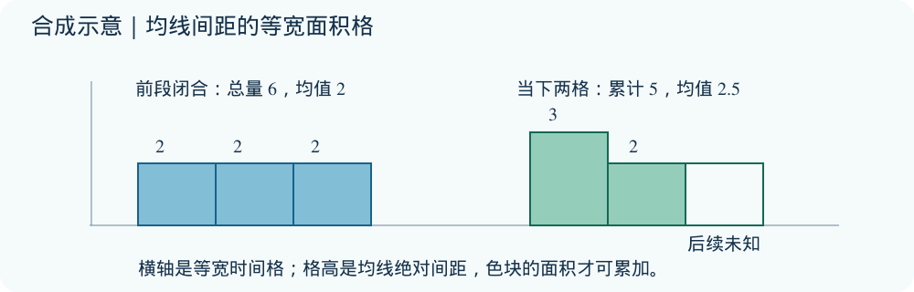

# d03｜趋势力度：已经闭合的面积与当下平均值

来源：《缠中说禅-股市技术理论》PDF 物理第 19 页，第二章第 3 节。

## 两把尺子和两个时刻

短期与长期均线分别是较短、较长窗口的价格平均线。先固定窗口、价格字段、复权口径、采样间隔与相交判定。上一次相交结束以后，短均线与长均线保持同一上下关系，直到下一次相交开始，两线夹出的面积是书定义的趋势力度。若相交形成一段重合而非一个点，从重合结束后计入本段，遇到下一段重合的开端停止。面积取间距绝对值；方向另记。等间隔离散教学中，记每格代表间距为 d、宽度为 Δt，则面积为各格 d×Δt 的和，单位为价格×时间；折线积分另需给各格端点与积分约定。

若后一交点尚未确认，用截至当下的夹面面积除以经过时间，得到趋势平均力度，单位是价格。平均值可与上一次在相同采样和比较口径下的平均值对比，不必等下一次相交；代价是它会随新数据更新。第 19 页因此提醒，即时比较比比较两个已闭合面积风险更大，也更依赖判断技巧和经验。上一段总面积与现段平均间距的单位不同，不能直接比大小。刚开始、经过时间为零时，平均值未定义。

## 算例：总量暂小，平均反而大

上一段同向区间已闭合，在三个单位时间格上的代表间距为 2、2、2，总面积 6，平均为 2。本段从前一次相交结束起算，下一次相交尚未出现。目前只有两格，间距是 3、2，累计 5，平均为 2.5。5 小于 6 只反映目前累计，2.5 大于 2 说明这段截至当下的平均更强。若下一格间距为 2，且其后交叉确认闭合，最终总量为 7，平均为 7/3。若第三格是 0.5，则最终 5.5，平均约 1.83。即时判断与最终比较可能反转。

## 怎样使用，哪些输入还不够

小级别均线可能更早反应，但分钟数更小并不保证更接近真实高低点；当下尚未确认的交叉要保留。书还列出相对大盘、涨跌时的成交量、笔或线段的斜率与长度、MACD 及 BOLL 等辅助量。它们量纲不同：同一时间窗的相对收益、同口径量能、价格除以时间的斜率不能相加充当“总力度”。斜率比较还须同一比例尺。力度也不直接划分上涨：书以首个中枢后的三买和后续非背驰向上描述形成上升趋势的过程，仍须核合格次级离开、首次回抽不入核心以及第二个独立同级中枢。只有均线发散或三买候选时，趋势未因此确认。

## 练习

1. 前一已闭合同向区间四个等宽格，每格 2 分钟，间距为 1、3、3、1 元。本段未闭合，目前两个格，间距为 2、4 元。求前段总力度和平均力度，以及本段暂累计和当下平均。若本段再增加一个同宽格、间距 3 元后确认闭合，重算本段两个值。
2. 某人看见短均线刚上穿且持续时间仍为零，宣称本段平均力度为 0，并以两根上行 K 线宣布形成同级向上趋势。已知此前仅有一个合格中枢 [30,32]，尚无已完成离开、回抽或第二中枢。写出应保留和应补核的结论。
