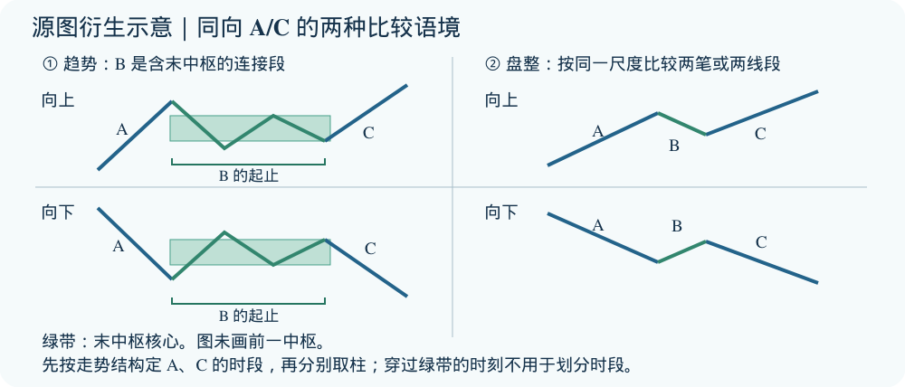
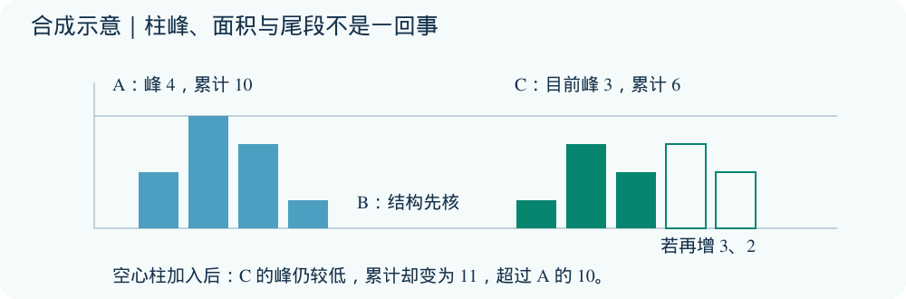
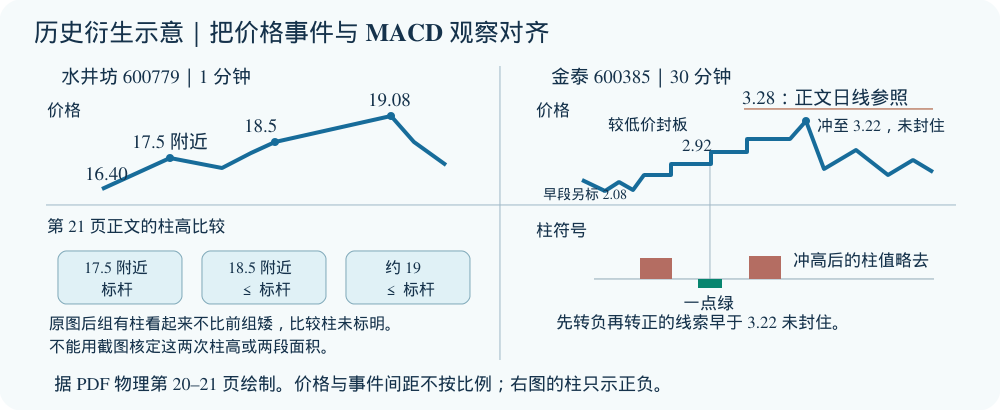

# d04｜背驰和盘整背驰：谁跟谁比，减弱以后看什么

来源：《缠中说禅-股市技术理论》PDF 物理第 19–22 页，第二章第 4 节；对读作者[第 24 课](https://blog.sina.com.cn/s/blog_486e105c0100087y.html)、[第 27 课](https://blog.sina.com.cn/s/blog_486e105c010008h4.html)和[第 43 课](https://blog.sina.com.cn/s/blog_486e105c010009mm.html)。

## 先分走势语境，再比同向段

趋势背驰是合格趋势后段的力度衰竭：先确认同级至少两个独立、依次同向的中枢，再选最后中枢两边结构对应的同向段比较。向上看离开时是否把高点推高却力度变弱，向下看是否创新低却力度变弱；不创新极值可作为另一类失败离开的线索，不混作本课严格候选。盘整背驰是在盘整或中枢震荡中，按同一尺度比较两段同向波动：用笔就前后都取同级笔，用线段就都取同级线段，方向、结构位置和力度口径要可比。第 19 页称造成上述任一种已确认背驰的末段走势为该级别的**背驰段**：趋势图里的 C 可以是趋势背驰段，盘整图里的 C 可以是盘整背驰段；只见可能减弱时，应加注「候选」。

第 19 页原图 ① 左右分别画向上和向下，以相连的 A、B、C 折线示意相对位置。下面的教材重绘另加了括号，用来指认连接段 B 的首尾。原图没有这些括号，也未给逐柱起止时点；计算时仍要由实际结构确定范围。绿带是 B 内最后一个中枢的核心价格区间。B 可走出绿带，不能把整个 B 当作核心。比较 B 前后同向的 A 与 C；图未画出前一个中枢。图 ② 把围绕一处震荡、隔着反向 B 的同向 A 与 C 简化成折线，按同一尺度比较力度。第一中枢后的减弱，在所定级别不能称趋势背驰；第二个中枢之后也不必立即出现背驰，趋势可能继续延伸。书给出的比例没有样本与验证方法。

书另用 a+A+b+B+c 解释末中枢的回拉。这个记法里的 B 指中枢。按时间 b 与 c 可能同向，若把进入 B 的 b 反向看作从 B 向另一侧离开的区间，得到两侧回拉的几何比喻。这一重述不改变 MACD 对同向 A/C 的要求。若 B 级别大于 A，先前的 a+A+b 与 B 后的 c 还可能实际**反向**；此时比较的是反转尝试和此前趋势，不应称同向趋势背驰。书讨论此时黄白线分处零轴两侧、至少穿越一次的读法；实际先查 B、两段区间和有效返回，再看指标。中枢并无可直接测得、必然等值的物理拉力。

## MACD 的三种尺度

MACD 使用快慢指数均线之差 DIFF、其平滑线 DEA 及两者之差所导出的柱；常见参数 12、26、9，软件可能有柱值倍数与颜色差别。A、C 先过结构审查：两段是同向趋势，中间的 B 是连接它们的盘整或逆向趋势。A 前先有与 B 内中枢同级或更高级的背景中枢；若 A 前实际上是一段和 A 逆向的趋势，原书认为整个组合可能落在更大的盘整中，须重查背景，不能照用这套趋势背驰模板。B 内的中枢级别高于 A、C 内部中枢，B 常把 DIFF、DEA 拉回零轴附近。先按走势结构定出 A、B、C 的起止，再分别用 A 的时段和 C 的时段取柱。B 的柱不计入两段，交界柱按同一取样规则只归一次。折线穿过绿带的时刻不是截取 MACD 的边界。核回拉位置时另用末中枢的核心价和外围价。计算面积时，把各段同向柱的绝对值逐根乘等宽时间再相加；上涨取正柱，下跌取负柱。柱**最高值**是单次最大值，柱**面积**是整段累计，DIFF/DEA 是否创新高或低是另一个维度。回零是线索，零轴附近也可能是更高级的中枢，不能反过来单靠指标定义中枢或级别。书的标准两中枢上涨依次是：黄白线上穿、第一中枢附近出现二买候选；下一同向离开可能很强且持续；第二中枢使黄白线回零；最后同向离开再比较面积、峰值和结构终结。下跌镜像。把盘整、短时涨停或大级别背景混作同一量纲会错判。

算例：已有两个独立上移中枢，A 与 C 是合格同向段，C 创价格新高，B 把两线带回零轴附近。前后每根柱的宽度均取 1 个时间格，面积单位是柱值乘时间格。A 的四根正柱为 2、4、3、1，面积 10，最高 4；C 目前三根是 1、3、2，面积暂为 6，最高暂为 3。若此刻 C 未完，只是减弱候选。若又加两根 3、2 才结束，C 总面积为 11；虽每根仍低于 4，“面积减弱”失败。若 C 在前三根后就确认结束，面积比较才以 6<10 成立。两种结果都须与结构、等级和后续返回分开记录。

## 回拉的不同分支与第一类点

第 19 页将两类背驰都概述为回拉中枢；第 21 页又承认盘整背驰后可能出现三买，两处不能同时理解成“盘整背驰都已经实际进入核心”。按作者第 24、27、43 课的结构语境读：第 21 页先把标准趋势背驰的回拉表述为至少回到 B 的中枢；第 27 页再细分，最弱的回拉可能只触末中枢外围 DD（上涨镜像看 GG），未进入核心。用价格分别核对外围和核心，再观察结构怎样重组；对盘整背驰，若 C 没有有效脱离，继续观察核心内震荡；若 C 突出核心，首次合格返回入核心则延伸或扩展待核，若不返回则另核三类点，不能仅因盘背排除该分支。弱小回拉也可能在更低级别形成反向点后恢复原方向，不能推出永久反转。大级别中段的小背驰往往只是局部候选，接近大结构末端则需要核对能否引发大转折；级别不能由跌幅直接认定。

按本课严格界外口径，已完成合格的直接次级上离后，核对紧随这次离开的首次直接次级回抽。回抽身份未知，先查；已知不是首次或级别不符，这段不能用来确认三买，其他返回另核。身份已核时，完整回抽的最低点严格高于核心上界 ZG 才可记三买；未完且暂在 ZG 上方，等完段。只要该回抽已经触到 ZG 或更低，即使未完，也排除本次严格三买，完段和后续结构另查（PDF 第 10 页中枢定理三；第 21 页盘整背驰后可出现三买）。

第 19–20 页的「背驰—买卖点定理」含两条模型内命题：**任一符合定义的背驰，都会产生某个级别的买卖点；任一级别的合格买卖点，也都源自某个级别走势的背驰。** 两条都用「某个级别」，没有要求背驰级别等于买卖点的标注级别。严格一买以该结构的趋势底背驰为架构；较大级别的二、三类点也可以在其回试内部，用较小级别的一类点定位。反过来，1 分钟背驰不保证产生周线点，更不保证当时已确认大级别转折。对于周线及以上只有一个大中枢的背景，本书另给“类一买”用法：新低后的合格盘整背驰值得跟踪；不创新低、后次同向柱面积小且黄白线回零附近，是“类二买”线索。两者不自动升格成严格一、二买或历史底部。这里的双向命题是原书的结构主张；MACD 减弱候选不能当作已证的背驰或成交保证。第 22 页所称准确率 90% 或 100% 未附可复算证据。

## 两张历史图，各自只回答一种问题

第 20 页的水井坊 600779 一分钟图标出 2007 年 1 月 19 日 13:45 附近 16.40、1 月 22 日 10:03 附近 19.08；19.08 在峰处，明显回落在峰后。第 21 页正文把主升概括为从约 16.5 到 19，用 17.5 附近柱高作参照，称在 18.5、约 19 两个价位观察到的柱伸长均未超过该柱高，同时称后段面积大于前段。图中的两个「≤ 标杆」记录的是正文的说法：原图没标出比较的是哪几根柱，不能把「约 19」钉在 19.08 峰对应的那一根柱上。原图后组有柱看起来不比前组矮；缺少比较柱与窗口，不能凭截图证实或推翻正文的两次比较，也不能复算面积。这里讲的是一分钟急升时的乖离预警；不能用单柱高替代标准 A/C 的整段面积比较。

第 21 页 600385（图题 *ST 金泰）30 分钟图标有 2.08、3.22。2.08 是早段旁的单独标注，不能当成一段横盘或封板价。价图箭头旁标 2007-01-16 10:00，指标另有 MACD“一点绿”。正文说 2.92 时有一点绿，之后继续涨停、柱转红。价图先见低于 3.22 的封板横段，再见单次冲至 3.22，未封住便回落震荡。3.28 是正文所说的日线前期高位，单凭这张 30 分钟图不能核实。连续一字涨停会让短周期 MACD 波动失真，先核中枢是否仍上移，再在长一点周期看回零及更大背景；第一段上涨打开后，仍可能形成中枢再涨。预警不等于封单可成交，柱子变绿也不自动等于转折。

## 练习

1. 已有两个独立下移的同级中枢，A 与 C 合格同向且 C 创新低。各柱宽均为 1 个时间格。A 的负柱绝对值为 4、3、3；C 的三根已观察值为 1、4、2。C 现在未确认结束。算两段现有的柱面积和柱峰，再分别判断 C 当下结束与又新增一根绝对值为 4 才结束时的面积比较。
2. 本级只有一个合格核心 [40,45]。相对这个核心，直接次级的向上离开已经完成，创出新高，但比前一可比同向段力度弱。从这次上离分别假设甲、乙两条独立路径。每条都有一段已完成的合格首次直接次级回抽，甲的全段最低为 46，乙为 44。按本课严格界外口径，分别判断三买和本级趋势背驰。若身份已核的回抽最低到 45，或所给回抽身份未知、已知失格，又该怎样判？
3. 连续一字涨停中，短周期柱呈近似周期波形；较长周期某次柱从正转负又转正，给出的价格序列未列次级构件、对应时段或成交记录。能否凭这些证据宣布大级别趋势背驰和可成交卖点？列最先补的资料。
4. 甲已按定义确认 1 分钟顶背驰，未给周线构件；乙已按定义确认 30 分钟三买，该次返回内部可用已确认的 1 分钟一买定位。按书的双向命题，甲能推出哪一方向的买卖点？能否据此确定卖点级别、周线结构和卖点确认时刻？乙是否一定还要找一个 30 分钟背驰？
