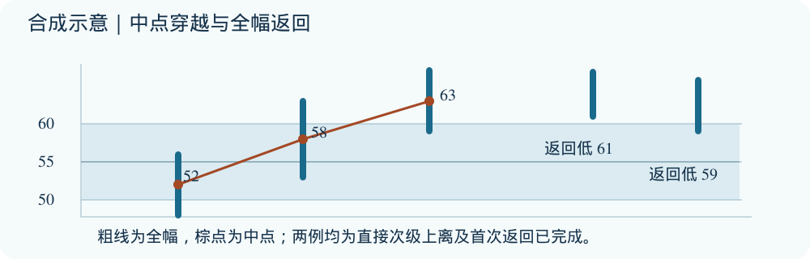

# d05｜中枢震荡：用中轴监视，用返回确认

来源：《缠中说禅-股市技术理论》PDF 物理第 22–23 页，第二章第 5 节。第 23 页的 5333—5395 点上证案例是文字叙述，这两页没有对应历史图。

## 核心、外侧与每段中点

选好一个级别与已确立的中枢。核心下界记 ZD，上界记 ZG；中轴 Z=(ZD+ZG)/2。把监视中点和延伸检验分开记：

| 要做什么 | 哪些段可记入 |
| --- | --- |
| 监视偏强或偏弱 | 按时间记录围绕这个中枢、已核实且已完成的直接次级震荡段，上下两向都可记。每段用全幅 [dn,gn] 算 Zn=(dn+gn)/2；未完只另记暂值，不截取内部小波动充数。 |
| 检验旧枢是否延伸 | 按 M08 先核同一旧枢的构件归属，再按形成方向选出完整的直接次级 Zₙ：回调型取向下段，回升型取向上段。检验下一条合格同向段时，不因它在核心外就先删掉。Zn 是价格中点，Zₙ 是一整段走势。 |

按第 10 页中枢中心定理一，延伸检验用 Zₙ 的全幅与固定的旧闭核心求交，即 dn≤ZG 且 gn≥ZD。等号也计入：[60,66] 与已确立的 [50,60] 只在 60 相接，满足这一段的区间条件。它与「首次用三段成枢时只交于一点是否采用」是两个判定；在已完成向上离开后，返回最低恰等于 ZG 也不满足本课三买的严格不触及条件，向下镜像。中轴与上下界等距；把 Zn 连起来只表示各段价格区间中心的迁移，不是收盘均线，也不因新波动进入就重算初始核心。核心上下界与外围极值是不同阈值。

Zn=Z 是居中；Zn>Z 是相对偏强，Zn<Z 则偏弱。Zn 有时可越出 ZD 或 ZG，但全幅仍可与核心相交。全幅是最低到最高的区间，区间相交不能填补跳空。例如只观察到 35 跳至 43，全幅 [35,43] 与核心 [36,42] 相交，但这两个观测价都不在核心内。已观测的极值或其他路径记录才能说明是否触边或进入核心内部；能否取得可交易报价须另查。全幅也不能确定方向、起终点或结构资格。低位中点、流动性或成交速度不佳时，震荡差价更难执行；缓慢抬升却始终没有合格上破，也可能形成上升楔形式的失败，缓慢下移的镜像同理。第 22 页给出监视口径：**Zn 的记录不超过 9 个，恰好 9 个仍在范围内。** 再多时，原书建议检查次级是否升级；升级要另核连续构件、完成资格和重叠，不能由计数直接确认。原书还有一般预警：如果当前次级走势已呈趋势、各区间中点的变化与这个趋势方向相应，应关注变盘；这不给结束时点。末个较小中枢已移到大核心外、下一次级走势又在这个小中枢区间内完成，原书把这一组合视为更重要的变盘线索。BOLL 收口可辅察时间；边界判断仍依结构。

原书的模型内结束条件是：中枢震荡最终由适用级别的第三类买点或卖点结束；若期间升级，就按最后实际震荡的级别检查。书因此把中点最终越过边界当作监视线索，反过来不成立：Zn 可以多次越界，不能由某次越界定三类点、结束时刻或方向。一条合格的 Zₙ 全幅落在核心外，已不符合「每条 Zₙ 都相交」的延伸判据，但终结点还须靠完整离开与首次合格返回确认；返回未完成且未见否决证据时，才保留候选。若已核实返回身份，只要已知回抽最低 ≤ZG 或反抽最高 ≥ZD，就排除相应的严格三类点，不必等完段。即使跳过核心而未见带内价格，越过阈值的已知极值也足以否决。

## 算例：中点越界，回抽却仍入核心

核心 [50,60]，中轴 55。三个已经完成的次级震荡全幅依次为 [48,56]、[53,63]、[59,67]，中点依次是 52、58、63。三段分别交于 [50,56]、[53,60]、[59,60]，最后一个中点高过 60，但这一段的全幅仍与原核心重叠。另设一次已完成的直接次级返回全幅为 [59,67]，低点 59 已见；假定它是回调型旧枢待核的向下 Zₙ。返回内部还有一个更低层的小波动 [63,66]，虽全在核心外，却不单独进入两栏。延伸检验用整段返回，交集仍是 [59,60]；只凭内部小波动不能否决旧枢延伸。若书中所说中点延续相对平滑这一假设成立，已知某段低点 58、暂估中点 61，则高点情景值为 2×61−58=64；这是带输入假设的估计，不是当下的区间上界。

此后相对核心有一次合格直接次级上离已完成。以下两条路径的首次直接次级返回分别已完成，都对应这次离开。如果最低是 61，按严格不触及口径可记三买；如果最低是 59，仍进入核心，不能记三买，重查延伸或级别扩展。回抽尚未完成，只见最低 61 时，等全段结束；若已知同一回抽已经到 60 或 59，全段最低不会再抬回 60 之上，立即排除这次严格三买。此时返回完成时点和后续结构仍待核。是否首次、是否为直接次级若尚未知，先待核其资格；已知并非同次离开后的首次返回或级别不符，排除用这次返回确认三买。向下离开后，用返回最高点与 ZD 同样核三卖。核心外的弱离开可提出盘整背驰的短差退出设想；这与以后是否另出三买是两个时间点。原书说未成三类点时常见扩展、震荡常对称，但没有给出可复算概率，不能把两次中点轨迹对称当作确认。分笔力度亦可辅看更小周期的 MACD 柱长，先声明它不是面积法。

## 历史文字例：5395 的短线判断与周线条件

书描述上证离开 5333 附近中枢到 5395，该次线段出现类背驰并有终结证据，据此讨论短线震荡卖点。5412 是正文的周级别观察位，与 5395 相差 17 点；是否突破与周顶分型是否满足须另查，不由短线退出决定。书随后列条件情景：若周顶分型成立但未成笔，观察是否形成底分型并触及五周均线；若发展成向下笔，就以约 3600 起涨至 5412 的总幅 1812 点为参照，四分之一为 453 点，约为正文的 450 点，三分之一与二分之一则更大。这些是原书预设情景，顶分型与成笔定义本身不产生回撤比例，也不保证一定碰均线。若周顶不成立，短线仍可再核后续震荡低点或三买；无逐根、精确中枢上下界和后续日历输入，不能说这些分支哪一个实现了。

## 练习

1. 核心 [36,42]；三个已完成的次级震荡全幅是 [34,40]、[39,45]、[41,49]。求 Z、三个 Zn 和各段与核心交集，判断最后一个中点越界是否足以叫三买，并说明这三个全幅还能确定什么、下一步查什么。
2. 对同一个 [36,42]，每条路径均已完成合格的直接次级下离，所给反抽都是同次下离后的首次直接次级返回。甲、乙、丁均已完段，全段最高分别为 35.5、37、36；丙、戊均未完成，暂见最高分别为 35.5、36。分别写三卖判断；说明丁的返回段是否与旧核心相交，能否据这一段断定整个过程一直延伸。
3. 已知上一段区间中点 70，观察者假设下一段中点 71；当下看到低点 67，次级段未完。算估计高点，并说明为何不能据此称确定高点。
