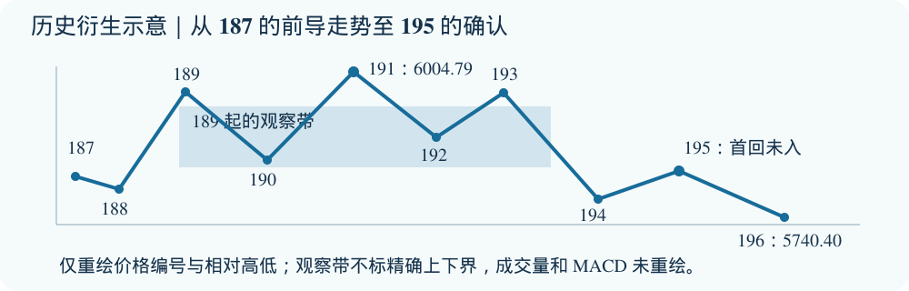

# d06｜中阴阶段：上一段已结束，下一段尚未定型

来源：《缠中说禅-股市技术理论》PDF 物理第 23–26 页，第二章第 6 节。上证编号图另可对读作者[第 88 课](https://blog.sina.com.cn/s/blog_486e105c01000edy.html)。

## 同时保留两套观察边界

先指定操作级别，给出前一走势的完成证据，例如一次合格背驰及其后结构。前一段结束而下一段的走势类型还不能确认时，书称为中阴阶段。按第 23–24 页的模型表述，单独截取这一阶段，总表现为某一级别的盘整，即围绕前段某个中枢震荡；这是作者对切片的理论刻画，未给样本频率，也不表示继起走势必为盘整。放回完整走势看，新方向仍可能续原向、转成反向，或发展为更大盘整。先登记旧段最后核心、外围极值及可知时刻，再从候选端点记录新段。旧中枢是当下的观察基准；新段具备足够结构后，低层分析可以换基准，旧走势继续参加更高级的拼接。一次窄幅来回如果没有“旧段完成、新类待定”这个关系，只是普通震荡。作者进一步认为，转折处最初的局部 V 形（顶转折为倒 V）的级别决定中阴阶段的级别与力度。这一层级关系不能换算为固定点数、持续时间或继起方向。

## 历史图：从 189 借基准，到 195 换重心

第 24 页图的价格面板是上证 1 分钟图，另附成交量和 MACD。价格面板可辨 187 是前导局部高点，随后下探 188，再上行至 189；187、188 没有单独标出可核的精确报价。按第 23–24 页读图：189 起的一段作为旧中枢观察背景；190→191 和 191→192 在较小级别形成倒 V；191 标 6004.79，原书视其为前一走势的背驰终点。192 处仍缺新段形态，193 可从 191 后续角度读作二卖，同时从旧核心角度仍是围绕 189 起的区间震荡。194 为其后低点，195 的反抽由原书标成相对旧中枢的三卖。到 195 的资格证据齐备后，书才把线段级分析重心转到从 191 起的至少类下跌形态；并未宣布更高级走势已完成。原图标 196 的低点价为 5740.40；它在 195 之后，只供回看，不能用于 193 或 195 当时的判断，也不提供旧核心的边界。

重绘只保留价格面板的编号顺序和相对高低，不含原图的成交量或 MACD 面板。原图能读 6004.79、标号和相对位置；没有逐根资料，不能重建逐分钟价格、逐根成交量和 MACD、各线段边界、旧中枢的精确上下界、MACD 面积或最早可知时刻。单层编号可压缩，例如线段记 Xn，1、5、30 分钟各记 Yn、Wn、Sn，日、周、月、季、年记 Rn、Zn、Mn、Jn、Nn。191 可在 X 与 Y 两层有编号，189 在作者举例中只记 X；同点跨级标注显示其参加不同级别的构造，不能靠标号数预测百年顶底。书另举 6124 前后若干日的局部 V 形作尺度类比，未附本节可复核的日线逐值。

## 下跌以后怎样长成高一层

第 25 页另从 6004 开始的 1 分钟**下跌随后发生背驰**说起；别把这次下跌末端和图中 191 的上涨终点当作同一个事件。若按递归构造超 1 分钟走势，先核 5 分钟中枢的三个合格直接次级构件。构成以后，原地延伸则继续跟踪；向外完整离开及首次回抽不回，按这个 5 分钟核心核三类点；若升级成 30 分钟中心，改看那一层的第三类买卖点。最终类型看是只有一个核心，还是另有独立同向迁移。盘整之名反映一个中枢，幅度可能很大。不能把书所说“每个完成类型随后必面临更大中枢”理解成下一根出现，也不能把稍后同级别重组写成矛盾。第 27 页及作者第 43 课明确允许同级别反趋势；应区分局部过渡及其后来并入的更高结构，和当前可确认的新类型。

第 26 页还给位置参照：作者说，后续更高级震荡至少涉及前一走势最后的中枢范围；如果深入更早中枢，反向力量的线索较强。原文用的是「范围」，不单指核心或外围；单个触点也不能确认升级。该页的例子设 a+b+c+d+e 是类上涨，c+d+e 构成末个小中枢，f 是背驰回落。若 d+e+f 已够构成新高一级中枢，可写成 a+b+c+(d+e+f)，旧上涨末两段被纳入新结构；若随后另有 f+g+h 自足成枢，可保留 a+b+c+d+e，再接 (f+g+h)。若 d 起又延伸到九个小构件，先核能否组成三个连续、合格且共叠的高一层类型，再谈 5 分钟中枢。分配同一条腿到两个备选解释可以对照，采用一条解释时不能把同一条腿重复计数。两个年级别中心之间的连接甚至可以是线段或缺口；连接部位不必本身是完整趋势。

## BOLL 提醒检查时间，方向由结构给出

布林通道通常以滚动均线为中轨，上下轨取中轨加减若干倍滚动标准差。先固定观察周期、窗口、参数、价格字段与“有效回到轨外”的规则。价格由外侧回到通道，下一次试探再创新高或低却不能回到外侧，原书把它视为一类点的辅助线索。第一次回跌或回升后再试时，滞后的上轨可能下转并压住反抽，或下轨上转并托住回落，可结合次级结构观察二类点。轨外标签、触线或转向都不能单独定一、二类点。5 分钟中阴可以观测 30 分钟 BOLL；若带宽上轨减下轨连续缩小，书用来提示低一层中阴接近结束或扩展。方向和结束须等合格离开、首次返回等结构事实。此节没有给出收口阈值、结束时刻或近 100% 准确率的可复算数据。

合成例：前一 5 分钟上涨最后的核心 [96,102]，外围 [94,104]，更前一个核心 [85,90]。旧走势获准结束后，当下震荡仍与 [96,102] 重叠；同一 30 分钟 BOLL 的三个已收盘快照，轨道由 [90,110] 缩到 [94,106]、[96,104]，带宽 20→12→8，只记收口。两条路径都已完成相对该核心的合格直接次级下离及随后的首次直接次级回抽。甲的回抽全段最高 95，低于 ZD=96，可按严格条件记三卖；若随后回到早期核心 [85,90]，下行深入对原多头更不利。乙的回抽全段最高 99，在旧核心内。这一价格既否决本次严格三卖，也提供这次返回与核心相交的证据；仍可用旧核心作观察基准。是否延伸、再离开或扩展，要按 M08 分别核对构件和后续。若把回抽改成未完成，先按 M08 核身份：身份不明先查，已知不符就不用该段。身份已核且暂见最高 95，只记候选；若已见 96 或更高，立即排除本次严格三卖。若前一段原是下跌，深入更早上方中枢对多头的意义相反。以上均用实际位置判断相对强弱，不以“健康”代替阈值。

## 练习

1. 已有核心 [80,84]。三个连续 30 分钟收盘快照的 BOLL 区间 [下轨,上轨] 分别是 [75,91]、[78,88]、[80,86]。相对该核心的直接次级上离已完成。三条路径的后段均是同次上离后的首次直接次级返回：甲乙均已完成，全段最低分别为 85、83；丙暂见最低 85，尚未完成。计算带宽，判三条路径及收口是否给出方向。
2. 历史例只给 189、191（6004.79）、192、193；193 后缺数据。按书的读法列可用的旧基准、193 的局部点和当时不能确认的内容。后来补给课堂条件：相对 189 起的旧核心，合格直接次级下离与其后的首次直接次级回抽都已完成。甲中，195 回抽的全段最高严格低于旧核心下沿；乙中则恰好等于下沿。分别判断能否用严格三卖作为换观察重心的依据，并说明何处仍须保留旧走势。
3. 已知 a+b+c+d+e 是候选旧上涨；方案甲只有 d+e+f 具备新高一级中枢的构件资格，方案乙在旧上涨之后的 f+g+h 单独具备资格。分别写一条不重复占用构件的表达式；何时可以登记为已完成新类型？
