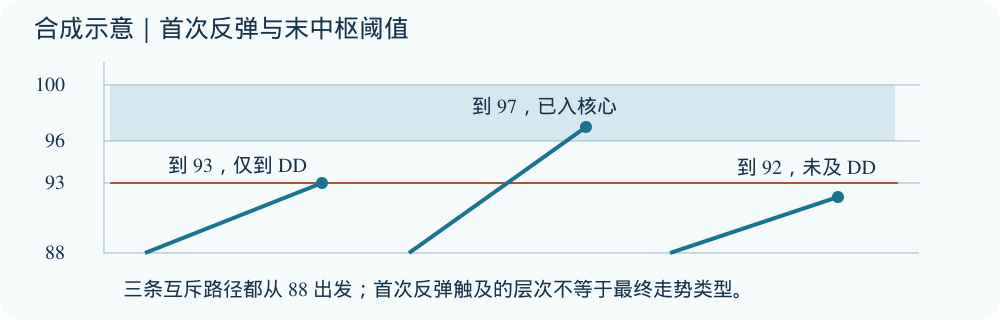

# d07｜转折的力度与级别：充分条件与必要条件

来源：《缠中说禅-股市技术理论》PDF 物理第 26 页末至第 30 页，第二章第 7 节。对读作者[第 29 课](https://blog.sina.com.cn/s/blog_486e105c010008la.html)、[第 43 课](https://blog.sina.com.cn/s/blog_486e105c010009mm.html)与[第 44 课](https://blog.sina.com.cn/s/blog_486e105c010009oo.html)。本节历史例见第 28 页文字，PDF 未附该例历史图。

## 先分趋势转折和中枢内摆动

某级别上涨的转折可用某级别第一类卖点定位；下跌用第一类买点。这个“某”未必是直接次级，可能在更小级别找到，或多级重合。围绕一个大中枢的小涨小跌不是该大级别的趋势转折；先证明是哪个尺度的趋势，再比合格的同向段有没有背驰。均线刚缠绕后沿原方向短延伸再回头，或先横向消耗时间后换向，是书举的两种过程；当下平均夹面和间距开始缩短只能辅助。正在形成的背驰段是否成立可因低一级延伸而改变。

本节的分解前提：**单个走势类型不能包含比自身级别更大的中枢。** 若观察区间里已经有更大中枢，就重查它是否属于更高级类型的一部分，或能否切分为若干原级类型的连接。不能保留原来的单一类型标签，同时把更大中枢装进其中。

## 同级背驰后的三条路径

设原趋势为 5 分钟下跌，至少两个独立下移的 5 分钟中枢，最后一个记 B。其核心用 [ZD,ZG]，围绕 B 的波动低点中的最小值用 DD，高点中的最大值用 GG。第 27 页和作者第 29 课的论证先限定跌离 B 的末段最多是直接次级，即 1 分钟或更小：若跌离段本身已在 B 下方形成另一个 5 分钟或更高级的中枢，B 就不再是该 5 分钟下跌的最后一个中枢，或原段不再能作为单一 5 分钟类型。然后书以反证讨论回拉：若整体反弹连外围 DD 都不触及，作者认为 B 下方将另成一个 5 分钟中枢，与「B 是最后一个」矛盾。由此在该模型下，最弱的回拉只须触及 DD，未必进入 [ZD,ZG]。第一次次级反弹不到 DD 只说明当次未到；没有后续构件不能宣布 B 下方已经另成中枢。上涨顶背驰用外围 GG 镜像。不能把这个论证换算成已确认的成交或收益。

| 路径 | 按什么证据区分 |
| --- | --- |
| 末中枢扩展 | 原 B 与后续构件演化成更大中枢，原切分仍可重组。常先看到只够触到外围的弱反弹，待后续结构核实。 |
| 更大级别盘整 | 确认原下跌类型完整结束，另有一个更大级别的独立盘整类型；5 分钟下跌后的这种分支至少按书中 30 分钟一层查。 |
| 同级或更大反趋势 | 反向出现合格的同向独立中枢序列，允许同为 5 分钟的上涨，也可能升级。原来是上涨时，第三支是下跌。 |

第 27 页和作者第 29、43 课的细分把盘整分支写作**大于原趋势级别**，把反趋势写作**原级别或更高**。第 29 页与作者第 43 课随后用“至少该级别的盘整或反向类型”总说层级，并举一段同级盘整后可复涨作简说；这不覆盖上表对**独立完成**盘整的严格条件。同级别切分允许某些盘整块串接，与这里按中枢演化划分不是同一读法。无有效分界时也不能把一段持续上涨写成两个独立相邻上涨来“证明”一次转折。

PDF 第 28 页演示 a+A+b+B+c 按一组特定取法共有 9 段：两个 5 分钟核心各含三个 1 分钟构件，a、b、c 各计一个。30 分钟盘整的最小构成也可在相应最简取法下数得 3×3=9；仅凭段数相等推不出升级，仍须核各中枢、重叠和旧趋势边界。若 B+c 已变成更大中枢，可把 a+A+b 暂记为低级连接，把 B+c 记为新高级核心；后面甚至还能形成高级下跌。若原下跌和新盘整都独立完成，才记两个类型相接。

## 算例：先判到达哪个阈值

已确认 5 分钟下跌的最后 B 核心 [96,100]，外围 [93,103]，底背驰低点 88。从 88 起的三条互斥路径均为首次已完成的直接次级反弹。第一条高到 93，只触及 DD，离核心下界还差 3；末中枢扩展是待验证分支。另一条反弹高到 97，已达到核心区间的下端一侧，不宜再当“只碰 DD”，但还得核后续是新盘整、反趋势或改写边界。第三条只到 92，等后续回拉；若在 B 下方另成独立下移的同级中枢，再重审 B 是否是末枢。第 28 页用首次直接次级反弹作初判，第 27 页所讨论的回拉则是整个反向过程：盘背后三卖的低级反抽低于末中枢级别；同级趋势背驰引出的扩展分支，要看整个回拉演化是否达到末中枢同级或以上，不能把第一波次级反弹的级别当作整个结果。

## 小级别顶背驰不能直接决定大级别

在 30 分钟向上结构 a+A+b+B+c 中，如果 c 对 b 的 30 分钟比较未背驰，只有 c 内 1 分钟顶背驰，先核 c 是否至少含一个合格的 5 分钟中枢。资料不够，就把 c 的直接次级资格、B 的三买与终结及 c′ 的身份都留待核实。若已知 c 不含合格的 5 分钟中枢，或已知 c 不具备直接次级构件资格，就不能用它确认 B 的三买或终结，也不能拿一个假设的 c′ 套局部判据。确认 c 至少含一个合格的 5 分钟中枢后，再在 c 内辨认最后一个，记作 c′；B 的三买仍须另核合格的离开和首次返回。在作者第 44 课的向下转化推理中，小背驰先出现在 c′ 之后，先拉回 c′，使局部成为围绕 c′ 的震荡。此后先核相对 c′ 的局部三卖：合格的直接次级下离完成后，首次直接次级回抽若已完且全段最高严格低于 c′ 下界，可记局部三卖。回抽身份未知，先查；已知非首次或级别不符，这段不能用来确认，其他返回另核；身份已核但未完且暂在下界之下，等完段；身份已核且已触下界或更高，即使未完也排除本次严格三卖。底背驰向上路线镜像核三买。

再核大层前提：只有 c′ 是 c 内最后一个直接次级中枢，且局部三卖成立，才满足本例的大转折必要条件。末枢身份未知，先查；已知 c′ 不是末枢，它的局部三卖仍可独立判断，不能用它满足大层条件。满足必要条件也不能断言已经回进 30 分钟 B。仍在 c′ 周围正常震荡或向上突破，可使原 30 分钟走势延伸。若后面出现又一个 30 分钟中枢 C，按书的上涨例在上方且外围无重叠可继续归入原向上；B、C 重叠且通过扩展条件时，可归作 B+c+C 的更高结构。若目标是固定 30 分钟分解，作者允许事后以该小背驰点为边界；必须等到相应后续证据才作回溯注记，不能提前当天确认。

书的模拟分层处置又用形成 B 三买的那段 5 分钟回试**高点**作阈值。筹码较多者可选分段方案。选用后，先核 c′ 是否为包含 B 三买的那段 5 分钟上涨的最后一个 5 分钟中枢；核实后，在这个末枢出现合格三卖时先减一部分。归属未核，不能从一般的局部三卖推出这条减仓指令。原书说未发生随后那次跌破时，可以回补已卖部分。

按本课演练，当前 5 分钟回落已完成、全段最低仍严格高于阈值时，仍持原仓者继续观察；已按分段方案减仓者，可在资金、数量和成交条件允许时考虑回补已卖部分。暂见最低在上方但未完，只记「目前未见跌破」，不按已完段决定。恰触阈值记「到线、未破」，本课先观察，不凭到线判退出或回补。若已知低于阈值，按该方案在随后的向上反抽退出：未先减者退出原仓，已先减者退出余仓。实际可卖量和成交须另核；没有成交就不能记成已经退出。触发这项处置也不能确认 30 分钟转跌。

设 B 核心 [80,85]，c′ 核心 [101,105]，原三买回试高点 94；合格下离后，若首次直接次级回抽已完、最高为 100，则可记 c′ 的局部三卖。若随后 5 分钟回落已完、最低 98，已知 98 高于 94、未到 B。这里三个阈值不可互换。练习不预设实际仓位，处置要按各分支的执行条件另核。

## 历史文字例：2007 年 2 月 6—7 日

第 28 页把从约 2980 开始的 5 分钟下跌作为背景。2 月 6 日在 5 分钟候选背驰段里找 1 分钟及更细背驰定位，第一波 1 分钟反弹立刻回入原最后中枢，书据此排除只碰外围的最弱路径。随后演化为 5 分钟上涨，2 月 7 日 11 时前后书以一次 1 分钟背驰解释上涨结束，后续中枢发展成 30 分钟级别，所以不再按快速 5 分钟上涨设想，而等更高级盘整或上涨的证据。正文未给中枢核心端点和逐段输入，也未给最终结果。书建议用离 DD 的距离观察候选，首次反弹再核能否达到末核心、首次回试能否站稳、下一次上行有无盘背；书另区分两套模拟路径。其一，一、二类点已参与，确认首次回试是三买则续持，确认没有三买才按计划查退出，回试未完且暂见最低仍高于上界，或最低资料未齐时，先记待定；若已确认同一次回试触及上界或进入核心，立即排除本次严格三买，何时完段及是否满足退出条件另记。其二，书给小资金或熟练者一个选择：若突破段出现次级背驰并具备退出条件，可先退出；随后确认三买才考虑回补，否则不回补。退出和回补都要有实际可交易数量，核算成本且接受不成交。这些是按新证据更新的分支，不足以预判 V 形反转或保证第一类点成交赚钱。

## 练习

1. 已确认 5 分钟下跌及其底背驰，末中枢核心 [53,58]、外围 [51,60]，底背驰低点 47。从 47 起，三条互斥路径的首次已完成直接次级反弹最高分别为 50、51、55。算三者相对 DD、ZD 的关系，指出每条可以确认与需重核的事项。
2. 已确认原 30 分钟上涨未出现本级背驰；最后核心 B=[70,76]。c 中确认 1 分钟顶背驰，c′=[88,93] 是 c 内最后一个直接次级 5 分钟核心。小背驰在 c′ 之后出现，已先拉回 c′。随后合格的 1 分钟下离完成，首次已完成 1 分钟反抽最高 87；原 B 三买已另行核实，其合格回试的高点为 83。模拟处置另给：c′ 也是包含 B 三买的那段 5 分钟上涨的最后一个 5 分钟中枢。先假设随后 5 分钟向下段已完成、全段最低 85：哪些条件成立，哪些不能推断？分别写仍持原仓和已按分段方案减仓的后续处置。另辨三条独立路径：暂见最低 85 但尚未完成；已完最低恰为 83；已知最低已到 82。分别写该阈值的状态和下一步。另以 88 为界，分辨回抽身份未知、已知失格、身份已核但未完且暂在界外、身份已核且已经触界四种情况；若 c′ 已知不是 c 内最后一个直接次级中枢，局部三卖和大转折必要条件各怎么判？
3. 将下面两种情况分别写成结构：甲，原 5 分钟下跌已确认结束，随后独立形成并完成一个只有一处核心的 30 分钟类型；乙，原 5 分钟下跌末核心已被纳入一个 30 分钟中枢，暂时没有新类型的完成证据。说明为什么“都是 30 分钟”不足以合并分类；包含该 30 分钟中枢的整个乙区间还能否标为单一 5 分钟下跌？
