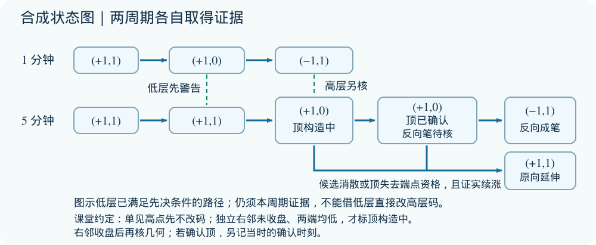

# d08｜走势结构的两重表里关系：双周期笔状态

来源：《缠中说禅-股市技术理论》PDF 物理第 30–32 页，第二章第 8 节。对读作者[第 91 课](https://blog.sina.com.cn/s/blog_486e105c01007wc1.html)、[第 93 课](https://blog.sina.com.cn/s/blog_486e105c0100869y.html)。

## 一个周期如何记四个状态

笔是按规定的包含处理和顶底分型间隔，把合格的相邻异类分型连起来得到的方向构件。单独一笔不能充当原义中枢或已完成的次级走势类型；线段和各级走势类型才是书中可参加成枢的构件。先有同一口径下可识别的笔，再问其当前方向和构造状态。第 30 页的「笔定理」说，当下落在一条有明确方向的笔内；笔内的位置分为「分型构造中」和「分型构造确认后延伸为笔的过程中」。教学实际如资料截断、包含尚未处理或方向未建立，仍须明确标为待核。

| 状态 | 当前方向 | 现在正在发生什么 |
| --- | --- | --- |
| (+1,1) | 向上 | 从已确立分型出发的向上笔在延伸。 |
| (+1,0) | 向上 | 顶分型构造中，或顶分型已确认而反向下笔待核（课内附注）。 |
| (−1,1) | 向下 | 从已确立分型出发的向下笔在延伸。 |
| (−1,0) | 向下 | 底分型构造中，或底分型已确认而反向上笔待核（课内附注）。 |

第一坐标是方向。原书第 31 页把 0 称为「分型构造中」，1 称为「分型确认延伸为笔的过程中」。本课沿用四个主码，另给 0 加附注：「构造中」或「分型已确认，反向笔待核」。后者是课内记法：暂留原方向，分别记录分型确认和反向成笔的知情时刻；附注不另计主码，0 也不指横盘。只给课内主码 0 时，不能判断分型是否已确认；要核同一周期当时的附注和知情时刻。

例如，m05 的三根相邻无包含 K 线为 [10,16]、[13,21]、[9,17]，中根两端都高，顶已确认。若此前是上笔，目前还没有合格的后续底和独立 K 线，也未证实续涨，就记 (+1,0)，附注「顶已确认，反向笔待核」。继续等合格异类分型、两组之间的独立 K 线，并核顶中心最高价是否高于底中心最高价（见 m06）；反向成笔才改记 (−1,1)。若该顶失去作为本笔终点的资格且证实原向延伸，回到 (+1,1)；两路都未证实，保留当前记录，随本周期新数据复核。底分型镜像：从 (−1,0) 可续跌回 (−1,1)，或成反向上笔记 (+1,1)。第 32 页与第 93 课在举 (+1,0) 的段落中又点名 (−1,0)，两处都这样写；顶、底主码仍按第 31 页的定义。

## 两个周期的配对与过滤

先声明“大周期在前、小周期在后”。只看方向时有四对：上／上可同向强化，上／下可能是高层向上内的局部回试，下／上可能只是跌中反弹，下／下可同向下行。每层只计 0、1 两个主码取值，不计 0 的附注；两层各有四个主码，所以形式上有 4×4=16 个配对。较短周期易较早发出变化信号；高层仍是延伸时，低层出现反向笔可以只是笔内波动。高层已在构造时，短层方向也不能替代高层自己的成型证据。书所称“两重表里”提醒笔的这种过滤只是其中一层：用别的结构（如较小走势类型、中枢或背驰）有时能再区分同一个笔状态。第 8 节没给出另一重的完整判定程序，不能从这四码补出一种总诊断。

以 5 分钟向上延伸为例。原书第 31 页对相邻周期设先决条件：5 分钟从 (+1,1) 改为 (+1,0)，1 分钟至少须已出现 (+1,0) 或 (−1,1)。若已知 1 分钟仍延伸为 (+1,1)，尚不满足条件；若低层资料缺失，先待核。低层满足也只提供先决证据，不能单独确认高层构造或换向。这是原书的结构判别，不是来路不明的报价或未来时间保证。1 分钟出现顶分型构造是小警告；短层构造只落在同一根 5 分钟 K 线时，高层常仍缺足够构件。若低层顶分型本身获确认，警告增强。高层须独立核验：单见候选高点还不够；须用本层右邻的当时数据核出顶构造，才从 (+1,1) 改记 (+1,0)（下例给出本课约定）；顶已确认而反向笔未合格时仍为 (+1,0)，只更新附注；本层反向笔合格才记 (−1,1)。若证实原向延伸则记回 (+1,1)。下行按底分型镜像处理；低层信号既可能发展，也可能消散。

第 30–31 页没有规定怎样用未收盘的 K 线统一标记「构造中」。下面另做本周期的 K 线几何练习，不以低层编码作为这项局部标注的输入。若本层达到课堂几何条件，可登记局部构造候选；低层仍延伸或缺证时，不得把该记录写成原书的双周期转换。每次按当时的高低价重做包含处理；已有两根收盘的处理 K 线，两端同升，右侧在走的一根经处理后仍独立、两端均低于中根，才标「顶构造中」。右邻收盘后重核几何，成立才记顶确认。没有独立右邻，或两端关系不齐，就先保留已证的上笔状态，不借低层换码。

例如 10:25 已有前两根收盘 K 线 [10,16]、[13,21]，两端同升、无包含。到 10:27，右邻 10:25–10:30 这一根还未收盘，分两条路径看：

| 截至 10:27 的右邻 [低,高] | 本周期当时能怎样记 |
| --- | --- |
| 甲 [14,18] | 被中根包含，按前两根的上升方向暂合为 [14,21]，没有独立右邻。只有候选高点，仍记 (+1,1)。 |
| 乙 [12,18] | 与中根无包含，12<13 且 18<21，独立右邻两端均低。按本课约定记 (+1,0)，附注「顶构造中」，知情时刻为 10:27。 |

若乙在 10:30 收盘时全幅为 [9,18]，重做处理仍无包含，9<13 且 18<21，此时顶才确认。反向笔未合格、原向延伸也未证实时，仍记 (+1,0)，另注「顶已确认，反向笔待核」，登记 10:30，不把确认补记到 10:27。

## 历史文字例：周日组合的四个分支

PDF 第 31 页以“最近大盘”举例，作者第 91 课发于 2007 年 12 月 17 日。按周在前、日在后，书把两个都处在向下笔的配对分成四种。这个日期是发文时点，PDF 未附原始周日图或逐日判断表。

| 书中顺序 | 周线 | 日线 | 读法 |
| --- | --- | --- | --- |
| 第一 | (−1,1) | (−1,1) | 大小层仍向下延伸，尚无这两个周期的底构造。 |
| 第二 | (−1,1) | (−1,0) | 日线先呈底构造，周线尚无底构造。 |
| 第三 | (−1,0) | (−1,1) | 周线底构造未定，日线仍向下；这是文中所称当时状态。 |
| 第四 | (−1,0) | (−1,0) | 两层都呈底构造，书认为可能有转机；两层都未证明反向笔。 |

书从第三种跟踪两个竞争方向：若日线转入底构造且周线保持，成为第四种；若日线下行使周线底构造失效，回到第一种。这是该叙述里的两条观察路，后续事实不能从文字重建。原书称 1、5、30、60 分钟、日、周、月、季、年可排九行：独立作形式计数得 4⁹=262144，三个周期 4³=64。实际转换受时间聚合和结构条件约束，形式计数既不保证每一状态可达，也不能推出自动盈利、状态等概率或首选转折点。

## 算例：顶分型之后怎样更新

设到 t1，1 分钟出现顶构造，记 (+1,0)，5 分钟仍为 (+1,1)；到 t2，低层已成 (−1,1)，5 分钟出现顶构造，记 (+1,0)。到 t3，5 分钟顶分型确认，后续底及独立 K 线还待核，高层仍记 (+1,0)，更新附注。到 t4，5 分钟向下笔合格，才登记 (−1,1)。另一条路径是顶构造消散，或已确认的顶后来失去端点资格；若证实原向延伸，则高层回到 (+1,1)。恢复上行后，书建议拿被 (+1,0) 隔开的两段同向对应走势比力度；设已完成的同口径面积由 12 降为 8，后段创新高，这是向上减弱候选，仍要辨明是趋势或盘整，才在低层用区间套找候选端点。

对于书的模拟操作，保守方案在长时间上笔后出现顶构造时，若实际仓位已具备获利和成交条件，先卖到净回款收回原投入，余下利润对应的仓位继续按计划观察。份额按实际持仓、成本与扣费后的成交回款核，不能从图上推定已经够回本。剩余仓位另查：确认反向下笔后，在选定的较低周期等对应下笔走完，再核随后合格的向上笔。向上笔已走完且没有创新高，才按这一路考虑退出。比如周线转向时，可选日线或 30 分钟图跟踪这两笔，用同一口径比较前高。只有 t4 的反向成笔、下笔内部的一次反弹，或尚未走完的向上笔，都不足以按此分支判退出。周线有效跌破五周均线是书给的另一条退出规则，分别核查。

短差方案先确认：与上笔转入顶构造相对应的较小级别上涨，已经明确背驰并确认结束。少了这项证据，先保留待核。条件具备才以这段小级别上涨的末中枢作参照，仍围绕核心可继续观察。若已选用先卖再回补的短差方案，所跟踪周期一旦确认转为 (−1,1)，最后一次卖出的份额不回补；若该方案还有余仓，也按可卖量和成交条件退出余仓。比如已经卖了 60 股、还持有 40 股：不买回 60 股，并按方案处理余下的 40 股；未成交部分仍记为持仓。弱势确认后先不参与，等该周期出现 (−1,0) 再评估；这个状态本身不是回补指令。原书声称有两种 (+1,0) 成因，但第 32 页和第 93 课紧接着只明确列出“下层上涨已明确背驰而结束”一种；本课将“无该证据”保留为一种待核状态，不编写第二条原文。长时间上笔也不能证明个人仓位已经盈利。

## 练习

1. 在三个已经结束的观察包中，1 分钟依次是 (+1,0)、(−1,1)、(−1,1)。对应三包里，5 分钟依次是：仍从合格底分型向上延伸；截到上例 10:27 的乙路径，右邻仍未收盘，也未成反向笔；已通过反向笔全部条件。给出每包两层码、预警或确认状态。若第二包换成上例甲路径，高层如何记？若仍见乙的几何，但低层仍延伸或缺资料，分别按本周期约定、原书双周期规则怎么记？若在第二、三包之间，5 分钟顶已确认，反向笔尚未合格，也无原向延伸证据，高层怎么记、接下来查什么？
2. 截至今日日线仍是 (−1,1)，周线是 (−1,0)。甲次日及周线更新后，日线出现底构造，周线底构造保留；乙更新后日线延伸导致周线底构造失效，周继续下行。分别指出书中的次序，判断任一是否确认了周线上涨。
3. 两个周期各有四个主码；写出形式配对数量。大周期从 (+1,1) 进入 (+1,0) 后回到 (+1,1)，前后同向力度分别为 12、8，但 8 所在段未完成。只给主码，未给 0 的附注。说明能确认的状态变化、能否判断 0 时顶分型已确认，以及还需哪些力度资料。
