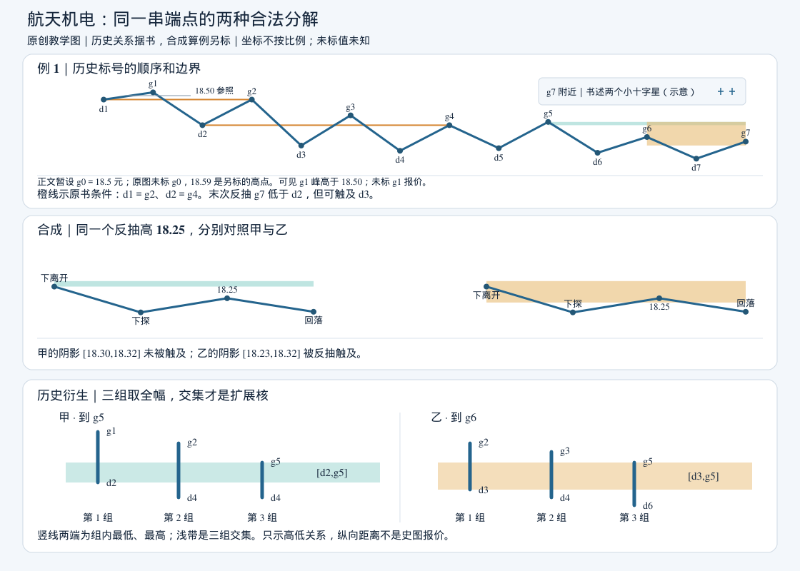

# h01 · 航天机电：同一串端点的两种合法分解

来源：《缠中说禅-股市技术理论》PDF 物理页 62–64，第三章第 25 节。

## 分段口径与等价重组

物理页 62 图为「航天机电 (1分钟)」，日期栏可读 05 月 18 日，年份未从图确认；横轴有 13:21、14:30、14:50 等，标出 d1–d7、g1–g7，价格另标 18.59 与 18.03。正文暂设 g0＝18.5 元作为起算点。原图没有标 g0，18.59 是图上另标的高点；可见的 g1 峰高于右轴 18.50 横线，图上未标 g1 的报价。g 是峰、d 是谷，除末段外正文把每条相邻标号间的次级走势视作不拆开的线段。下式按正文描述到 d3 为止书写；物理页 62 等号左边印成 g0g3，但末项止于 d3，按端点应读到 d3。

- 到 g1 只走了两段，不能形成三段中枢；在更细的分笔操作口径里，作者把 g1 视作二卖。
- 到 d2，原书用 g0→d1→g1→d2 示范首核，写作 [d1,g1]。用端点价表示这三段，最大低点为 d1，最小高点为 min(g0,g1)。交集非空时，只有 g0≥g1，上沿才取 g1；若直接代入 18.5 为端点价，按图示高低，上沿取 g0。若改取各段实际全幅，在其余界限不变时，首段的实际最高也须至少达到 g1；不能用另标的 18.59 补这个前提。下沿仍按原书的 d1 读：d1＝g2，d2→g2 只触下沿，原书归为震荡；若 g2＜d1 且离开、首次反抽合格并完成，才可判为三卖。原书把未触下沿的 d3→g3 判为三卖。
- 到 d3 可移括号：`(g0d1+d1g1+g1d2)+d2g2+g2d3 = g0d1+(d1g1+g1d2+d2g2)+g2d3`。右式核心缩至 [d1,g2]，这里是同一价位，仍改变不了 g3 在其下这一点。

## 到 d4、g5、g6、g7 如何更新

到 d4 可择「甲：括 d1→g2」或「乙：括 d2→g3」；其余各段先保留为未分组。不能把 `(d1g1+g1d2+d2g2)` 和 `(g2d3+d3g3+g3d4)` 直接并列为两个同级中枢：两组共用端点 g2，中间没有独立连接。第 62 页的例子强调须有连接；按第 10–11 页，合格连接可以是次级别或更低级别，最低级别的缺口也可能承担连接。第三类点的离开和返回须按各自的直接次级条件另查。把三个合格次级走势作为上一级的成员时，只查它们能否按规则组成上一级中枢，无须在成员之间另加两条同级中枢的连接。

- 到 g4、再到 d5：甲把 d4→g4 的衰减后反弹及随后回落看作向新中枢移动或升级的中间过程，标准未定；乙用 g4=d2 认定触及原核心，作为可操作定义更清楚的震荡。到 g5，甲的三个次级成员齐备；乙仍按震荡读。到 g6，乙的三个次级成员才齐备。压成一段后用组内实际走到的最低、最高作为代表价，而不是取组在时间上的起点、终点价格。例如甲第一组从 d1 到 g2，虽有 d1＝g2，整组实际低至 d2、高至 g1。

| 分法及成立时点 | 沿时间的三个成员 | 组内实际价域（由低到高） | 三组共同区间 |
| --- | --- | --- | --- |
| 甲，到 g5 | d1→g2；g2→d4；d4→g5 | [d2,g1]；[d4,g2]；[d4,g5] | 最大低点 d2，最小高点 g5，交集 [d2,g5] |
| 乙，到 g6 | d2→g3；g3→d5；d5→g6 | [d3,g2]；[d4,g3]；[d6,g5] | 最大低点 d3，最小高点 g5，交集 [d3,g5] |

两种扩展分组都不纳入 g0→d1；首核上沿的疑点不改变表中交集。表中边界取自物理页 62 图的相对高低和物理页 63 的分组。压缩后改变的是计组单位，不能用截图像素给每个标号补精确价格。

- 到 g7：对甲，作者称 d7→g7 可作 1 分钟级反抽，g7 在 [d2,g5] 下，作者据此读为对该 5 分钟核心的三卖；图面无法独验核心形成后的直接次级下离及其确认时点，两段资格须用更细原始输入核实。对乙，g7 触及 [d3,g5]，只是震荡。作者据 d7→g7 中较大的回试及停在该区域的两个小十字星，推断内部可分出更低级别的三段；若要严格从原始数据重画，需 1 分钟以下行情。两分法对总体偏弱可相互印证，但不能互换三卖的标签。

## 拆解力度与极端边界

原书物理页 62 用 MACD 辅助比较早期三个同向下段的力度：g1→d2 强于 g2→d3，后者又强于 g3→d4。到 g7，作者另用两次回拉未能上穿零轴、第二组正柱面积较小，辅助判断后势偏弱（物理页 63 末至 64 首）。这组线索不承担早期三个下段的逐段比较；截图也不足以定出逐柱切点、复算面积。

大幅下破也可以先出现较小级别的三卖，之后才见对应大级别的完整离开与返回；不能仅靠涨跌幅决定级别。作者举 600477（2007-04-09）离 2 月中枢甚远及 600837（2007-02-06）为三买示例，也以旧时急跌后第一次反抽为反向说明，本段均未给相应原始输入。作者提到猛烈突破还要看速度、成交量、力度是否配合；这不构成个股涨跌或成交保证。

合成：设候选共同上沿都是 18.32，甲下沿 18.30、乙下沿 18.23，假定两分法下均有已完成的直接次级下离，且同一次首次合格反抽已完成、最高 18.25。18.25 < 18.30 对甲成立，18.25 ∈ [18.23,18.32] 对乙成立。反过来，若一个以 10000 为核心的震荡按已确认次级结构仍会回到核心，单凭最低 0.01 或最高 100000000 也不能改判结构；这是书中刻意夸张的假设，不是可发生条件的证明。震荡和离开后的走势要用各自的边界与力度解释，追涨杀跌本身不能替代判定。

[打开矢量图](../../../assets/chan-book/full/h01.svg)

## 自测

1. 合成：两个合法分解的 5 分钟核心分别是甲 [30,33]、乙 [27,33]，给定同一次已完成、合格的次级下离开和首次反抽，最高 29。甲乙分别归类；若只看到反抽进行中的 29 又怎样？
2. 按时间已有相邻三个区间组 A、B、C，各已判为合格次级走势且有共同区间 [10,11]。A、B 直接相邻、共用端点，中间没有任何独立连接。解释为什么不能先说 A、B 是两个已连接的同级中枢，却可以另讨论三组共同组成一个上一级中枢。
