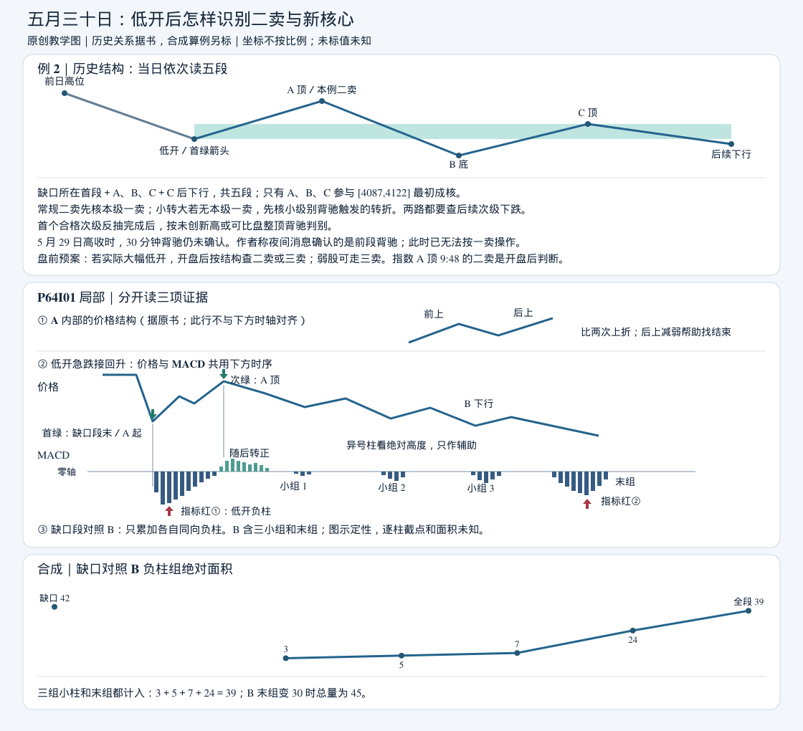

# h02 · 五月三十日：低开后怎样识别二卖与新核心

来源：《缠中说禅-股市技术理论》PDF 物理页 64–65，第三章第 25 节。

## 缺口之前，首卖尚待定位

按物理第 34 页，严格一卖发生在某级别上涨趋势中：向上突破最后一个中枢的次级走势形成背驰点。进入背驰段只能开始寻找，还不能定位一卖。常规二卖先核本级一卖。第 36 页另给小转大路径：小级别背驰触发本级转折时，若本级没有一卖，仍可查二卖，见 [O04 小转大](o04.md)。两路都须核高点后合格的次级下跌，以及首次合格且已完成的次级反抽；反抽未创新高，或与此前可比上涨构成盘整顶背驰，才按相应分支判定。只见普通下转不足以确认。三卖须相对于具体中枢核查下离和首次回试。

物理第 64 页是另一个情形。5 月 29 日高位收盘时，30 分钟走势已进入背驰段，但尚未确认背驰，不能定位一卖。作者称，夜间消息使此前的背驰得到确认，此时已无法按一卖操作。开盘前能写下的是条件：若大幅低开，转查开盘后的二卖或三卖；这时还没有观察到实际开盘，也不能先给卖点定位。

开盘后才按实际结构判断。作者将本例指数 9:48 记为二卖；更弱个股可能走三卖，不能照搬指数标签。这里的问题是确认时机，小转大那一路则是本级不出现一卖。大幅低开本身不能证明任意走势已经背驰。原图可用于核开盘后结构，不能证明夜间消息或作者何时判断。

## 从缺口到 A、B、C

物理页 64 的上证指数 1 分钟图可见代码 1A0001、2007-05-29 与右栏 2007-05-30，左侧跨日急跌，中间见 A、B、C 与四个绿色价图箭头。主价图标 4335.69、4016.67，右侧行情摘要另示开盘 4087.41 和最低 4015.51；摘要、主图标值与正文的整数边界应分别记录。图下有成交量和 MACD(24,52,9)，右下有当天的分时小窗，分时小窗也不提供逐根序列。

1. 作者把向下缺口视为最低级别的无内部线段，和本图的其他 1 分钟以下走势在当前观察层都作为一段。随后 A 段是首个次级反抽。原图 A 顶低于缺口前高，本例走未创新高一支；原书还用 A 内部「上—下—上」中后上明显减弱来定位反抽结束。若反抽创新高，须另查它与此前可比上涨是否构成盘整顶背驰；A 内部减弱不等于这项跨段比较。图中窗把三项检查分开：① 在价图里比 A 的后上与前上；② 原书以成交量，或低开急跌的负柱与随后回升的正柱的绝对高度辅助判断。MACD 第一支红箭头指低开开始的负柱组；A 已起，负柱仍在缩短，随后才转正，不能把这两组异号柱各归为 A 的一次上折；③ 比两段同向下跌时，才把缺口段与 B 各自的完整负柱面积相比较。图上可认顺序和柱群，不能确定逐柱截点。若 A 强力突破前高，又没有可比的减弱证据，不能凭缺口确认二卖。
2. B 段在图面像有三处小中枢，但每处第三折只在下倾的第二折里延续，作者未把它另外划成一段。先等 B 跌破 A 段的低点；在本案作者以此进入比较，不把 B 尚未破 A 低点时的短柱直接判成盘整背驰。比较同向的「缺口所在下段」和 B 段，两个红箭头提示负柱组；B 要把末组以前的三组小负柱也加进去。计入前三组以后，原书称 B 的力度不大于缺口段，并结合走势结构把它读成盘整背驰。截图不能复算面积或排除等值；下面给定数字的合成例才作严格大小比较。作者说本案比较的是 1 分钟以下力度；换到 1 分钟级，尚要看 DIF、DEA 是否回抽零轴。B 段内部若只见负柱逐组增多，不能提前宣称结束；最细层末端柱缩短可触发小转大，并不要求 B 内部同级背驰成立。
3. C 反弹恢复到第一个绿色箭头所在水平上方，最高点可用 C 内部同向柱高度辅助找；但 C 高点没有回到 B 内部最后一个反弹起点，不违反上述小转大的分支。A、B、C 完成后的 1 分钟核心在正文记为 [4087,4122]，之后才能以它区分震荡或新的离开。物理页 64 说全日共有五段 1 分钟以下走势：缺口所在的首段、A、B、C，还有图上 C 顶后的下行。第五段不参与 A、B、C 的最初成核。能读出结构与能在成本、交易限制和通道之下成交，是两项不同的条件；书中所述股指期货空间、T+0 等属于作者对当年例子的讨论。

合成：缺口下段负柱绝对面积是 42，B 的三小组为 3、5、7，最后一组 24；全段合计 39 < 42，省略前三组会夸大差距。若末组改为 30，全段 45 > 42，省略小组还会把力度方向读反。面积只作结构已划定后的辅助。

## 次日附录：同一个旧核心，另一次观察

物理页 65 的附录称，早盘上冲未触 4087，因此是旧核心三卖；三波下跌与前一日 B 比较减弱，最后一波负柱收缩，作者据区间套定位 10:02 低点。随后反弹未按同级趋势延续，作者把结构更新为 [4015,4122] 的 5 分钟中枢，之后观察这一级震荡或三类点。原页无次日独立图；例 3 的跨日图提供 6 点与 7 点的结构参照，不替代逐分钟输入。附录还将当时的 1/2 线、月线收盘和轮动、消息压力列作更大层观察；本附录未单列其计算基准和完整板块验证数据，不能用它给今天定点。

[打开矢量图](../../../assets/chan-book/full/h02.svg)

## 自测

1. 合成：A 已是完成的次级回升，最高 98，前高 104；后上面积 5，前上 9。随后同向比较段中，早期下段负柱面积 40，B 小组 4、6、7，末组 25。分别写 A 和 B 的力度证据；A、B 能否只凭这些面积同时判为背驰？
2. 次日的旧 1 分钟核心 [4087,4122] 已确认；三条独立路径均已完成相对该核心的合格次级向下离开。甲的首次合格次级反抽已完成，最高 4077；乙的首次反抽仍在进行，暂见高点 4077；丙的首次合格次级反抽已完成，最高 4090。分别登记。
