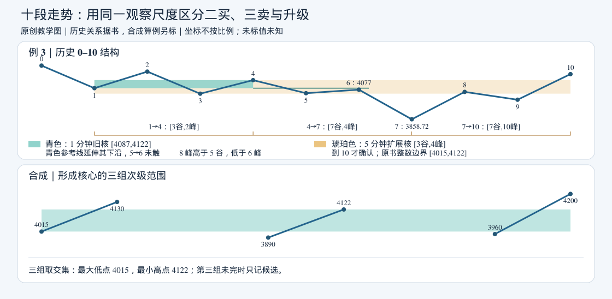

# h03 · 十段走势：用同一观察尺度区分二买、三卖与升级

来源：《缠中说禅-股市技术理论》PDF 物理页 65–67，第三章第 25 节。

## 0–10 是一次有口径的划段

物理页 66 上证指数 1 分钟图跨 2007-05-29、30、31，标 0–10；图左标 4335.61，7 附近标 3858.72；图下成交量、MACD(12,26,9)。这和例 2 的 MACD(24,52,9) 不同，不能把两图柱面积直接相减。先把图上 1 分钟以下的形态压成相邻段：0→1 是低开缺口，2→3 内有多次折返；两者在这个观察尺度都是一段，内部实际层次并不一样。2→3、7→8 的箭头处疑似第三折，作者说缩小后太弱而不另计；8→9 一处第三折较明显。若改用较细口径，把 7→8 箭头处计入并相应合看 7→8→9，其他同等微弱处也应统一处理。这样是在复现书的示范口径，不能以像素大小代替严格线段规则。

## 两种分法各回答什么

- 旧核心用 1→2、2→3、3→4 得 [4087,4122]。作者以 4→5 为合格离开、5→6 为合格返回；5→6 有上—下—上，正文解释其中的下折纳入缺口，6 最高 4077 小于 4087，所以是三卖。这一次要专查真实次级别，不能仅以「在 1 分钟以下」代替资格。
- 5→6 后上比前上弱；同理 6→7 是下—上—下，后下更弱。在 6→7，中间一折虽幅度很小却耗时较长，负柱回缩到零轴，作者据此保留这次结构上折。读图时价格箭头与柱组箭头应对同一段；书中以红、绿称呼，复制图里的青、紫色不改变柱号正负。给定高速分析和执行通道不代表实际已成交。
- 到 6 可另取 3→4、4→5、5→6 成 1 分钟核心，把 2→3 与 6→7 作为该核两次同向震荡；后者所有负柱面积总量较小，作者再查 6→7 内部，把 7 定为转折点。若类比 7 为一买，后续合格次级上行、再回落不创新低或盘整背驰，9 是二买；7→8 内的小回落是更细级的二买。2 则是二卖。这里的类比不把每种盘整末端升级为趋势一买。
物理页 67 的另一分法，到 10 才按书例确认 5 分钟核心。下表按原书认定的三个合格次级成员分组，在物理页 66 图上分别找每组的最低和最高。

| 次级成员 | 组内全幅 |
| --- | --- |
| 1→2→3→4 | [3谷,2峰] |
| 4→5→6→7 | [7谷,4峰] |
| 7→8→9→10 | [7谷,10峰] |

3 谷高于 7 谷，4 峰低于 2 峰和 10 峰，所以共同区间为 [3谷,4峰]。原书给出的整数边界是 [4015,4122]；示意图用标点定位，不从像素补报价。改组 3→4→5→6 时，三个相邻段交于 [5谷,6峰]。5 谷略高于 3 谷，是这套 1 分钟核心的下沿；原图的 8 峰高于 5 谷、低于 6 峰，说明 7→8 已到这个区间，不能据此判断每一折的资格。只有 6 的三卖时，5 分钟扩展所需的第三组尚未走完，不能提前确认。

合成：三个已具次级资格的成员是 [4015,4130]、[3890,4122]、[3960,4200]。最高的低点是 4015，最低的高点是 4122，所得 [4015,4122]。若第三组尚未封口，即使暂见范围相同也只能暂记候选。

## 周五附录与执行层

物理页 67 的附录把周五图面解读成 [4015,4122] 的震荡；另报当时 1/2 线 4144、所谓这一涨段的 1/3 在 3734、半分位 3434，提到年线、半年线附近个股反弹和新闻压力。这些是作者该时点的层级判断；例 3 本身没有足够的高层完整输入或独立市场证据来重算、证明因果。附录另举 1996 年连续 3 天指数跌停后创新高，以及「跌 40% 后反弹再调仓」的应对主张；没有逐笔成交与完整交易成本，本课只用来练区分涨跌基数。若 100 跌 40% 为 60，再从 60 涨 20% 是 72；若「回 20%」指恢复原价的 20 个百分点，才是 80，均不能从文字推出确定收益。正文建议未熟练时只用有限仓位练习。另用一个极端假例说明尺度会决定换手：若 30 分钟三买后从 10 涨到 100000，但按该层口径一直未形成新的 30 分钟中枢，单凭涨幅仍没有作者讨论的同层退出点。它说明细级图例不等于同层必须频繁进出；数字不是持有或收益承诺。

[打开矢量图](../../../assets/chan-book/full/h03.svg)

## 自测

1. 合成：某 1 分钟核心 [4087,4122] 已确认并有合格次级下离开，完整首次次级反抽高点为 4077。另一种合资格分解的核心是 [4060,4100]。各如何归类？若只知道反抽在 1 分钟 K 线上出现，缺哪个前提？
2. 合成课堂事件：先跌 40% 后从低点涨 20%；最初价格 100，忽略费用。算两个端点。再说明何以不能把档案里的“回 20%”直接写成同一个数字。
