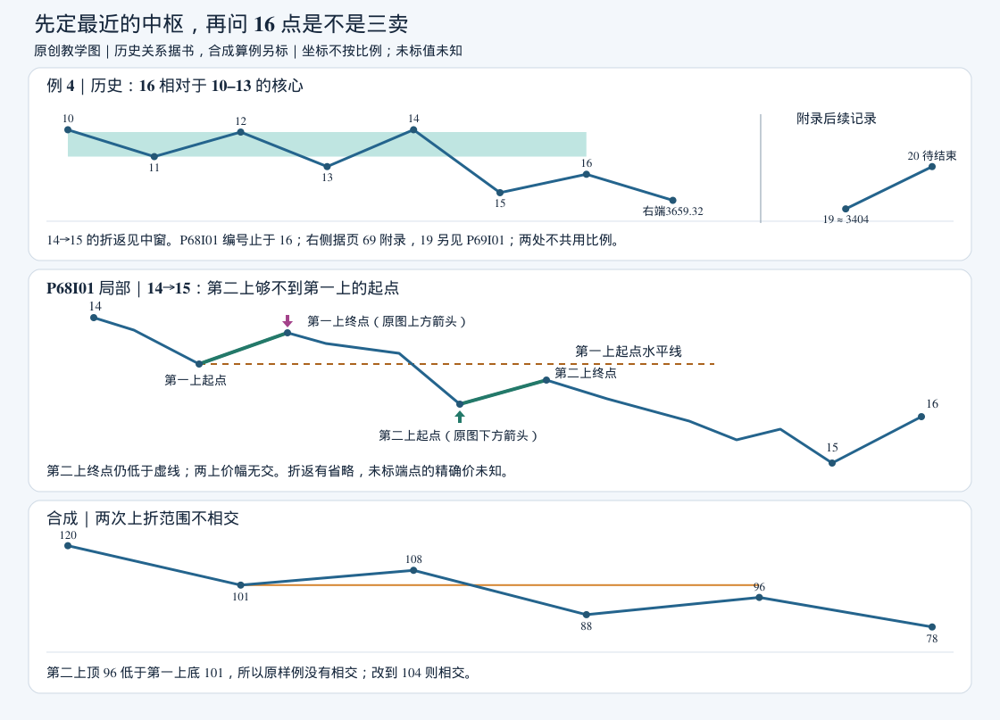

# h04 · 先定最近的中枢，再问 16 点是不是三卖

来源：《缠中说禅-股市技术理论》PDF 物理页 68–69，第三章第 25 节。

## 14–15 的折返为什么仍是一段

物理页 68 图为上证指数 1 分钟，横轴可辨 29、30、31、01、04，左栏单根时间 05291446；标 0–16，左图 4335.69，右端另标 3659.32。图下量与 MACD(24,52,9)；和上一例不同，图延伸到新的观察日。前后相邻已完成段方向交替；这里的缺口另作最低层特例。看中窗的 14→15 放大示意：原图上方箭头标第一上终点，下方箭头标第二上起点。把第一上起点水平向右延伸，第二上终点仍在线下，两次上折的价幅没有交集。原书据此将下—上—下—上—下仍划为一条下段；图中四个局部端点的精确价格未给出。合成：以下每段全幅由两端点给出。从 120 出发到 101，反弹至 108，再到 88，反弹至 96，再到 78；两上为 [101,108] 和 [88,96]，因 96 < 101 不重叠。若第二个上到 104，则交集 [101,104] 出现，应重做结构检查；交集本身仍不直接证明分段完成。

14→15 整段的 MACD 双线显示力度很大，作者不判为 1 分钟以上背驰；但 15 附近很细级的同向负柱组收缩，作者以此解释 15→16 的反弹，而反弹在 14→15 最后一个上折附近受阻。图复制用紫、青等色，先按柱位于零轴上方还是下方辨正负，再核其对应的走势段，不拿文中「绿柱、红箭头」当固定配色。5 日线在本节开头只是作者示意如何复盘自己的反应；不能由心理自述证明按此线已有成交。

## 两层三卖与下一时点

针对 10→13 的最新 1 分钟核心，作者把 15→16 判为首次合格反抽未回核心的三卖，不应以更早的 7 未被突破作为同一标签的理由。16 后延伸到新的末段，是否背驰要等下一个时段：加速可推翻候选，若反转后回到 15 才有机会从 15 讨论 1 分钟核心。再放大一层，1→10 的 5 分钟核心下沿是 4015；要等这个 5 分钟核心的合格直接次级下离与首次直接次级反抽完结，后者全段最高严格低于 4015 才可按本课口径另判该级三卖。作者另用约 4000 点描述反弹可能受压，这个整数不是核心下沿的替代。若 10 后有另一个合格的 5 分钟中枢，且其外围最高严格低于 1→10 前枢的外围最低，才按这条分支检查 5 分钟下跌。只有两核心分开时，仍待核外围和趋势资格。反弹站回 7 对较大结构转强有观察意义，作用和 16 的三卖参照不同。

## 附录：19 与 20 是后续记录

物理页 69 附录称第 19 段结束位置约 3404，下午走第 20 段，接下来关注 20 结束及随后震荡；还把月线 5 均线与 3434 左右盘中一度突破解读为假突破。「上图」所指不能只按相邻上一图补号：物理页 68 的图只标到 16，页 69 的 P69I01 属于紧接例 5 的第一幅连续图，才可见 19 标 3404.25。它支持事后标注与衔接，不能用来精确复算作者当时定位 19 的区间套步骤。

[打开矢量图](../../../assets/chan-book/full/h04.svg)

## 自测

1. 合成下段：134→111→119→96→110→85。每一折的全段最高和最低就是它的两个端点，不另有段内极值。列两个上折的完整价幅，检查第二上是否触到第一上的起点。另一条路径仅把第二上端点及全段最高从 110 改为 112，哪项判断必须更新？
2. 给定最近 1 分钟核心 [90,96] 与较旧参考高点 106。相对于这个 1 分钟核心，合格的直接次级下离和随后的首次直接次级反抽都已完成，反抽全段最高 89。上层核心 [80,100] 是否也能仅凭 89 判为三卖？列出两层各自的证据。
