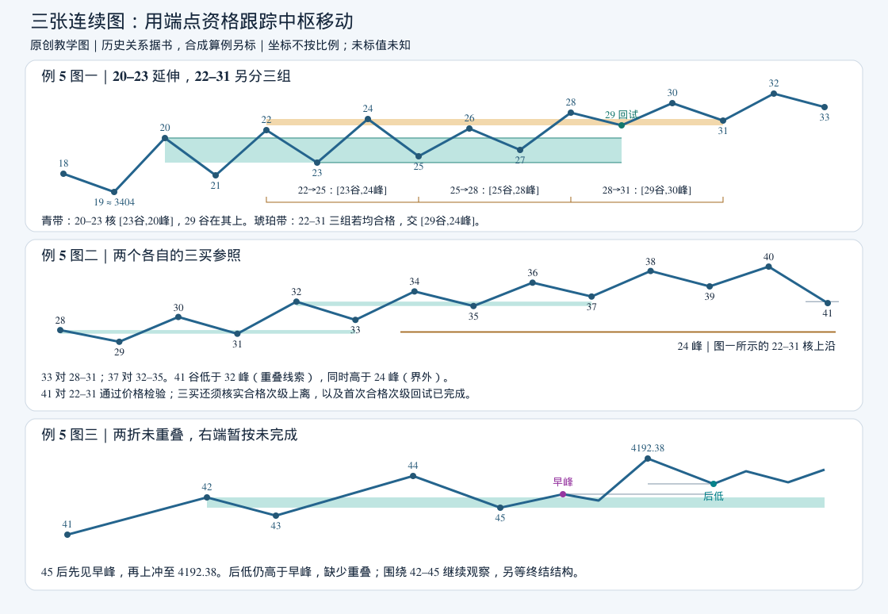

# h05 · 三张连续图：用端点资格跟踪中枢移动

来源：《缠中说禅-股市技术理论》PDF 物理页 69–71，第三章第 25 节。

## 同向长段不等于多段

先以本书的 1 分钟图和一致精度为观察基准。线段是否继续，应看相邻上折或下折的相交和后续终结结构。原书用「每个新低都高过前高」说明长距离也可能只是一条上涨段；相邻两条已划线段不能同向。无折返的一字涨停按书中的示范只是更小层次的情形，时间长不自动长成线段。用分型、间隔和笔确认作严格验证时，仍要有原始 K 线；本例只读作者已标的结构。

物理页 70 追述 7–8–9：8 的低点 3994.57，7 内最后高点 3994.21。按书中讨论的个位直接截尾，两者都写 3994，是相触候选；两位小数则 3994.57 > 3994.21，相隔 0.36 点，可按原书改读为一段。四舍五入的结果又不同，分别为 3995、3994。作者提到 8 内有明显下—上—下，支持他采用较粗精度时分三段；取整的相等只处理过界这一步，不能单独证明每一笔和段合格。

## 图一到图三：保留各图自己的截止

三幅均题「上证指数 1 分钟」，含价格、成交量、MACD(12,26,9)，编号相接；编号是结构端点，不是分钟根号。

| 物理页与图 | 可定位的画面 | 作者用这张图作出的判断 |
| --- | --- | --- |
| 69 图一 | 左见 18，19 标 3404.25；横轴显示 04、06、07、08，32 旁标 3914.34，右见 33 | 20→21→22→23 的前三段以较高的 23 谷为下沿、较低的 20 峰为上沿，核心为 [23谷,20峰]，随后延伸。29 的回试低点高于上沿，作者记为三买；独立复核仍须确认三段成员资格、合格的次级离开及首次次级回试已完成 |
| 70 上图二 | 左栏时间 06070951，日期标签 2007-06-07，横轴续至 12；28–41，40 标 4025.21 | 33 对 28–31，37 对 32–35，均为各自最近 1 分钟中枢的三买 |
| 70 下图三 | 左栏时间 06120944，轴见 12、13；41 标 3910.39，42–45 可读，右端高值 4192.38 | 45 后先见小峰，再升到 4192.38，随后回落的低点仍高于早峰。相邻两折缺少重叠，右端线段暂按未完成处理；围绕 42–45 等待震荡或三类点 |

原图三的紫箭头指早峰，青箭头指后低；书中文字箭头颜色与图版不同，按先后与高低辨认。后低高于前高只说明此处没有重叠，还须等后续可核的终结结构。趋势段可用同级背驰辅助找结束，盘整则用盘整背驰，突发情形另看二类点；若这些信号只来自更细层，先看能否终结当前层，而非立刻改线。

## 大层两种分解及次日附录

1–19 的 5 分钟走势未形成两个 5 分钟中枢，作者归为盘整。对 19–45，41 谷低于 32 峰，给出价位重叠的线索。物理页 70 据此判断至少已有一个 5 分钟中枢，整个走势仍未完成；原书未列出这一分法的三个完整成员，单凭 41＜32 不能复判成核。

另看同页提出的 22–31 分法。沿图一试括三组，先核每组是否为已完成且连续的直接次级走势，再各取全组最低和最高：

| 试括的三个成员 | 组内全幅 |
| --- | --- |
| 22→23→24→25 | [23谷,24峰] |
| 25→26→27→28 | [25谷,28峰] |
| 28→29→30→31 | [29谷,30峰] |

29 谷高于 23、25 两谷，24 峰低于 28、30 两峰，所以三组若都合格，交集为 [29谷,24峰]。29＜24 说明两边界之间有共同价域，不能代替成员资格。

图二的 41 谷低于 32 峰，却高于这套分法的上沿 24 峰。41＞24 只通过三买的价格检验；还须核对相对 22–31 核的合格次级上离，以及首次合格次级回试已完成且全段最低仍高于 24。原书在这套分解下判 41 为三买，截图不足以独立验证这些结构条件。

若 41 后形成新的合格 5 分钟中枢，且其外围最低严格高于 22–31 前枢的外围最高，作者才把 19 以来这套结构更新为 5 分钟上涨趋势。只有局部标点或核心范围时，还不足以确认外围分离。

围绕 42–45 的 1 分钟中枢，若未出现三卖，或三卖后的扩张仍未触及 22–31 的 5 分钟中枢震荡区间，书中归为较强震荡；即使最后长成 30 分钟或更大的中枢，作者仍从 42–45 的中枢追踪其发展。若三卖后的扩张触及 22–31 的震荡区间，原书转向较弱分支：以该旧区间为基础，观察能否扩张出 30 分钟中枢。触及旧范围只决定接下来查哪一支，须另查 30 分钟中枢的次级构件和交集才能确认。合成：旧中枢的全幅震荡范围为 [36,43]，右侧新核心为 [45,48]，并已出现三卖。其后向下扩张仅到 44，旧范围未触；若到 42，旧范围已触，转查以旧范围为基础的 30 分钟扩张。

物理页 71 附录另记：当日缺口没完全补上，42–45 延伸九段，作者把它读成 5 分钟中枢；深成指 13700 为另一个观察位，不能移给上证。书中以「先卖后回补」解释震荡节奏，强调下震荡力度加大、可能形成三卖时，停止按旧震荡逻辑回补，重新等待结构证据；成交、成本和盈利均未由书图证明。附录没嵌新图，页 71 同页图是下一例扩展到 61 的独立读图。

[打开矢量图](../../../assets/chan-book/full/h05.svg)

## 自测

1. 以 3994.57 与 3994.21 为输入，分别用直接截尾到个位、四舍五入到个位、保留两位比较。哪种支持边界相等？这能单独确认 7–8–9 为三段吗？
2. 合成：旧 5 分钟中枢核心 [40,42]、完整震荡范围 [38,44]；右侧 1 分钟中枢已有合格三卖。其后扩张甲最低 44.5，乙最低 43.8。依照例 5，在各自截止点分别记录是否触及旧范围、归入哪一支、下一步跟踪什么。
