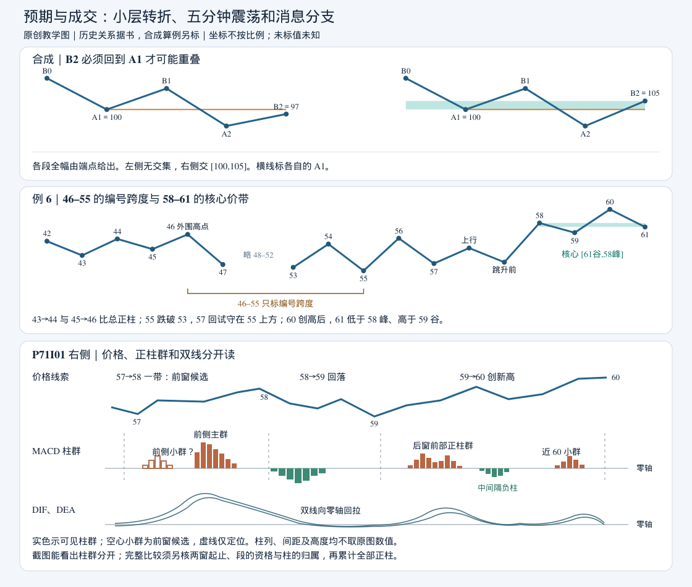

# h06 · 预期与成交：小层转折、五分钟震荡和消息分支

来源：《缠中说禅-股市技术理论》PDF 物理页 71–73，第三章第 25 节。

## 用 A1 检查第二次反弹

按作者讨论，未成为交易的恐惧或预期是观望，不作为已成交通向的证据；消息、政策、资金及看法可作分力的解释，走势是实际合力留下的图形。即使走势没有回到某位，也不能从图上算出多少人看空或断定某条消息是唯一原因。作者由此主张保留多种当下合法分解：分法不同，各自仍需满足本层规则，随着续图出现可以撤回旧候选。

用五个端点说明：B0 下到 A1，反弹到 B1，再跌到更低的 A2，然后反弹到 B2。给定同级别、连续、已完成且可作为成组成员的各段，并且各段全程的最高、最低都由相邻端点给出，检查后来的最高 B2 相对较早反弹起点 A1：B2 < A1 时，A1→B1、B1→A2、A2→B2 没有交集；B2 ≥ A1 时会有公共区间，等号是点状边界，是否纳入按预设口径。合成 B0=120，A1=100，B1=113，A2=89：B2=97 时下界 100 大于上界 97；B2=105 时交集 [100,105]。级别、连续性和完成条件缺失，算术只能说明重叠，不能声明新中枢。

## 42–61 图：力度与不同尺度的应对

物理页 71 的上证指数 1 分钟图有 42–61 号，左栏时间 06131114，横轴显示 13、14、15、18；价图标 55 附近 4067.85、60 附近 4267.60，另有量与 MACD(12,26,9)。紧接前例未完处，作者以 45→46 对 43→44 作盘整背驰比较，要加两段各自所有正柱，非只比末根。再放到线段以下，红箭头后第一次反抽不创新高，作者说明其后会出现更小的下—上—下重叠，这类小结构未必能让高层操作者行动。作者举 30 分钟观察者可以忽略 46→47，仍把从 3404 开始的 5 分钟上涨作为较大跟踪对象。逐笔成交作为最低观察时钟是思想实验；成本、通道与资金容量约束能实际处理的最细级别。

- 作者把 46–55 归作 5 分钟中枢。图中括号只标编号跨度；46 是外围高点，不是核心上沿。课图未给出可据以重算该核心价带的三组次级全幅。55 破 53 但盘整背驰；把 55 比作一买后，57 是二买类比；原图可看出 56 峰高于 54、低于 46，57 的回试低点高于 55；图不足以精确报出 57 的报价。「盘整末端」与严格趋势中的一买要分开。
- 原书把 55→60 判作线段级上涨。对读原图 P71I01 右侧的价图和 MACD：58 前可见一组较高的正柱；附近还有小正柱，可先把 57→58 一带作为前窗候选。双线随后向零轴回拉。59→60 的价格创新高，下方可见前部较显眼的正柱群和靠近 60 的另一小群，中间隔着负柱；这一带的 DIF、DEA 峰也低于前侧。双线峰值和正柱累计是两项证据，最高的一根柱不能代表整段。
- 原书判断 59→60 的完整正柱累计和两条线各自的高点均不及前段，据此判断回落会跌破 58。图上能辨认柱群及其先后，但前窗的精确起止、与后窗是否同级同向且均已完成，以及边缘柱属于哪一段，不能只凭截图确认。复算时先用带时戳的逐根数据核定段的资格、起止和柱的归属，再分别累计两段的全部正柱。
- 图中 61 谷低于 58 峰而高于 59 谷，60 峰又高于 58 峰。按作者划分的三段 58→59、59→60、60→61 求交集，得到另一个 1 分钟中枢 [61谷,58峰]。是否上扩，以及回撤是否重新触到前一个 5 分钟中枢的高点 46，是后续待查。尚未触 46 可列较强分支，不可保证永远不触。

## 消息分支与 4224、4254

若消息在背驰未定位时使上涨突发终结，第 72 页以 5 月 30 日说明：若出现合格二卖，可以用它应对。第 64 页给这次大幅低开预案保留了二卖和三卖两支；弱股若走出三卖，不能只等指数所走的二卖，见 [H02](h02.md)。若转折此前已定位，消息不改变此前时点已有的证据。这是案例方法，原书未实测突发消息的概率。如果消息只造出低于所跟踪级别的一阵波动，不必把其中的二类点当作本层信号；若向下缺口确实终结了一个日线级别的上涨，原书允许用当天盘中 1 分钟、甚至线段级的合格二卖定位退出，无须等日线二卖。

原书也举了反向介入的例子：快速行情中，一段 5 分钟级下跌可能很深，作者用约 50% 的跌幅说明这种情形；若此后确认 5 分钟底背驰，作者认为后续反弹的价格空间可能比通常的 30 分钟反弹更大，原按 30 分钟操作的人也可以评估按 5 分钟级别介入，不必等 30 分钟买点。约 50% 是原书的说明，既不是本课从指数图复算的跌幅，也不是入场阈值。练习时仍须确认细层结构，并另核风险、仓位和可成交条件；价格空间再大也不把 5 分钟信号改标成 30 分钟信号。

物理页 72–73 附录把 61 处写为 4224，给出自 60 开始的 1 分钟中枢 [4224,4254]。作者说：未在下沿下方出现合格三卖，仍可按强势震荡观察；要重新上攻，要等上沿上方的合格三买；两边都无则继续看延伸。同时把个股分成创新高后回试、前高下蓄势、反弹受阻的平台、底部筑形四类，分别观察三类回试、小级别突破或震荡、平台与前高距离、底部的一二类转折。指数与个股的标签各看本身结构。

[打开矢量图](../../../assets/chan-book/full/h06.svg)

## 自测

1. 合成 B0=135、A1=108、B1=124、A2=96。给定三个直接次级构件连续、已完成，各段完整范围恰是相邻两端点之间，B2=105 和 B2=113 时各求三段公共区间；怎样回应‘这证明多数投资者看空’？
2. 附录核心 [4224,4254]。三条独立路径均已完成相对该核心的合格次级离开及首次合格次级返回。甲向下离开，反抽最高 4220；乙向上离开，回落最低 4258；丙向上离开，回落最低 4240。依次归类。
