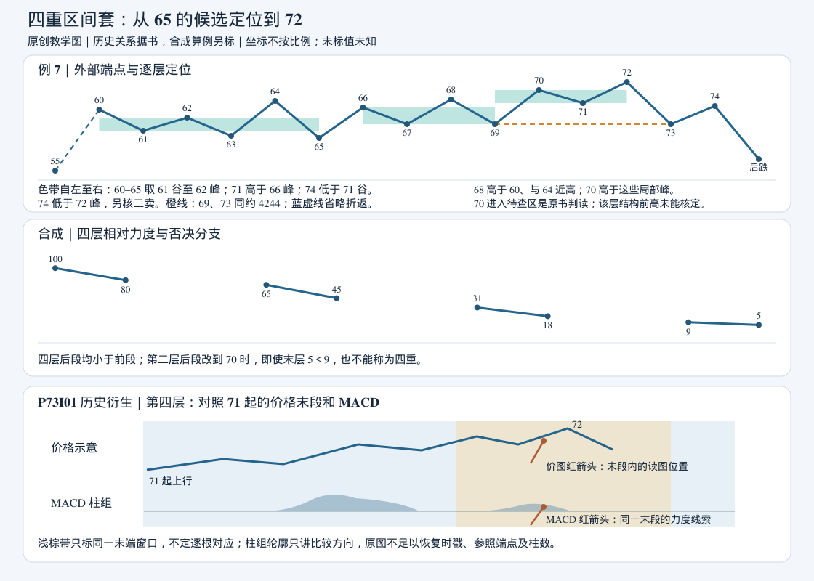

# h07 · 四重区间套：从 65 的候选定位到 72

来源：《缠中说禅-股市技术理论》PDF 物理页 73–74，第三章第 25 节。

## 先确定每层要比较的同向段

区间套的意思是：先在较大走势中设末端的候选区间。大层尚未完、也没有否决证据时，就开始在候选区间内跟踪可比同向段，逐层缩小观察范围；大层仍只记候选。大层若被否决，就撤掉以它为前提的这条嵌套。每层都要另核参照和确认条件，最小层的柱缩短不能替大层补证。物理页 73 的上证指数 1 分钟图可见 54–74，轴为 15、18、19、20，正文定位 2007-06-20 13:30 前后；72 附近价图标 4312.00，图下量和 MACD(12,26,9)，价图与 MACD 上箭头用来对照内部最后一次减弱，不能从中读出完整柱序列。

## 65→69→71→72 的四层检查

1. 围绕 60–65 的 1 分钟中枢，55→60 是上行参照，65 起先记为候选。P73I01 的首三段 60→61→62→63 取共同价域：62 峰低于 60，定上沿；61 谷高于 63，定下沿。64 高过上沿，65 低于 61、63；后续另查延伸或离开，不拿 65 重设核心。65 起的段还没走完、也还没有反证时，已经可以跟踪它的内部，外层仍记候选。若 65 起的力度超过前段，则撤销候选及这条嵌套。要核实第一层，须将 65 起的同级、同向完整段与 55→60 比较。原书最后把 65 起的走势判为第一重；图文不足以核定其比较终点和对应完整柱组，不能从候选未被否决或内层减弱推出第一重成立。
2. 原书判到 69 尚未满足所查层级的创新高条件，到 70 进入待查区。P73I01 可见 68 已高于 60、与 64 近高，70 则高于这些局部峰；原书未指明该层唯一的结构前高，图也不能确认用哪一峰作参照。按原书，69→70 对 67→68 未构成盘整背驰，不能据 70 判结束。第二层应把 69 起的整段与 65→66 比，原书判后段较弱；图上可定性观察柱组，不能精确核定全段截点和累计面积。
3. 按原书分段，66→67→68→69 以前三段成核，66 峰低于 68，限制上沿；下沿取 67、69 中较高的谷，两者在图上近同高。69→70 是直接次级上离；合格且完整的首次次级回试 70→71 的最低点 71 高于 66 峰，因此作者判 71 为该核三买。三买后可形成新中枢上移，也可扩展；若要顺利上移，71 起的上行不应对 69→70 盘整背驰。第三层比较 71 起的上行与 69→70。原书判后段较弱，图上柱组可作定性线索；精确复算仍须核对段落端点和完整柱组。三买本身没有免除这一步。
4. 进一步在 71 的上行内部看价图与 MACD 红箭头所示的末端减弱，作者用作第四层，最后定位为 72。下图底部把物理页 73 主图勾出的末端位置与 MACD 红箭头并排对齐：先在 71 起的上行内定位，再看同一末段的柱组是否支持内部减弱。这是图上的定性联系，两个箭头不提供可核的逐柱窗口、比较参考端点或确切时戳。每层都要等该层真正出现必要条件。若最内层只有一根变短且没有合格可比段，只记候选。

合成：给完成且可比的上行段，四层后／前面积比分别是 80/100、45/65、18/31、5/9；四项均小于 1，并且事先验证每层包含关系、相应创新高与终结条件，才构成四层支持。把第二层改为 70/65，第二层不能成立，最小层的 5/9 不足以补回它。

## 为什么 74 兼具二卖和三卖

按原书分段，73→74 是 72 转折后的首次完整次级反抽。P73I01 的 74 峰低于 72，属反抽未创新高的二卖分支；若不走这条分支，须另证可比的顶盘整背驰，光是首反抽不足以确认。三卖另看 69–72：69→70、70→71、71→72 三个合格段成核，较高的 71 谷定下沿；72→73 直接次级下离，73→74 为同次下离后的完整首次次级回试，74 的全段最高仍低于 71 谷，所以作者也判三卖。若改从 70–73 组核，到 74 只有第四段，仍缺第五段首回。书图示 74 后更大回落，不是实盘可预先保证的收益。操作讨论还区分所跟踪级别及资金容量：1 或 5 分钟的调整对大级别未必是退出信号。

## 4244 的两个参照

书中 69 与 73 都约为 4244：69 用来观察 60–69 这个 5 分钟中枢是否向下出现三卖并可能扩成 30 分钟结构，73 用来观察 72 后的反弹是否重回强势。作者把站稳与延伸震荡、未站稳与扩展或下跌列为不同后续，不能用「价格低于 4244」代替次级离开及首次回试条件。同页后续复盘（没有另图）提到早盘补缺口的底背驰定位、最低约 4147，和所引 1/2 线 4144 仍应分别记录；与 4244 用途不同，未给足原始逐根数据重算。

[打开矢量图](../../../assets/chan-book/full/h07.svg)

## 自测

1. 合成：已核四层的成员和时序，前三层后段/前段面积分别 64/80、31/29、12/24，最内层暂见 4/9 而未完成。指出哪两处会阻止‘四重已确认’，说明怎样保留当前最细判断。
2. 69→70、70→71、71→72、72→73、73→74 是五个连续、合格且已完成的同级段。前三段已确认核心 [100,110]。相对这个核心，72→73 是直接次级下离，73→74 是同次下离后的首次直接次级反抽，后者全段最高 98。为什么可说是 69–72 三卖，却不能说是 70–73 三卖？
