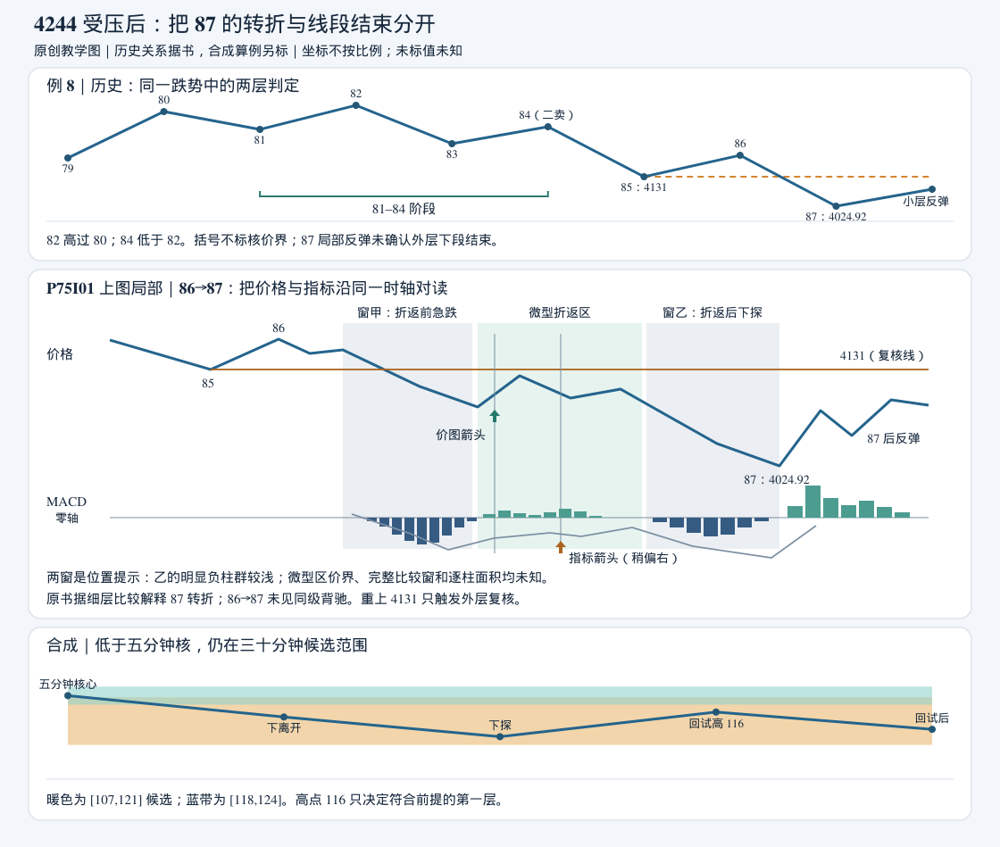

# h08 · 4244 受压后：把 87 的转折与线段结束分开

来源：《缠中说禅-股市技术理论》PDF 物理页 75，第三章第 25 节。

## 先读编号 81–87 的证据

物理页 75 上方是灰度的上证指数 1 分钟图，价格、量、MACD(12,26,9) 三个面板，时间栏 06200859，横轴 19–22，续接前例 72 附近 4312.00；右端 87 附近标 4024.92。下方从 79 接到 102 附近的另一幅图用于例 9，不从它倒推本例在 87 时的判断。文字说 4244 再受阻；这是一条历史观察线，不是一到就自动出信号的触发器。

先核是否围绕同一核心，再比前后同向段的力度。P75I01 上 82 峰高于 80，84 峰低于 82。作者判 81→82 为盘整背驰、84 为二卖；79→80 只列为待核的前段候选，书页未确证其为可比窗口。图中括号只定位 81–84 阶段，不给出核心价界。84 后为线段尺度的下跌。看中窗同一时轴：86→87 内，价图箭头指向急跌后的微型折返区，MACD 箭头稍偏右，指在这处折返附近的指标线区。可把折返前的急跌、折返后下探 87 分别圈为同向候选窗。后一窗对应的明显负柱群较浅，但原图未给细层价界、完整比较窗或逐柱数据，不能据此重算力度。原书据微型区前后的比较把 87 判为细层背驰转折，同时判断外层 86→87 没有同级背驰。因此，局部反弹已经发生和 84 后线段已完是两句话。作者在这一时点以重上 85 的 4131 为重新审视线段完成的阈值；若突破了，也要按统一划段口径验证终结，不能用单根越线代替。

## 4188 和 4067–4192 属于不同层

75–84 是 5 分钟中枢，书中给下边 4188；若下离开后首次合格次级反抽最高仍低于 4188，警惕形成该层三卖。46–87 同时纳入更大的 30 分钟结构，作者给核心 [4067,4192]，当时仍问第三段是否结束。三段合格并确认后，继续辨这一级的震荡或三类点；低于 4188 的报价不能独自确认 30 分钟三卖。月线和季线收盘是另一层：作者认为季 K 线长上影意味着之后压力较大，用 4144 的 1/2 线评当时多空；这不是对未来时间和涨跌的验证。

合成：已确认 5 分钟核 [118,124]，相对该核心的合格直接次级下离已完成；同次离开后的首次直接次级反抽也已完成，全段最高 116，则为该层三卖。另一个暂定 30 分钟候选核 [107,121] 的第三个成员仍未结束；116 落在这候选区间里，但还不能把不完整 30 分钟核用作三类点参照。若 116 只是反抽途中报价，连第一层都不能先确认。

[打开矢量图](../../../assets/chan-book/full/h08.svg)

## 自测

1. 做 87 当时的记录。已出现小层背驰反弹；外层 86→87 并无相应背驰，反弹尚未越过 4131。写一项已发生、一项未确认以及下一项需见什么。
2. 5 分钟核心下沿 4188，合格直接次级下离已完成；同次下离后的首次直接次级反抽也已结束，全段最高 4179。30 分钟候选核 [4067,4192] 的第三成员仍在构建。两层分别能登记什么？
