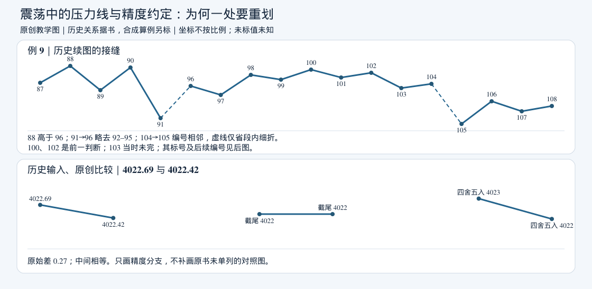

# h09 · 震荡中的压力线与精度约定：为何一处要重划

来源：《缠中说禅-股市技术理论》PDF 物理页 75–76，第三章第 25 节。

## 先把三个观察尺度分开

物理页 75–76 的书中解盘，回引 6 月 4 日的判断：上证 4144 的 1/2 线、深成指 13700 是不同指数的中期观察线；上证当时约 3600 的 月线上的五期移动平均线是另一条可动边界。只要这条均线未被有效跌破，作者把调整视为正常；若有效跌破，作者判断调整时间将明显延长。原文没有给出「有效」的精确判据，不能用盘中一次触线替代。作者把当月读为夹在均线与 1/2 线之间的震荡，并预期 7 月均线上行、压缩区间，再等待突破方向。八月前后、季度上影与市场压力是当时时间判断，不当作已验证规则。短线则先看能否重过 4131，随后跌破约 4025 又扩大压力；这两个整数作用不同于 4144 或 3600。

## 100、102 与未完成的 103

- 物理页 75 下图是上证指数 1 分钟灰度图，左栏 06211329，价格标号从 79 至 102 附近，尾部箭头下跌，下面是成交量、MACD(12,26,9)。同一价图上，88 峰高于 96；88 至 91 中间有 89 谷、90 峰。教学图的虚线有两种省画：91→96 中间略去 92–95；104→105 是相邻编号，只省段内细折。后者在 h12 是作者比较用的完整旧跌段。不能由像素补写 100 时的逐根数值。
- 物理页 76 中图同为上证指数 1 分钟，左栏 06261000，轴见 26、27、28、29；续标到 108、100 附近标 4112.76、105 附近标 3780.84，也有量及 MACD(12,26,9)。标为 103 之后的走势在这张图可见，不能据此说作者在前一观察截止已知。
- 作者把 100 读作顶背驰，102 读作转折后首次次级反抽的二卖。文字当时把 102 后的 103 记为未完，下一步要求线段内底背驰作结束依据。原页印作「要 102 走完」，按本句前后是问 102 后这一段何时结束，不能把卖点 102 自身当成下一段。箭头所示价位是压力观察，最低一处未能重新站稳时，作者要求至少等待 1 分钟以上背驰再议。震荡买卖不是每次都必须执行，是否可做还依赖尺度、仓位及成交条件。该段还岔谈德国、韩国交易所挂牌和私人股权前景；这些叙述不进入技术分支，也没有相应挂牌材料可在本章核验。

## 精度附录：直接截尾与四舍五入

附录物理页 76 给红箭头值 4022.69、绿箭头值 4022.42。直接截尾到个位，二者都是 4022，可在该书演示口径下把它们看成有接触；按四舍五入，分别是 4023 和 4022，并不相等；按两位小数，两点相差 0.27。书上说后来统一直接截尾。精度只是资格检查的一部分；是否有新线段还要查旧结构是否被另一线段终结，不能因两个显示值相等而直接宣布完成。正文指「下图」「右图」，但本版本页 76 附录下面没有独立的可比左右配图；P76I01 是附录前的连续主图。不凭文字方向替现有灰度图硬定颜色和每个箭头的精确时刻。

独立合成例：12.79 与 12.12 直接截尾同为 12；四舍五入为 13 和 12。若有人把第一输入截尾、第二输入保留两位，他比较的是 12 和 12.12，此结果不属于任何一个统一口径。规则应在看结论以前设定，并一起应用到全部端点。

[打开矢量图](../../../assets/chan-book/full/h09.svg)

## 自测

1. 书中 4022.69 和 4022.42，求两位小数下的差、截尾到个位、四舍五入到个位三组结果。哪组可按本案口径认作边界相触，哪项资格仍没证明？
2. 某阶段已经标 100 的顶背驰与 102 的次级反抽二卖，到收盘 102 后仍下行，未找到该段内底背驰。另有后来截图印出 103、104、105。分开写当时与后来各可记录什么。
