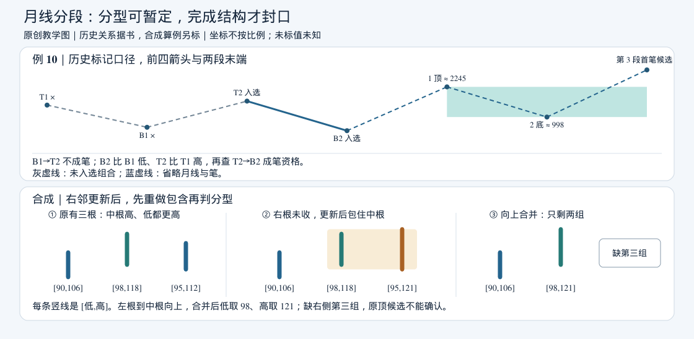

# h10 · 月线分段：分型可暂定，完成结构才封口

来源：《缠中说禅-股市技术理论》PDF 物理页 76–78，第三章第 25 节。

## 从月 K 线挑入选分型

用每月 K 线的高、低点而不是月收盘连线。先按统一规则处理包含；相邻三根处理后 K 线，中间一根的高和低都高于两侧时是顶分型，都低于两侧时是底分型。构笔还需顶底交替，且两个分型之间至少留一根不属于两个分型的处理后 K 线；未满足这两项的图上分型仍可能存在，但不入笔。线段至少需要三笔及结构条件，不能把三个标签自动划为一段。

物理页 77 是上证指数月线图，轴标 90 至 07，价图两端可见 95.79 与 4768.89，左栏日期 19901231。下两面板是成交量与 MACD(12,26,9)。绿箭头示顶、红箭头示底，X 是未被选入笔的分型；1、2 标作者所划的前两段终点。用这一张图读月级大方向，不能还原所有小周期或验证每个分型间隔。

## 候选替换与本段三条约束

把 P77I01 的前四个箭头依次记为 T1、B1、T2、B2。原书判 B1→T2 间隔不足，不成反向笔。随后出现 B2，图上 B2 比 B1 低，故按同类候选规则取 B2；T2 比 T1 高，且中间没有合格反向笔隔开，故取 T2。T2→B2 仍须具备成笔资格。图上能读高低；仍须用处理后的月 K 检查，两个分型之间有独立一根，且顶分型中心 K 的高点高于底分型中心 K 的区间上沿。若同价或后点不更极端，先保留原候选，必要时待核；中间若已有合格反向笔，就保留该笔。

时序上，B1 出现时可暂记 T1→B1；遇到 T2 时记间隔不足、选择未定；到 B2 才据新证据更新。原图的两个 X 标明早期顶底未入笔，旧时点的暂定记录仍保留。

物理页 77–78 中，作者按线段中笔的类背驰归纳出 1 顶、2 底，认为从 2 开始的第 3 段当时连首笔也未走完。以作者采用的线段规则，若它长成一段，要等待首上、随后下调及再上一笔，不能由「还需要一笔」预测具体时间和价格。同时作者把 998 至 2245 作为线段的**类**中枢，若调整笔不跌破 2245，讨论类三买；这不是小周期严格中枢的无条件买点。首上完成至少需要合格顶分型，不能把当月大阳线或右端最高标值看成已经成顶。作者用「走势必完美」称这些结构完成约束；这套推理本身没有独立验证现实涨幅、唯一路径或胜率。

合成月线，无包含，三根已收月 K 的 [低,高] 分别为 [90,106]、[98,118]、[95,112]。第二根是顶分型；若同一组改为第三根尚未收且更新为 [95,121]，它包含第二根 [98,118]。在此处第一到第二根向上，重做包含后得到 [90,106]、[98,121] 两组，缺右边第三组；原顶候选不能确认。即使三根都已收，这也只确认顶分型，还要核和前一入选底的间隔才可纳入笔。物理页 78 开头追问「7 月主动、8 月持有」如何用分型解释；在图面材料下只能拟条件：更短尺度若已结束调整且较高层首笔仍未结束，观察重点可从定位转为持有管理；没有仓位、交易及月 K 原始记录，不能证明作者真实操作动机。

[打开矢量图](../../../assets/chan-book/full/h10.svg)

## 自测

1. 合成，三根无包含且均已收的月 K 线 [低,高] 是 [68,79]、[74,91]、[72,86]。是否出现顶分型？若其右侧 K 未收且临时更新为 [72,94] 呢？
2. 给入选候选 T1、B1、T2、B2，T1→B1 当时可暂记，B1→T2 不够间隔，T2→B2 已具间隔，B2 在规则下替代 B1。说明何时更改记录。另有第 3 段尚无一笔完成，能否从‘至少三笔’算出下一顶价格？
