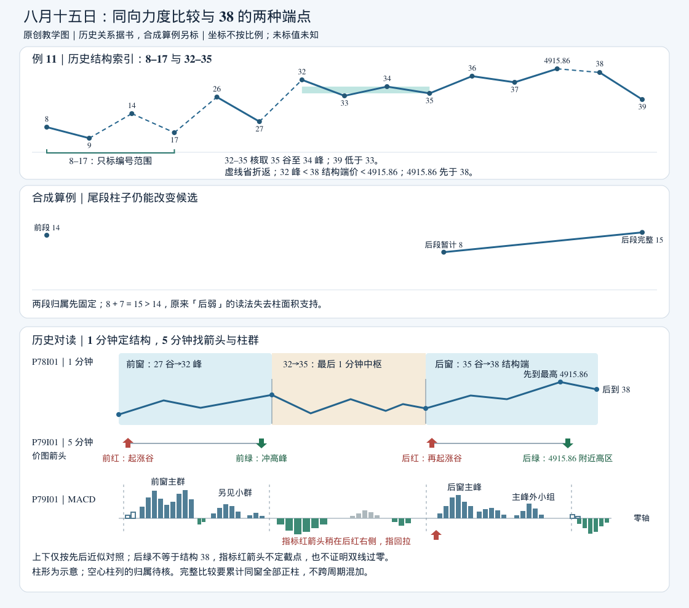

# h11 · 八月十五日：同向力度比较与 38 的两种端点

来源：《缠中说禅-股市技术理论》PDF 物理页 78–79，第三章第 25 节。

## 合法调组之后，仍按条件分三路

原文题下时间是 2007-08-15 22:41:35。结合律指连续段可以按规则重组；成员层次、相邻连接和交集仍须有效。作者以约 4300 的 5 分钟中枢作背景，之后用 8–17 表示新一个 5 分钟核心。已有核心之后，先观察三路：相对这个核心，合格直接次级上离与同次上离后的首次直接次级返回均已完成，且后者全段最低严格高于核心上沿（三买），继续上行时另核新的同级中枢；向下镜像地核查三卖和新的同级中枢；或在原区间延伸，或三类点以后扩到更高一级如 30 分钟。一次三买不保证永远走第一路：若之后结构重叠，要重新检查是不是第三路。书中把结合律及分解不变性作为理论主张，这一张图没有证明数学唯一性。

17–38 在书中作为一段已走出的 1 分钟上涨，最后 1 分钟核心是 32–35。原书当时已看见围绕它形成新 5 分钟核心的形态，先把区间从 32–35 算起，再等待更自然的区间和新三类点。对书中的 1 分钟观测者，已见顶背驰宜先处理这一层；5 分钟观测者继续看自己这一层上涨是否背驰；30 分钟观测者可只登记较细变化。这里是对同一图的三个操作口径，不是三个同时发生的成交。

## 两个已匹配的比较窗口

物理页 78 的 P78I01 是上证指数 1 分钟图（8 月 2 日至 15 日，左侧标 4285.02），用来认结构编号。物理页 79 上图 P79I01 是 5 分钟图（7 月 19 日一带至 8 月 15 日，左侧标 3887.81），用来对照箭头和力度形态。两图的 MACD 参数均为 (12,26,9)。两图都标出全段最高价 4915.86；页 79 下图走 105–111，属于例 12。沿两图横轴从左向右作近似对照：

| 1 分钟结构 | 5 分钟原图的箭头 |
| --- | --- |
| 前窗 27→32：从 27 谷到 32 峰 | 价图前红箭头指起涨谷，前绿箭头指冲高峰。 |
| 中间 32→35：回抽形成最后一个 1 分钟中枢 | 原图 MACD 红箭头略在后一个价格红箭头右侧，仍指回抽，只作后窗开端附近的视觉线索；它不标 38、逐柱截点或双线穿越零轴。 |
| 后窗 35→38：从 35 谷到结构终点 38 | 价图后红箭头指再起涨的谷，后绿箭头指 4915.86 附近的高区；后绿箭头不能代替 1 分钟图的结构终点 38。 |

两段上行才是力度比较的对象。中间三段 32→33、33→34、34→35 取共同价域，下沿取较高的 35 谷，上沿取较低的 34 峰。38 后的 39 谷低于 33，已穿过核心带。价格关系是 32 峰 < 38 结构端价 < 4915.86；最高价先到，38 后到。

看 5 分钟图的正柱：前窗能见较高的主群和隔开的较小柱群；后窗也有主峰之外的正柱，不能以最高柱代替全窗累计。课图只示柱群形态，虚线附近的柱列归属待核。原书判断后段创新高但力度较弱。要复算，先把结构编号核到时戳，再按同一采样周期和参数，分别累计两个完整上行窗里的全部正柱。两图的箭头只给出视觉对应，不能据此给 5 分钟柱定精确截点，也不能把 1 分钟柱与 5 分钟柱混加。

合成：前段从 110 上行，已完成，全段最高 118。回抽期间给定已由三个合格次级成员确认的中枢 [115,118]。后段从 115 上行，仍未完成，暂见最高 121，已经超过前段全段最高。假设两段的结构位置及计算口径可比，前段的完整正柱为 4、6、4，共 14；后段暂见 3、3、2，共 8，只提出力度减弱候选。若同一后段再补入 7，完段总量为 15，就撤掉这项减弱候选。实际止于哪一笔要另按线段规则判断。

## 38 的编号不是最高点价

物理页 78 的 1 分钟图用红箭头标出结构终点 38。全段最高价 4915.86 在它之前出现：从 37 到最高处不足三笔，不能在那里就划完整线段。把这一段作为供高一级取重叠的 1 分钟走势区间时，上沿取全段实际最高价。原书也把 37→38 的最高价记作该 1 分钟走势成员的结束价；细层结构图仍在 38 标终结。历史的精确时戳和 38 端价不能由截图核定。合成：若全段最高 121 在不足三笔时先到，其后在 119 才按结构规则确认线段结束，全幅的上沿仍是 121。

[打开矢量图](../../../assets/chan-book/full/h11.svg)

## 自测

1. 合成：27→32 完整正柱 8、4、3；35→38 暂见 4、5；后一段创新高。补入同一段剩余的 7 后分别算总量；指出何时可以否决较弱候选。
2. 合成：从 37 起，事后核定全段最高价 126、最低价 115；126 在不足三笔时已先出现。其后满足本层终结规则，确认结构结束点的价格是 123。写结构端点值、参加上层重叠计算的区间；不能把 126 自动作为已确认端点的理由是什么？
