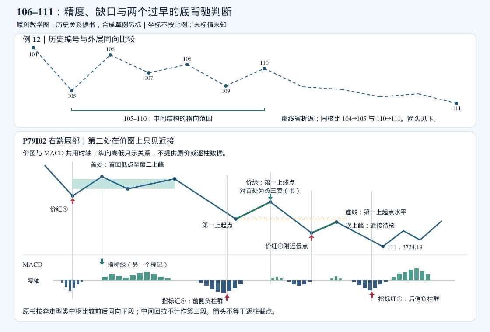

# h12 · 106–111：精度、缺口与两个过早的底背驰判断

来源：《缠中说禅-股市技术理论》PDF 物理页 79–80，第三章第 25 节。

## 先定精度，再读 106–109

物理页 79 下方 P79I02 是上证指数 1 分钟图，横轴可辨 29 与 02，续接例 9 的 105 后图；价图标明 105–111、106 附近 3919.31、111 附近 3724.19，下面是量与 MACD(12,26,9)。依编号衔接和当年交易日期窗口，可把这里读作 2007 年 6 月末至 7 月初的续图；图本身未列每个箭头的完整日期时刻。页 79 上方 P79I01 是例 11 的 5 分钟图，时间窗口完全不同。

直接截尾指先按既定精度删去小数位，再比较相等、越过及间隔；它区别于四舍五入，也区别于「差在一定范围」的口径。物理页 80 说 106→107 箭头所指的那一笔以截尾为前提，未给该对端点的完整精确价格，不能借用例 9 的 4022.69、4022.42 当成本段输入。软件对 1 分钟数据也会有细小差异；原文举 0.49 与 0.51 刚过阈值，说明任一精度都可能遇到边界。若改用「相差不超过 0.50 点视为一样」，必须全程用同一原价精度和同一阈值，并明确它只用于两点比较；例如 10.00 与 10.40、10.40 与 10.80 分别相差 0.40，两次近似相等不意味着 10.00 与 10.80 也相等。

108→109 中的箭头那一笔不能单凭自己成立新线段，至少要有三笔且以另一合格线段终结旧结构。作者把顺着旧下笔、未终结旧笔的当日低开缺口仍纳入原笔；逆向且突发破坏原走势的缺口，例如他所举 5 月 30 日，按本书的特殊处理当成最小线段，以「三个零式缺口可叠成原缺口」解释其例外。这是作者的结构约定，不是图上看见三笔成交；和前例在不同观察层把缺口当成无内部段相容。

## 110–111 的外层参照：不要拿最近的一跌代替同核段

价图第一个红箭头处刚略破 109，110→111 尚在早期，其已见负柱面积已和 108→109 的对应面积接近。这说明有力而不是证据充分的背驰。正文选的同核比较对象是 104→105，以 105–110 为中间的震荡中枢；104 的标号在物理页 76 的 P76I01，不在本案近景 P79I02；同一张 P76I01 上，104 高于 106。下图的 105–110 只标中间结构的横向范围，原图没有给出该中枢的精确上下界。对另一细分 105–107，110 还接近三卖，但作者没有判成已确认三卖。进入之后的强下跌，两次小反抽都未终结该结构，故不要把「贴近某边界」当成结束。书中给出两条路径：小级别转大级别，以更长的震荡消化这股力度；或与同核、力度更大的前段相比，在新段完成时形成背驰。本例按第二条找 104→105，第一次略破时仍不能判底。

合成：同口径完整 104→105 的负柱绝对面积 56，较近、却不匹配的 108→109 为 26；110 后仅见 24。24 与 26 已接近，110→111 尚未结束；即使后续总量变 40，也要用 40 和对应旧段的 56 比，再查是否创新低、是否有结构终结。若后续加到 60，便连 56 的力度参照也超过，应否决该项减弱。

## 线段以下的两处类中枢：第二个红箭头也还早

读图先分清**价图**与**MACD 面板**各自的红、绿箭头。价图第二处红箭头仍不能算最终定位；绿色标出的反抽相对前一微型「上—下—上」重叠是类三卖。原文用「类」是因为该级低于线段，不是严格意义的走势中枢。P79I02 的第一组重叠，下沿是高于第一上起点的首回低点，上沿是略低于第一上峰的第二上峰。绿色反抽后有两条路：扩成更大的类中枢，或向下移动，直至形成新的类中枢。图的中窗把绿箭头反抽同时用作后一组的第一上：急跌后的低点起涨，先到价图绿箭头的峰，再回落到价图红②附近的低点，才见末次上折。只见绿箭头，尚不能确认第二处类中枢或 111。

再看指标：MACD 红①指向原书所说的「下—上—下」第二下破了上折低点，双线仍反映有力的下冲。单凭破位不能判底；若另有线段结构突发终结的证据，须按该分支复核，作者未在这里确认这一例外。

原书把后来的回拉读作奔走型「上—下—上」，称第二上与第一上的低点稍有重合，据此识别较低的第二处类中枢。只看价图，第二上峰顶略低于第一上起点的图面水平，两者近接；缺少精确端点，不能确认价带有正宽交集。图中用虚线标这条参照，第二处只记近接待核。两处都属于 110→111 内部，不能当作严格的走势中枢。

按原书的第二处类中枢读法，比较进入前、离开后的两个同向下段。图中价格和 MACD 共用时轴：从左到右，价红①、指标红①、价绿、价红②、指标红②；另有一支指标绿箭头，位于价红①右侧、指标红①左侧，与价图的绿色反抽箭头不是同一标记。指标红①、②各提示一侧的负柱群，中间回拉不是第三个下行比较段，箭头也不给出逐柱截点。原书以后一侧负柱减弱辅助末次定位；这是极细层比较，不能用双线未过零轴否决，也不能用截图复算。史图最低另标 3724.19。正文末尾的「62、63课」是原课程编号。

[打开矢量图](../../../assets/chan-book/full/h12.svg)

## 自测

1. 合成，书例中精确端点未提供。现给独立教学输入 3901.76 和 3901.39，分别用直接截尾、四舍五入到个位、差值不超过 0.50 点三种口径判断是否同值／等同。若仅这项相等，能否判新线段？
2. 合成，围绕同一已核核心的匹配同向旧跌负柱为 60；图上较近的另一跌为 32。新跌第一箭头已见 31 且段未完，第二箭头属于某微型结构尚在破位，最后整个新跌确认为 45。如何分别记录两箭头和后来的力度证据？
