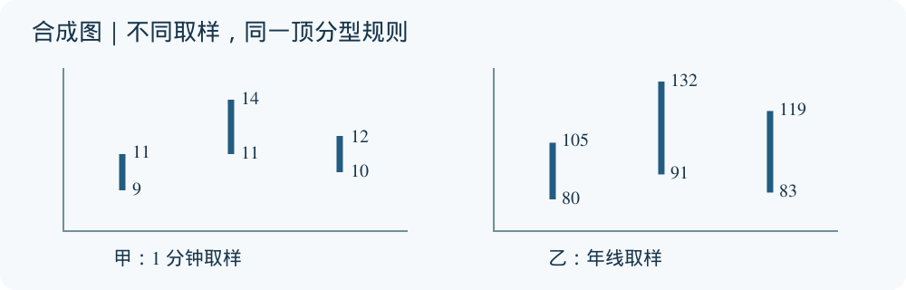

# m01 · 自同构性结构：变化的是行情，重复的是判别关系

来源：PDF 物理第 3 页「第一节 自同构性结构」起，至第 4 页末。

## 同一规则可以用在不同层（第 3–4 页）

先读懂价格区间 [低点, 高点]。自同构性结构在本节指在不同级别重复出现的关系结构。例如，三根已处理且相邻互不包含的 K 线中，若中间一根高、低点都高于两邻，则按同一规则判为顶分型；1 分钟取样与年线取样都可以问这个问题。原书也把走势类型、中枢、走势必完美归入这种跨级复用的思路，但它们的构件和判别规则另有定义，不能拿三个 K 线区间直接当三个次级别走势。原书说明分型来自去包含后相邻三根 K 线的完全分类，不需要预先假定某种分形理论；走势形状的视觉相似也不足以证明构件合格。

## 三个支点与推论的范围（第 4 页）

- 走势本身不可重复：路径、尺度、时长和后续走法不能从相似结构推出。原书据此反对绝对预测。
- 关系结构可以复现：可依同一规则对已给数据判别；原书据此强调可操作性。这并不说明未来一定出现给定形态或产生收益。
- 理论作纯逻辑推导：从定义推出规则是作者的论证方法。结论能适用到什么对象，取决于前提与构件是否成立；本节没有逐一证明所有市场或方法都受其涵盖。

作者以「基因」比喻结构自组出不同级别，并把它解释为参与者的贪、嗔、痴、疑、慢等共同心理下的「类生命」现象：观察结构的生成、展开和消退。作者还把结构视角推广到人生与社会，举社会经济、政治的转折为例，并以此区别于他所说的经验归纳式结构思维。这些是作者的哲学解释及延伸意见；本节未提供社会现象的判据或检验材料。作者认为波浪理论及经验性 K 线分类可放进本框架加以比较，声称本理论涵盖有效程序、反向涵盖不成立；本节没有给波浪计数实例或完整的比较证明。

## 例：重合的是高低关系（第 3–4 页）

合成样本甲（1 分钟取样）依次是 [9,11]、[11,14]、[10,12]；乙（年线取样）依次是 [80,105]、[91,132]、[83,119]。先查两对相邻区间：从左到中，两端都上移；从中到右，两端都下移，所以相邻互不包含。甲的 11 大于 9、10，14 大于 11、12；乙的 91 大于 80、83，132 大于 105、119。二者都是顶分型。这两组的宽度、时间跨度并无固定换算关系，不能据此断定右侧还会沿相同比例下跌。若把甲的中间低点换成 8，则 [8,14] 包含两邻，不能用原三根直接判顶；须先按包含规则处理。

[查看矢量图](../../../assets/chan-book/full/m01.svg)

## 作者留下的研究问题（第 4 页）

原书称每种彼此不同构的自同构结构对应一种分析路径，把分型和走势类型作为两个基础例子；这是一项理论主张。它追问走势能容纳多少类此结构、不同结构会给出怎样的操作差异、起始交易条件怎样影响生成，以及怎样按市场交易条件选择或细化结构。原书把起始条件与市场调控的研究设想相连，本节没有给出数目、生成算法或调控结果。

## 练习

1. 以下都是相邻、顺序给出的 K 线候选。甲 [3,6]、[5,9]、[4,8]；乙 [35,54]、[38,75]、[37,58]；丙 [3,6]、[2,9]、[4,8]。先查相邻包含，再指出哪些能直接作同类判断，列出你的高低比较。
2. 某人把两张图上的已完成顶分型都找对了；一张用 1 分钟取样，另一张用年线取样。下一根 K 线两图均未提供，完整递归构件也未提供。能否由此推出相同跌幅、年线图上更高一级的走势已确认？分别说出缺少什么。
