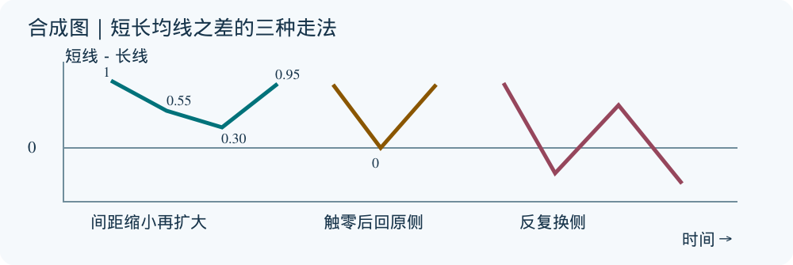

# m02 · 均线位置形态：从排列到穿越

来源：PDF 物理第 5 页「第二节 均线位置形态」，至第三节标题之前。本节是原书用来与缠论比较的旁支。

## 先定数据与窗口（第 5 页）

均线是按指定方法汇总最近若干个取样期价格得到的曲线。为使算例可复做，本文用收盘价的简单移动平均，即最近 N 个收盘价之和除以 N；短期线用较小的 N。原书未指定窗口、复权方式、近到什么程度算「接触」或出现多长时间才算有效。所有判别要先固定这些口径。同一时点，短、中、长线依次由高到低叫多头排列，依次由低到高叫空头排列；交叉、重合或次序不同，可以两者皆非。排列描述位置关系，不是对后续价格的保证。

## 先看价格对短线，再看短线对长线（第 5 页）

| 形态 | 先观察什么 | 接着核验什么 |
| --- | --- | --- |
| 靠近 | 价格一度冲过短线，短线仅略向长线逼近 | 短线未穿长线，原有方向恢复；仅有短长间距缩小还不足以重建价格动作 |
| 接触 | 短线已挨近长线，但没有向另一侧突破 | 按原方向离开；必须预先设定如何认定「挨近」，可以贴线后退回 |
| 缠绕 | 短线向下跌破或向上升破长线 | 可能多次在长线两侧换位；也可从接触演变来 |

原书说「靠近」较少见，常在很强的走势中，之后常有震荡；「接触」在基本趋势中常见，长线在上时常用来观察反弹结束，短线在上时常用来观察调整结束，但接触仍可能演成缠绕。缠绕可能只是较大调整，也可能是转折。原书给两条典型转折线路：缠绕之后仍沿原趋势冲一段，形成诱导，再转折；反复缠绕先搭出箱形，随后冲出与均线位置转化相伴。若长线原先在上且短、中、长三类线又一起缠绕，原书把它看作重大转折的线索。这里均是观察性说法，第 5 页未给频率统计、样本或进出场的确定条件。

## 例：一次价格穿短线不等于短线穿长线（第 5 页）

连续收盘价取 8、9、10、11、10.2、12（合成）。以 2 期作短线 S，以 4 期作长线 L，从第 4 期才有两线同时可比：

| 期 | 收盘价 | S | L | S−L |
| --- | ---: | ---: | ---: | ---: |
| 4 | 11 | 10.5 | 9.5 | 1 |
| 5 | 10.2 | 10.6 | 10.05 | 0.55 |
| 6 | 12 | 11.1 | 10.8 | 0.30 |

第 5 期收盘从 S 上侧来到 S 下侧，但 S 仍在 L 上方；第 6 期收盘回到 S 上方，短长线间距却仍在缩小。因此可说价格已回到短线上、短线正在逼近长线；若用「间距随后重新扩大」作恢复的观察条件，此处还不能确认完整的靠近后恢复。假如下一期收盘为 13，则 S=12.5、L=11.55、差为 0.95，间距重新扩大。若课堂取接触阈值为 0.10，此段仍没有接触。图中的接触和缠绕是另外两个合成输入；零点回弹和过零必须区分。

[查看矢量图](../../../assets/chan-book/full/m02.svg)

## 练习

1. 收盘价依次是 6、7、8、9、8、10、11。用最近 2、4 期收盘作短长线，从第 4 期算到第 7 期。以 S−L 为正表示短线在上，以最小距离不超过 0.10 且不穿越作为接触条件。指出价格在哪一期由线上跌到短线下、短线有没有接触或穿越，并判断间距是否恢复扩大。
2. 三根均线在第 1 期依次为短 10、中 11、长 12；第 2 期短 12、中 11、长 11.5；第 3 期短 11、中 11.4、长 11.6。逐期判排列，列短长差及其换号；这些数据是否足以确认重大反转？
